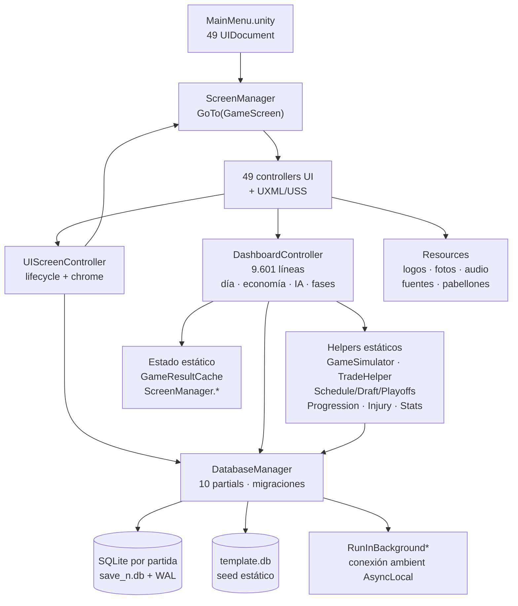

# Auditoría de Tactical Five — 2026-10-23

> **Fecha del informe:** 23 de octubre de 2026
> **Commit auditado:** `e76bf723` — `fix(Traspasos IA): valoracion realista en ofertas IA-usuario e IA-IA` (rama `main`, 2026-10-22)
> **Alcance:** revisión estática y de solo lectura del checkout actual. No se modificó ningún archivo del proyecto.
> **Método:** inventario → mapa de arquitectura → análisis por 10 áreas → verificación de datos → priorización → informe.

**Alcance técnico revisado:** 235 scripts `.cs`, 52 `.uxml`, 54 `.uss`, 1 escena de producción (`MainMenu.unity`) + 3 escenas de recuperación en `Assets/_Recovery/`, 334 tests EditMode en 31 archivos, 55 modelos `[Table]`, 10 partial classes de `DatabaseManager` (~9.281 líneas), sin `.asmdef`, Unity `6000.3.15f1`.

**Fuera de alcance (por indicación del solicitante):** simulador gráfico 2D/3D, animaciones en cancha y motores de física. La simulación se evalúa como estadística/textual; sí se valoran mejoras de presentación de datos.

**Convención de lectura:** cada hallazgo lleva evidencia `archivo:línea` verificada contra este commit. Lo que no pudo comprobarse se marca explícitamente como **No verificado**. Las opiniones de diseño se separan en la §8.

**Aclaración de diseño posterior (F1-01):** no existe un requisito de que cada franquicia alcance una media de equipo 85. La media se define como la media de los `overall` de todos los jugadores asignados (`team_id`); cada `overall` deriva de sus 11 atributos y se capa por `potential`. Por tanto, el rango 72,00–82,86 reportado en la tabla histórica de abajo es una observación de aquel snapshot, **no un incumplimiento** ni una instrucción para normalizar los equipos. La medición actual se registra en F1-03/ROST-02.

**Aclaración posterior de seed (F1-02, resuelta):** `DatabaseManager.Seeding.cs` es la fuente canónica de plantillas y la mantiene el usuario a mano; 14–17 (`TradeHelper.MAX_ROSTER` = 17, mínimo jugable 12) es la referencia de juego, **no una validación** del auditor: el tamaño de plantilla se publica como dato (`RosterOutOfRange`) y no genera hallazgo. John Konchar (id 461) pasa de NYK a agentes libres conservando `last_team_id` NYK; Trevon Brazile (id 134) permanece en DEN; RayJ Dennis usa el id 611 (ATL) y Tristan Enaruna el 612 (CLE). Estado actual: 479 asignados + 129 FA = 608; **27 de 30 equipos en 14–17**, quedan ATL 18, DEN 18 y PRT 13 como ajuste manual opcional (2 fuera, 1 dentro). El repo no tiene fuente externa de plantillas, así que el auditor solo valida consistencia interna.

**Aclaración de escala de atributos (decisión F1-05):** 1–99 es el rango legal. Los 86 valores bajo 25 (83 blocks, 2 three_point, 1 steals) son legales y no se corrigen ni se clasifican como defecto automáticamente. El 30 de generación de prospectos y el 25 de scouting son límites de procesos distintos. La implementación queda en curso: los tests de escala aislados pasan, pero el EditMode completo está bloqueado por una colisión de ID 610 en `DatabaseManager.Seeding.cs` que requiere resolver la entrada de RayJ Dennis.

---

## 1. Resumen ejecutivo

**Conclusión:** Tactical Five es un manager con contenido real, no un prototipo. El ciclo de temporada completo —calendario, 82 partidos, Play-In, playoffs, premios, draft, G-League, finanzas, progresión, legado, narrativa— está implementado y conectado a 49 pantallas cableadas sobre SQLite. El problema principal no es la falta de sistemas: es que **varios de esos sistemas incumplen sus propias invariantes declaradas** y que la simulación no ha sido calibrada de forma medible.

### Cinco fortalezas

1. **Ciclo de juego completo y encadenado:** temporada regular, Play-In, playoffs al mejor de 7, premios, draft con protecciones y swaps, G-League con playoffs propios, finanzas, desarrollo, Hall of Fame, dorsales retirados y storylines.
2. **Persistencia con fundamentos sólidos:** un `.db` por slot, WAL, conexión *ambient* por hilo (`AsyncLocal`), migraciones aditivas por columna y `schema_migrations` para datos; el día simulado y el rollover de temporada son transaccionales.
3. **Reglas puras separadas y testeadas:** `TradeHelper`, `TradeValueHelper`, `PlayerProgression`, `InjuryHelper`, `RotationPlanner`, `MarketEconomy`, `RivalryHelper`, `DynastyHelper`, `HistoricalStatsRules` son clases estáticas sin dependencia de Unity, con 334 tests EditMode.
4. **UI Toolkit amplia y coherente en lo estructural:** 49 pantallas, base `UIScreenController` con ciclo de vida único, chrome inyectado (header/sidebar), modal de configuración centralizado y barra de scroll propia donde el `ScrollView` nativo no es fiable.
5. **La simulación es auditable:** motor por posesiones con box score, play-by-play reproducible en UI, plan de partido, rotación vinculante por minutos y pronóstico previo. No depende de una cancha gráfica para existir.

### Cinco riesgos principales

1. **El seeder calcula algunos OVR de forma distinta al modelo:** trunca la media mientras el modelo redondea, afectando a **235 de 606** jugadores sembrados. El rango de media por equipo (72,00–82,86 en ese snapshot) es descriptivo; no se fijó un objetivo uniforme de 85.
2. **La simulación no modela el rebote ofensivo:** el OREB se anota como estadística pero no conserva la posesión; la siguiente posesión se decide con una moneda. El box score no es causa del marcador en ese punto.
3. **La valoración de traspasos es desigual:** la IA usa `TradeValueHelper`, pero la evaluación de las ofertas del usuario sigue con una heurística de OVR en `TradeHelper.EvaluateTrade`. Dos mercados con dos economías.
4. **El CBA está modelado de forma parcial e internamente inconsistente:** el matching salarial suma margen dos veces, la restricción de apron se aplica con el conteo de jugadores equivocado y no hay separación entre plazas estándar y two-way.
5. **No hay calibración empírica ni reproducibilidad:** `UnityEngine.Random` no inyectable, sin harness de Monte Carlo y sin ninguna medición publicada de puntos, victorias, paridad o lesiones por temporada.

### Diez acciones prioritarias

1. Unificar la fórmula de `overall` en una sola función usada por seeder, draft, editor y migraciones.
2. Documentar la media descriptiva de equipo y revisar cualquier regla explícita de balance sin imponer un mínimo uniforme de 85.
3. Añadir un test de invariantes del calendario: 82 partidos, 41/41 en casa/fuera, 1.230 filas, cero partidos perdidos.
4. Corregir la secuencia de posesiones para que un OREB mantenga el balón y un FT fallado genere rebote vivo.
5. Unificar la valoración de traspasos en un único evaluador compartido por IA y usuario.
6. Ejecutar el traspaso del usuario y el S&T en una sola transacción, revalidando después de cualquier cambio de salario.
7. Revisar matching y restricciones de apron contra una fuente CBA oficial y documentar los casos con tests.
8. Inyectar una fuente RNG y crear un banco de calibración con cientos de temporadas.
9. Evitar la captura de play-by-play y los snapshots cuando el modo de partido es directo.
10. Sincronizar documentación, datos de plantilla y versión del código en una única fuente canónica.

---

## 2. Mapa de arquitectura

Aplicación de gestión con una sola escena de producción. Los controllers reconstruyen la UI en `OnEnable`, las reglas viven en clases estáticas y `DatabaseManager` centraliza toda la persistencia. `DashboardController` actúa como orquestador del día, del mercado IA y de la economía.

**Puntos de acoplamiento a vigilar:**

| Zona | Tamaño | Problema |
|---|---:|---|
| `Scripts/UI/DashboardController.cs` | 9.601 líneas | Coordina simulación, mercado IA, finanzas, fases, modales y economía en un solo tipo. |
| `Scripts/Data/DatabaseManager.Records.cs` | 4.448 líneas | Rollover de temporada, premios, histórico y progresión comparten archivo. |
| `Scripts/Data/DatabaseManager.cs` | 1.608 líneas | Esquema, migraciones, seed base, transacciones y utilidades de hilo. |
| `Scripts/GameSimulator.cs` | ~1.315 líneas | Motor, rotación, narración y generación de lesiones en el mismo tipo. |

---

## 3. Hallazgos por área

### 3.1 Arquitectura y calidad de código

| ID | Tipo | Severidad | Descripción | Evidencia | Recomendación | Esfuerzo | Impacto |
|---|---|---|---|---|---|---|---|
| ARC-01 | Deuda técnica | Alta | `DashboardController` concentra simulación, economía, mercado IA, fases y UI. Un cambio local puede tener efectos en varios flujos y no es testeable de forma aislada. | `Scripts/UI/DashboardController.cs:10`; mercado IA `:5316–6860`; finanzas `:7763+`; 9.601 líneas. | Extraer por etapas servicios de dominio (economía, día, mercado), dejando el controller como coordinador. | XL | Alto |
| ARC-02 | Riesgo | Alta | `WaitForBackgroundBatch` espera con timeout de 10 s pero no comprueba si `Task.Wait` expiró. La cancelación solo se verifica en un punto del rollover. Si un lote excede el límite, el llamador continúa mientras el hilo sigue escribiendo. | `Scripts/Data/DatabaseManager.cs:193–239`; único `ThrowIfBatchCancelled()` en `DatabaseManager.Records.cs:3431`. | Fallar o esperar explícitamente si el lote no terminó; propagar el token a todos los bucles largos. | M | Alto |
| ARC-03 | Mejora | Media | La simulación puede correr sin persistencia, pero no es autónoma ni reproducible: usa `UnityEngine.Random` y el camino normal consulta `DatabaseManager`. Sin `.asmdef` ni harness separado. | `GameSimulator.cs:72–75, 95, 134`; `find Assets -name '*.asmdef'` sin resultados. | Inyectar RNG y un repositorio de datos; mantener tests puros y añadir harness de Monte Carlo ejecutable en Editor/CI. | L | Alto |
| ARC-04 | Deuda técnica | Media | La documentación de estado está desfasada: `AGENTS.md` declara HEAD `81d9e4f`; `PROJECT_OVERVIEW.md` refiere `8460d21`/`auditoria-final`; la auditoría previa anuncia 290 tests frente a 334 actuales. | `AGENTS.md:6`; `Docs/PROJECT_OVERVIEW.md:5`; `Docs/AUDITORIA_FINAL.md:7–10, 44–53`. | Una única fuente canónica de versión, rama, conteo de tests y checklist; generar los conteos automáticamente. | S | Medio |

### 3.2 Base de datos SQLite

| ID | Tipo | Severidad | Descripción | Evidencia | Recomendación | Esfuerzo | Impacto |
|---|---|---|---|---|---|---|---|
| DB-01 | Deuda técnica | Alta | No hay claves foráneas ni activación de `PRAGMA foreign_keys`. Las relaciones entre jugadores, partidos, temporadas, premios y mensajes dependen solo del código; una interrupción puede dejar referencias huérfanas. | `DatabaseManager.cs:443–515` crea tablas e índices; búsqueda de `[ForeignKey]`/`FOREIGN KEY`/`PRAGMA foreign_keys` sin resultados. | Constraints en tablas nuevas, validadores de integridad para saves existentes y borrados en cascada explícitos antes de migrar. | L | Alto |
| DB-02 | Mejora | Media | 55 modelos de tabla, 16 usos de `[Indexed]` y un conjunto limitado de índices manuales. Con carreras largas, las consultas por equipo/temporada/partido acabarán en full scans. | `DatabaseManager.cs:503–515`; `player_season_stats` solo indexa jugador y temporada `:1133–1152`. | Medir `EXPLAIN QUERY PLAN` contra una partida larga y añadir índices compuestos según filtros reales. | M | Alto |
| DB-03 | Riesgo | Media | Varias migraciones capturan y registran excepciones en lugar de propagarlas; `RunMigrations()` continúa hasta fijar `user_version=2`. El número de versión puede aparentar éxito con un bloque fallido. | `DatabaseManager.cs:518–523, 1130–1157, 1200–1269`. | Registrar resultado por migración, distinguir fallos recuperables y no marcar el esquema como actualizado si falla una migración obligatoria. | M | Alto |
| DB-04 | Deuda técnica | Media | Los datos estáticos viven en seeders C# y no hay base de referencia versionada; no es posible inspeccionar el esquema real de un slot ni contrastarlo sin abrir el juego. | `DatabaseManager.Seeding.cs`; `DatabaseManager.cs:111–135`; sin `*.db`/`*.sqlite` en `Assets` ni `StreamingAssets`. | Comando de auditoría de seed + fixture temporal de esquema para tests de integración (nunca incluir saves de usuario en Git). | M | Medio |

### 3.3 Motor de simulación de partidos

| ID | Tipo | Severidad | Descripción | Evidencia | Recomendación | Esfuerzo | Impacto |
|---|---|---|---|---|---|---|---|
| SIM-01 | Bug | Alta | Un rebote ofensivo se anota pero no conserva la posesión: `RunPossession` termina tras el rebote y `SimQuarter` elige al atacante siguiente con una moneda. El OREB es estadísticamente cosmético. | `GameSimulator.cs:501–555, 713–756, 847–854`. | Modelar la posesión como estado: defensivo cambia el balón, OREB continúa el ataque. Test determinista "fallo + OREB + nuevo lanzamiento". | L | Alto |
| SIM-02 | Mejora | Alta | El modelo no es gaussiano: son Bernoulli por posesión. El atacante se asigna 50/50 en cada evento, lo que permite diferencias arbitrarias de posesiones y no se deriva de pérdidas/rebotes. | `GameSimulator.cs:134–135, 501–520, 535–555, 713–744`. | Alternar posesiones y prolongarlas con OREB; medir distribución de posesiones y puntos antes de tocar coeficientes. | L | Alto |
| SIM-03 | Mejora | Alta | Cuatro atributos del roster —velocidad, dribbling, atletismo e IQ— no se copian al snapshot ni se referencian en el motor; no influyen en el resultado ni en la rotación. | `PlayerData.cs:21–31`; snapshot `GameSimulator.cs:8–26`; `InitPS` `:345–366`; sin referencias en el motor. | Asignar efectos verificables: velocidad en transición, manejo en pérdidas, atletismo en finalización/rebote, IQ en selección de tiro. Documentar escala y testear sensibilidad. | L | Alto |
| SIM-04 | Bug | Alta | Las faltas de tiro se sortean con 14% de los fallos de dos y 18% de los de tres; un FT fallado no genera rebote ni posesión viva. `pf` se acumula pero no hay expulsión por seis faltas ni bonus de equipo. | `GameSimulator.cs:797–844`; `DoFoul` `:1035–1042`. | Calibrar faltas por tipo/defensa, añadir faltas de equipo, fouling out y rebote en el último FT. Comparar FTA/PF/pérdidas con liga. | L | Alto |
| SIM-05 | Bug | Media | Si quedan menos de cinco jugadores sanos, el partido se marca jugado con marcador sintético (local 105–125, visitante 100–120) y se retorna antes de persistir box score, fatiga o lesiones coherentes. | `GameSimulator.cs:90–117`; persistencia normal `:263–283`. | Sustituir el fallback por resolución explícita de alineación o simulación de plantilla corta con estadísticas compatibles con el marcador. | M | Alto |
| SIM-06 | Mejora | Media | Las lesiones se sortean después del partido: no alteran minutos ni resultado. La probabilidad base es 0,8% por partido para cualquiera con minutos, sin escalar por exposición. | `GameSimulator.cs:324–327, 1263–1296`. | Sortear durante la simulación o ponderar por minutos; documentar que son postpartido. Calibrar por partidos perdidos. | L | Medio |
| SIM-07 | Riesgo | Media | Se aplican pisos artificiales de asistencias, rebotes, robos y tapones a élites después de simular, desacoplando el box score de la secuencia real de jugadas. | `GameSimulator.cs:213–245`. | Eliminar pisos deterministas; corregir pesos y validar con tests de distribución sobre 1.000+ partidos. | M | Alto |

### 3.4 Calendario y temporada

| ID | Tipo | Severidad | Descripción | Evidencia | Recomendación | Esfuerzo | Impacto |
|---|---|---|---|---|---|---|---|
| CAL-01 | Bug | Media | La estructura de enfrentamientos suma 82 partidos (16 divisionales + 36 intraconferencia + 30 interconferencia), pero la localía se sortea partido a partido: no se garantiza 41/41 ni el 2-2 divisional. | `ScheduleGenerator.cs:28–46, 167–180`. | Construir y validar orientaciones por pareja antes de asignar fechas; exigir 41/41 y balance por rival. | M | Medio |
| CAL-02 | Riesgo | Alta | El scheduler verifica 82 con un warning, no aborta. `scheduledPairs` identifica la pareja orientada: si una copia repetida falla pero otra se programó, la fallida desaparece del fallback. No hay aserción final del número de filas. | `ScheduleGenerator.cs:48–60, 73–105`. | Identificar cada partido por índice, registrar fallos del greedy, exigir 1.230 filas y 82 por equipo antes de `SaveRegularSeasonGames`; no marcar temporada generada si falla. | M | Alto |
| CAL-03 | Añadido | Media | Hay penalización de back-to-backs y límite semanal, pero no modelo de viajes, giras ni descansos largos. No existe NBA Cup ni Summer League; la pausa All-Star es una ventana fija del 8 al 14 de febrero. | `ScheduleGenerator.cs:62–105, 184–225`; búsqueda de Cup/Summer League sin resultados. | Estabilizar primero el calendario base; después añadir viajes/rest-days y competiciones separadas de `seasons.phase`. | L | Medio |

### 3.5 Economía, reglas NBA y plantilla

| ID | Tipo | Severidad | Descripción | Evidencia | Recomendación | Esfuerzo | Impacto |
|---|---|---|---|---|---|---|---|
| ECO-01 | Bug | Alta | La validación de apron recibe el número de jugadores **entrantes** (`playersInCount`) y rechaza recibir varios; no recibe los salientes, necesarios para validar agregación salarial. Puede rechazar traspasos válidos y permitir combinaciones incorrectas. | `TradeHelper.cs:47–77, 145–171`; ninguna llamada pasa conteo de salientes. | Modelar cada restricción de apron como regla independiente con conteos de entrada y salida, y tests de casos CBA. | M | Alto |
| ECO-02 | Bug | Media | En la rama bajo aprons, `maxReceive` ya incluye `$250k` y la comparación vuelve a sumarlos: el margen efectivo es `$500k` aunque el mensaje muestre el límite anterior. | `TradeHelper.cs:67–76`. | Definir el límite una sola vez y testear justo por debajo, igual y por encima en cada rama. | S | Medio |
| ECO-03 | Bug | Alta | `TradeValueHelper` gobierna las ofertas de IA, pero el mercado del usuario usa `TradeHelper.EvaluateTrade`, basado en suma/máximos de OVR, picks y nómina: ignora potencial, edad y contrato. Dos valoraciones incompatibles conviven. | `TradeHelper.cs:260–345`; `MarketController.cs:1726–1734`; `TradeValueHelper` sin usos en `MarketController`. | Compartir un único evaluador de valor y estrategia; mantener aparte la validación legal de roster/cap. | M | Alto |
| ECO-04 | Riesgo | Alta | `MarketController.ExecuteTradeNow` aplica contratos, hard cap, jugadores, dorsales, picks, historial y mensajes en escrituras separadas: un error intermedio deja la operación parcial. En el S&T extendido, el salario cambia **después** de revalidar. | `MarketController.cs:2022–2057, 2074–2135, 2155–2233`. | Revalidar con los nuevos salarios y ejecutar toda la operación en una transacción SQLite con rollback y mensaje explícito. | M | Alto |
| ECO-05 | Mejora | Alta | El modelo controla un máximo de 17 pero no separa plazas estándar y two-way; `ValidateTrade` acepta mínimo 10. El seeder crea todos los jugadores con `is_two_way=0` y deja equipos de 18. | `TradeHelper.cs:14–17, 126–162`; `DatabaseManager.Seeding.cs:29–75`. | Definir cupos explícitos y validarlos al sembrar, firmar, traspasar y volver de IR. Confirmar el número two-way contra el CBA objetivo. | M | Alto |
| ECO-06 | Deuda técnica | Alta | No hay estado RFA/UFA ni cap holds. El draft asigna salarios aleatorios por rango de pick y contratos de cuatro años en lugar de una escala por puesto. | `PlayerData.cs:31–37`; `DraftGenerator.cs:439–493`; búsquedas de RFA/cap hold sin resultados. | Añadir derechos, cap holds y rookie scale como reglas versionadas por temporada. | L | Alto |
| ECO-07 | Diferencia de diseño pendiente | En seguimiento | NBA publicó para 2026-27 cap $164,961,000, tax $200,428,000, aprons $209,015,000/$221,686,000. El juego conserva valores internos $174,647,000/$220,428,000/$229,015,000/$241,686,000 y crecimiento +5%; F1-04 no los modificó. | [NBA.com, topes 2026-27](https://www.nba.com/news/nba-salary-cap-2026-27-season); `TradeHelper.cs:7–18`; rollover `DatabaseManager.Records.cs`. | Decidir en un ítem separado si los topes del juego son una calibración intencional o deben seguir el CBA real; no cambiar la fuente única fuera de `TradeHelper`. | M | Alto |

### 3.6 Jugadores, progresión y roster

| ID | Tipo | Severidad | Descripción | Evidencia | Recomendación | Esfuerzo | Impacto |
|---|---|---|---|---|---|---|---|
| ROST-01 | Bug de datos | Resuelto (F0-04) | En el snapshot original, 235 de 606 OVR discrepaban por truncamiento en el seeder. El seed, el modelo y las migraciones ahora comparten `PlayerRating`; la auditoría actual no encuentra errores de OVR. | `PlayerRating.cs`; `PlayerData.cs`; `GLeaguePlayerData.cs`; migraciones `overall_recalc`/`gleague_overall_recalc`. | Mantener `PlayerRating` como fuente única y no duplicar la fórmula. | — | — |
| ROST-02 | Decisión de diseño | Resuelta (F1-03) | La media del roster es descriptiva (72,38–83,36 en el seed actual; media simple 76,83), no objetivo común. Se permiten varias Estrellas (OVR ≥90) por equipo: 18 en total; NYK/PHI tienen 2 y OKC 3. No hay regla de unicidad implementada ni confirmada. | `DatabaseManager.Seeding.cs` (OVR canónico por atributos); `PlayerRoleRules.cs:10–14`; métrica reproducida sobre los 30 rosters. | No normalizar a 85 ni ajustar ratings/reasignar jugadores por la distribución actual. El parámetro `ovr` del helper `Add` es redundante; `PlayerRating` sigue siendo fuente única. | — | — |
| ROST-03 | Decisión de datos | Resuelta (F1-02) | El seed contiene 479 jugadores de equipo y 129 agentes libres (608). El rango 14–17 es referencia de juego, no validación: 27 de 30 equipos lo cumplen y los desvíos (ATL 18, DEN 18, PRT 13) se informan sin ser hallazgo. | `DatabaseManager.Seeding.cs`; `TradeHelper.cs:14`; auditor de seed (`SeedAuditorTests.cs`). | Mantener el seed como fuente canónica manual; el auditor publica el desglose por equipo (estándar/two-way/IR). | — | — |
| ROST-04 | Decisión de escala | Resuelta (F1-05) | Hay 86 valores por debajo de 25 (mínimo 6), principalmente blocks. Se aceptan dentro del rango legal 1–99; no son defectos por sí solos. | Seeder `DatabaseManager.Seeding.cs`; `PlayerAttributeScale`; `DraftGenerator.cs`; `ScoutingHelper.cs`. | Mantenerlos; preservar los límites propios de generación (30) y scouting (25) como reglas distintas. EditMode completo verificado en F1-05. | — | — |

### 3.7 Gestión táctica y cuerpo técnico

| ID | Tipo | Severidad | Descripción | Evidencia | Recomendación | Esfuerzo | Impacto |
|---|---|---|---|---|---|---|---|
| TAC-01 | Mejora | Media | El plan de partido expone ritmo, enfoque interior/exterior y agresividad defensiva; no hay sets, pick-and-roll, coberturas, transición ni asignación de matchup individual. | `Scripts/Core/GamePlan.cs:8–57`; consumo en `GameSimulator.cs:713–887`. | Extender con 3–5 decisiones de efecto medible y trazable; no añadir toggles que no alteren la simulación. | L | Medio |
| TAC-02 | Mejora | Media | La IA construye hasta 12 activos y un quinteto por posición/OVR. La rotación vinculante por minutos solo existe para el equipo del usuario; la IA no tiene rotación estratégica comparable. | `DashboardController.cs:841–886`; `GameSimulator.cs:84–88`. | Dar a la IA rotación por rol y forma física, y aplicar promesas de minutos a moral y objetivos. | M | Medio |
| TAC-03 | Añadido | Baja | Existen staff, médico, ojeadores, psicólogo y esquema de asistente, pero la táctica recibe esencialmente un bonus numérico. No hay analistas de rival ni especialidades diferenciadas. | `DashboardController.cs:5300–5313`; `CoachScheme.cs`; `EmployeeData.cs`. | Especialidades de staff con efectos distintos y trazables (desarrollo, defensa, recuperación) antes de ampliar la plantilla. | L | Medio |

### 3.8 UX/UI (UI Toolkit)

| ID | Tipo | Severidad | Descripción | Evidencia | Recomendación | Esfuerzo | Impacto |
|---|---|---|---|---|---|---|---|
| UX-01 | Deuda técnica | Media | Incumplimiento amplio de las convenciones del proyecto: **790 usos de `rgba()`** en 46 USS y **229 declaraciones `-unity-text-transform`** en 38 USS, conviviendo con usos correctos de `text-transform`. | `UI/Styles/GlobalVariables.uss:6`; `Typography.uss:69–71`; conteo estático sobre `Assets/_TacticalFive/UI`. | Migración mecánica a `rgb()`/`text-transform` con validación visual; conservar clases compartidas. No se detectaron selectores `:first-child`/`:last-child`. | M | Medio |
| UX-02 | Mejora | Media | La configuración declara 1920×1080 y la raíz se fuerza a pantalla completa, pero hay muchas dimensiones fijas en píxeles y no hay evidencia de pruebas en otras relaciones de aspecto. | `ProjectSettings.asset:45–47`; `UIScreenController.cs:52–75`; `TheCity.uss:34–54`. | Probar 1280×720, 1366×768, 2560×1440 y ultrawide; definir mínimos, escalado de tablas y comportamiento de modales. | M | Alto |
| UX-03 | Mejora | Media | Sin paquete de localización ni tablas de texto: los literales están embebidos en UXML y C# en decenas de pantallas. | `Packages/manifest.json`; literales en `TheCity.uxml`, `DashboardController.cs` y resto de UXML/controllers. | Centralizar claves de texto y formatos antes de añadir idiomas; español como base. | L | Medio |
| UX-04 | Duda | Baja | `TheCity` está cableada, pero es un mapa con nueve botones que navegan a pantallas existentes: no tiene economía ni simulación urbana propia. | `TheCityController.cs:4–38`; `TheCity.uxml:18–55`. | Decidir si se mantiene como hub de navegación o pasa a pantalla de gestión con estado persistente. | M | Bajo |
| UX-05 | Mejora | Media | Conviven 12 UXML con `ScrollView` nativo y varias implementaciones de barra propia: aumenta el riesgo de comportamientos distintos entre listas largas. | UXML de Training, InfoLeague, GLeague, Calendar, Roster, Dashboard, Cartera, GameResults, Standings, MatchDay y Editor; helpers en controllers. | Una única abstracción de scroll validada con listas grandes y virtualización donde la carrera genere miles de filas. | M | Medio |

### 3.9 Bucle de juego, profundidad y retención

| ID | Tipo | Severidad | Descripción | Evidencia | Recomendación | Esfuerzo | Impacto |
|---|---|---|---|---|---|---|---|
| RET-01 | Añadido | Media | No existen NBA Cup ni Summer League: diferencias visibles frente a una carrera NBA. Sí hay All-Star, draft, playoffs, G-League, premios y storylines. | Búsqueda de "NBA Cup"/"In-Season Tournament"/"Summer League" sin resultados; `ScheduleGenerator.cs`. | Cup como competición de grupos/eliminación separada de `seasons.phase`; Summer League como ventana de desarrollo. | L | Alto |
| RET-02 | Mejora | Media | El archivo histórico guarda totales de partidos, minutos, puntos, rebotes, asistencias, robos, tapones y rating, pero **no splits de tiro**: no se puede reconstruir eFG%/TS de carrera. | `DatabaseManager.cs:1133–1152` (`player_season_stats`). | Añadir FGM/FGA, 3PM/3PA, FTM/FTA, TO y OREB/DREB por temporada con migración aditiva. | M | Alto |
| RET-03 | Mejora | Baja | Ya hay objetivos, despidos, ProManager, logros, dinastías y storylines. Faltan fantasy draft/importación de rosters y una liga sandbox editable. | `MainMenuController`, `EditorController`, `AchievementCatalog`; sin flujo fantasy/import. | Añadir fantasy draft/importación solo tras validar datos, derechos de imagen y reglas contractuales. | L | Medio |

### 3.10 Rendimiento, estabilidad y profesionalización

| ID | Tipo | Severidad | Descripción | Evidencia | Recomendación | Esfuerzo | Impacto |
|---|---|---|---|---|---|---|---|
| PERF-01 | Mejora | Alta | Aunque el jugador elija simulación directa, `SimulateGame` crea la lista de play-by-play, captura snapshots y construye deltas en cada posesión; `RunPossession` además usa LINQ. El log se descarta al final si el modo es directo. | `GameSimulator.cs:137–138, 501–555, 713–716`; filtrado posterior en `DashboardController.cs:1878–1879`. | Pasar un flag de captura desde el llamador y evitar snapshots/deltas en modo directo; sustituir LINQ caliente por buffers reutilizables. | M | Alto |
| PERF-02 | Riesgo | Media | Cada partido hace consultas y actualizaciones por jugador para fatiga y lesiones, repetidas en los hasta 15 partidos del día. | `GameSimulator.cs:298–320, 1263–1294`. | Trabajar sobre los objetos ya cargados y guardar en lote; medir un día completo y una temporada. | M | Alto |
| PERF-03 | Deuda técnica | Media | Hay 334 tests EditMode, pero no se ejecutaron en esta auditoría y no existe pipeline de CI, build ni suite de calibración: sin `.asmdef`, los tests compilan en `Assembly-CSharp-Editor`. | `Assets/_TacticalFive/Tests/Editor/` (31 archivos); `Packages/manifest.json`; sin `.asmdef`. | CI sobre copia aislada: compilación, EditMode, validación de seed e invariantes de calendario/CBA. | M | Alto |
| PERF-04 | Deuda técnica | Baja | Existe aviso de no afiliación con la NBA, pero el único manifiesto de licencia encontrado es el de StandaloneFileBrowser; no hay inventario de fuentes, fotos, logos y audio. | `UI/Screens/MainMenu/MainMenu.uxml:110–112`; `Assets/StandaloneFileBrowser/LICENSE.txt`. | Manifiesto de asset, origen, licencia y atribución. No es asesoramiento legal. | S | Medio |

---

## 4. Validación de datos

Las comprobaciones de esta sección se hicieron **leyendo y contabilizando los seeders C#** (`Add`/`AddFA` de `DatabaseManager.Seeding.cs`), porque el checkout **no contiene ningún `.db` ni `template.db` versionado**. No se abrió una partida real.

### 4.1 Seed de jugadores y convenio de balanceo

| Comprobación | Resultado |
|---|---|
| Equipos | 30 |
| Jugadores asignados a equipo | 478 |
| Agentes libres (`AddFA`) | 128 |
| Total de registros | 606 |
| IDs únicos | 606 / 606 |
| Abreviaturas de equipo desconocidas | 0 |
| Discrepancias OV seeder (truncado) vs modelo (redondeo) | **235 / 606** (202 de plantilla, 33 FA) |
| Equipos con media OV ≥ 85 | **0 / 30** |
| Rango de media OV por equipo | **72,00 – 82,86** |
| Jugadores con OV ≥ 85 | 61 |
| Jugadores con OV ≥ 90 | 16 |
| Equipos con más de una estrella ≥ 90 | NYK, OKC, PHI (dos cada uno) |
| Plantillas de 18 jugadores | DEN, NYK |
| Plantillas por debajo de 14 | PRT (13) |

**Medias por equipo en el snapshot auditado (OV sembrado con la fórmula antigua):**

La tabla documenta distribución, no un umbral de aceptación. El OVR de los jugadores se unificó después en F0-04.

| Equipo | N | Media | Equipo | N | Media |
|---|---:|---:|---|---:|---:|
| ATL | 17 | 74,88 | BKN | 16 | 72,00 |
| BOS | 17 | 78,41 | CHA | 17 | 75,47 |
| CHI | 16 | 76,38 | CLE | 15 | 76,07 |
| DAL | 15 | 77,33 | DEN | 18 | 77,67 |
| DET | 16 | 78,25 | GSW | 17 | 77,65 |
| HOU | 16 | 78,19 | IND | 17 | 76,71 |
| LAC | 16 | 75,12 | LAL | 17 | 75,94 |
| MEM | 15 | 74,93 | MIA | 14 | 76,00 |
| MIL | 17 | 73,12 | MIN | 15 | 76,40 |
| NOP | 17 | 73,76 | NYK | 18 | 78,61 |
| OKC | 14 | 82,86 | ORL | 15 | 75,20 |
| PHI | 16 | 80,94 | PHX | 17 | 74,88 |
| PRT | 13 | 76,08 | SAC | 15 | 72,73 |
| SAS | 16 | 80,31 | TOR | 15 | 75,60 |
| UTA | 15 | 76,00 | WAS | 16 | 75,12 |

**Otros incumplimientos contra reglas internas del propio proyecto:**

1. La media de atributos/OV no se sostiene en 235 registros hasta que alguna operación recalcula el valor (corregido después en F0-04).
2. Denver y New York superan el máximo configurado de 17 jugadores; Portland queda por debajo del estándar de 14.
3. Ningún jugador del seed tiene `is_two_way=1`: las 18 plazas de Denver y New York no se explican por contratos two-way dentro del modelo.

### 4.2 Contratos y cap

Los importes iniciales están internamente ordenados:

| Concepto | Valor |
|---|---:|
| Salary cap | $174.647.000 |
| Luxury tax | $220.428.000 |
| Primer apron | $229.015.000 |
| Segundo apron | $241.686.000 |

`SeedLeagueSettings` copia esas constantes a `league_settings` y el rollover las escala +5% anual. **No se verificó que sean los valores oficiales definitivos de 2026/27.**

Nómina calculada sobre los 478 jugadores de equipo del **snapshot original de auditoría** (el seed posterior se actualizó en F1-02/F1-04/F1-07):

| Situación | Equipos |
|---|---:|
| Por encima del salary cap | 25 |
| Por encima del luxury tax | 8 (CLE, DEN, GSW, HOU, IND, LAL, NYK, SAS) |
| Por encima del primer apron | 3 |
| Por encima del segundo apron | 1 (HOU, $274,4M) |

Superar cap o apron **no demuestra infracción**: pueden aplicarse Bird rights, excepciones y contratos firmados bajo otro tope. El seed no aporta año de firma, cap hold ni expediente de derechos, así que no es certificable contrato a contrato.

**Alertas que requieren revisión contractual (no infracciones concluyentes):**

- **En el snapshot original:** 9 salarios por debajo del mínimo interno de $2M, varios sin marca de rookie ni two-way. El conteo posterior y sus correcciones se documentan en F1-04.
- Embiid figura con $65M, el 37,2% del cap declarado. Sin año de firma ni desglose de bonos no puede concluirse infracción del máximo.
- `SeedFreeAgents` comentaba "140 jugadores" frente a 128 llamadas `AddFA`; el comentario ya no fija ese total (F1-07).

**Actualización F1-04 (seed de trabajo, 2026-10-23):** el recuento actual encontró 14 salarios inferiores a `TradeHelper.MIN_SALARY` ($2M), no 9: 8 jugadores asignados y 6 agentes libres, todos con `is_rookie=0` e `is_two_way=0` (Amari Williams, Tyler Bilodeau, PJ Hall, Drew Peterson, Brandon Boston, Pete Nance, Thanasis Antetokounmpo, Pat Spencer, Lachlan Olbrich, Taelon Peter, Chris Manon, Kobe Sanders, Max Shulga y Tyler Smith). Por decisión del usuario, se elevaron a $2M (aumento agregado $10,9M); la regla del auditor es ahora ERROR y no quedan incumplimientos. También se actualizaron los cap hits de 13 contratos HOU verificables y sus años/opciones cuando constan. Joel Embiid pasa de $65M/5 años a $57,985,752/3 años restantes, dos garantizados y PO 2028-29: extensión máxima firmada el 20-09-2024. El payroll resultante de las entradas HOU del seed es $207,164,502, bajo el apron interno y bajo el apron NBA 2026-27. Holiday, Jeff Green y Tristen Newton no constan con contrato activo 2026-27 en la fuente consultada; se conservaron sin reasignarlos.

**Actualización F1-06/F1-08:** `SeedAudit` vive en runtime (`Scripts/Data`). El slot nuevo y un template recién construido con ERROR siguen bloqueando y revirtiendo. Para resolver la incidencia del template antiguo del 24-10-2026, `EnsureTemplateDb` comprueba `db_meta.seed_fingerprint` y reconstruye templates sin sello, obsoletos o inválidos mediante temporal + backup + replace atómico; valida solo lo que clona (no G-League). El modal presenta resumen y la consola conserva el detalle. Los tamaños fuera de 14–17 y atributos legales <25 siguen siendo informativos. Se añadió `overall_recalc_v2` para saves creados con la fórmula de OVR anterior.

### 4.3 Atributos y posiciones

- **86 valores de atributo por debajo de 25** (mínimo observado 6), frente al suelo 30/25 del generador de draft.
- Sin valores superiores a 99 y sin `potential` inferior al OV sembrado.
- No se compararon alturas, pesos y plantillas con un roster oficial: **No verificado**.

### 4.4 Calendario

El patrón de enfrentamientos produce matemáticamente 82 partidos por equipo (16 divisionales + 36 intraconferencia no divisionales + 30 interconferencia). No se inspeccionó un calendario en runtime porque no hay DB. La localía no garantiza 41/41 y el manejo de partidos no programados tiene el riesgo descrito en CAL-02.

---

## 5. Análisis del realismo de la simulación

Los valores NBA de referencia son **rangos aproximados de temporadas recientes**, no un benchmark oficial de 2026/27. La columna del modelo se deriva de las fórmulas del código, no de resultados observados.

| Métrica | Referencia NBA aproximada | Derivación del código | Veredicto |
|---|---|---|---|
| Ritmo | ~98–102 posesiones/equipo | Base 101; cada equipo recibe cerca de `pace` posesiones, con 22–28 eventos por cuarto y atacante asignado al azar. | Media plausible; dispersión por partido sin calibrar. |
| Puntos | ~110–120 por equipo | Con ~100 posesiones, 11% de pérdidas y los porcentajes configurados, el centro teórico cae en 105–120. El fallback fuerza 100–125. | Sin evidencia de PPG observado. |
| FG% / 3P% | ~46–48% FG / ~35–37% 3P | 2P parte de 50% + atributo de tiro; 3P de 35% + atributo. | Punto de partida plausible; falta volumen y efecto real de la defensa. |
| Tiros libres | ~20–25 intentos por equipo | Faltas en 14% de fallos de dos y 18% de fallos de tres, más faltas sobre algunas canastas. | Riesgo de FTA alto; el FT% depende del OV, no de un atributo específico. |
| Pérdidas | ~13–15 por equipo | Base 11% por posesión con ajuste por rating y plan. | Probablemente bajo; sin tests de distribución. |
| Asistencias | ~25–29 por equipo | 55% de canastas asistidas más pisos para pasadores élite. | Media quizá cercana; los pisos inflan casos concretos. |
| Rebotes | ~40–45 por equipo | Se asignan tras fallos con mínimos forzados en élites. El OREB no conserva posesión y el FT fallado no genera rebote. | El box score no refleja el impacto real del rebote. |
| Lesiones | Deben depender de exposición y minutos | 0,8% por partido para quien jugó, no proporcional a minutos, y se asigna al final. | Sin calibrar; no altera el partido en curso. |
| Victorias y paridad | Rango amplio según temporada | Sin simulación de cientos de temporadas ni RNG controlable. | **No medido.** |

**Lectura crítica:** el motor por posesiones es la base correcta y no conviene sustituirlo por una distribución de resultados. El problema es que la secuencia de posesiones no está cerrada (rebotes, faltas, tiros libres) y que varios atributos no participan. Antes de ajustar coeficientes hay que hacer que las estadísticas **causen** el marcador; después, calibrar con datos.

---

## 6. Catálogo de funcionalidades nuevas

| Propuesta | Descripción y justificación | Dependencias | Diseño de datos necesario | Pantallas | Esfuerzo / impacto |
|---|---|---|---|---|---|
| Laboratorio de simulación | Simular miles de partidos y temporadas por lote, comparar contra rangos objetivo y mostrar histogramas de ritmo, puntos, victorias, lesiones y stats. Es la pieza que falta para poder afirmar que el motor está calibrado. | RNG inyectable; posesiones corregidas; runner batch. | No toca datos de partida. Opcional `sim_scenario`, `sim_run`, `sim_metric` fuera del save. | Editor o pantalla "Laboratorio"; tablas en Stats. | L / Alto |
| Motor CBA y cap sheet | Modelar RFA/UFA, cap holds, service time, excepciones, límites de roster, matching, regla de Stepien y restricciones de apron en un único motor. | Definir temporada/CBA objetivo; refactor de la validación de mercado. | Service time y tipo de agente; `team_cap_holds`, `cap_exceptions`, detalle de años de contrato. | Market, Finances, InfoLeague, Roster, Editor. | XL / Alto |
| NBA Cup | Fase de grupos y eliminatorias con clasificación, final y estadísticas/premios separados. | Calendario base robusto; no mezclar con `seasons.phase`. | `tournament_editions`, `tournament_groups`, `tournament_standings`; `games.game_type` y `series_label`. | Calendar, Standings, Playoffs, Results, Messages. | L / Alto |
| Summer League y camp | Ventana post-draft para probar rookies y sophomore, asignar minutos y decidir desarrollo o corte. | Draft persistente y progresión ya existentes; efectos acotados. | `summer_league_rosters`, partidos con `game_type` propio, foco de desarrollo. | EndSeason, NewSeason/Preseason, Stats, PlayerProfile. | L / Medio-alto |
| Archivo de estadísticas avanzadas | Guardar splits de tiro y métricas de carrera fiables; corregir el rótulo PER y habilitar tendencias. | Migración aditiva de `player_season_stats`; ID de jugador estable. | FGM/FGA, 3PM/3PA, FTM/FTA, TO, OREB/DREB, posesiones; derivar eFG/TS. | Stats, Trajectory, PlayerProfile, Historial. | M / Alto |
| Playbook y matchups | Decisiones tácticas con consecuencias medibles: ritmo, selección de tiro, defensa del P&R, transición y asignación individual. | Integrar atributos hoy ignorados; RNG y calibración. | `team_tactical_settings` o perfil versionado; historial de plan por partido. | Quinteto/Rotation, PreGame, MatchDay, Employees. | XL / Alto |
| Economía de franquicia ampliada | Merchandising, reparto de ingresos, renovación de derechos y reportes de rentabilidad por escenario. | Aclarar la economía actual y evitar doble contabilización. | Nuevos tipos de `finance_records`; resumen anual por canal. | Finances, Sponsors, TV, Arena, Dashboard. | L / Medio |
| Localización y accesibilidad | Preparar inglés u otros idiomas y lectura/navegación accesible sin tocar el modelo. | Extraer strings de UXML/C#; revisar escalado. | Assets de localización, no tablas de partida. | Ajustes y todas las pantallas. | L / Medio |
| Importador de rosters | Importar CSV/JSON con preview, mapeo de equipos/atributos y validación antes de tocar la plantilla. | Editor existente, validación de cap/contratos y licencias. | `import_job` opcional; el roster resultante sigue en `players`. | Editor, LoadGame o pantalla propia. | L / Medio-alto |

---

## 7. Roadmap priorizado

### Quick wins (< 1 día)

1. **Auditor de seed de solo lectura:** IDs únicos, 11 atributos, fórmula de OV, medias, tamaños de plantilla, salarios y valores fuera de rango.
2. **Tests de invariantes de calendario:** 82 partidos, 41/41 localías, conteo de parejas, cero partidos perdidos y máximo diario.
3. **Corregir el margen salarial duplicado** de `TradeHelper` y añadir tests de límites exactos.
4. **Unificar versión y conteo** de rama/tests/features en una fuente canónica.
5. **Inventario de licencias** de fuentes, fotos, logos, audio y librerías.

### Corto plazo (1–3 semanas)

1. Corregir el seeder y decidir la definición de balance antes de normalizar los 30 equipos.
2. Transacción única para traspasos de usuario y S&T, con revalidación tras cambiar salarios.
3. Usar `TradeValueHelper` también para evaluar las ofertas del usuario a la IA.
4. Revisar apron y two-way contra una tabla de casos CBA documentada.
5. Corregir OREB, rebote de FT y fouling out con tests por secuencia de posesión.
6. Convertir el riesgo de lesión en función de exposición/minutos.

### Medio plazo (1–2 meses)

1. RNG reproducible y laboratorio de Monte Carlo.
2. Calibrar puntos, FGA, FTA, TO, AST, rebotes, victorias/paridad y días de baja.
3. Ampliar el archivo de temporada con splits de tiro.
4. Mejorar programación de localías, descansos y viajes.
5. Añadir NBA Cup y Summer League una vez pasen las invariantes.
6. CI con build de Unity y EditMode en runner aislado.

### Largo plazo (3+ meses)

1. Motor CBA versionado por temporada con contratos, excepciones y matching verificable.
2. Playbook táctico granular y staff con efectos medibles.
3. Localización completa y adaptación probada a resoluciones e inputs.
4. Editor/importación de roster y herramientas de liga sandbox.

---

## 8. Preguntas abiertas y dudas de diseño

1. **Resuelta (F1-07):** el seed actual contiene 480 llamadas `Add` (479 asignados + 1 FA) y 128 `AddFA` (129 FA en total), 608 registros. Es la lista manual canónica del usuario, no una cuota ni una fuente externa de pertenencia a equipos. Los conteos de 478 + 128 y ~336 eran snapshots/contexto históricos.
2. ¿Se mantiene el máximo de dos two-way como regla de balance propia o se modela el CBA objetivo? El código fija 2 y elegibilidad por edad.
3. ¿Qué edición y fecha del CBA debe representar el juego? Las constantes están ordenadas, pero no se certifica aquí su vigencia oficial.
4. ¿`TheCity` debe ser un hub de navegación o una pantalla con decisiones económicas propias?

**Duda resuelta después de la auditoría (F1-01):** no se pretende que los equipos lleguen todos a OVR medio 85; la media se usa como estadística descriptiva del roster completo.
5. ¿La prioridad es un resultado estadístico consistente y reproducible, o mantener aleatoriedad opaca? Para calibrar conviene RNG reproducible al menos en herramientas de debug.
6. ¿"PER" pretende ser el PER de la NBA o una valoración propia por 48 minutos? La UI lo etiqueta PER pero la fórmula no es la oficial.
7. ¿El producto seguirá siendo solo español y 1920×1080, o debe prepararse para idiomas y resoluciones adicionales?

---

## 9. Apéndice

### 9.1 Archivos y recursos revisados

Revisión estructural de `Assets`, escenas, `Packages/manifest.json`, `ProjectSettings`, tests y documentación. Lectura enfocada de:

- `Scripts/GameSimulator.cs`
- `Scripts/Core/{ScheduleGenerator, GamePlan, TradeHelper, TradeValueHelper, DraftGenerator, PlayoffsGenerator, UIScreenController, ScreenManager, StatFormat, CoachScheme}.cs`
- `Scripts/Data/DatabaseManager.cs` y partials (`.Teams`, `.Players`, `.Staff`, `.Manager`, `.Games`, `.Seeding`, `.Records`, `.Achievements`, `.Storylines`, `.GLeague`)
- `Scripts/Data/{PlayerData, TeamData, LeagueSettings, GameData, DraftPickData, SeasonData}.cs`
- `Scripts/UI/{DashboardController, MarketController, RosterController, TheCityController, StatsController, GLeagueController}.cs`
- `UI/Screens/*` (TheCity, MainMenu, LegalNotice y escaneo del resto) y `UI/Styles/{GlobalVariables, Typography, Utilities}.uss`
- `Tests/Editor/` (31 archivos, 334 tests)
- `Docs/AUDITORIA_FINAL.md`, `DATA_MODEL.md`, `TODO_TECHNICAL_DEBT.md`, `PROJECT_OVERVIEW.md`, `AGENTS.md`, `.agent/MEMORY.md`

### 9.2 No verificado

- No se abrió una partida guardada real: no hay `.db` versionado; los recuentos provienen del código fuente.
- No se ejecutaron los 334 tests EditMode, ni el Editor, ni un build, ni el profiler. Su estado actual **no se afirma** en este informe.
- No se generó un calendario en runtime ni se corrieron temporadas Monte Carlo.
- No se comparó el roster ni los contratos con una fuente oficial externa 2026/27. No se certifican montos CBA ni validez legal.
- No se revisaron visualmente las 49 pantallas en resolución real: el escaneo de USS no sustituye una prueba de UI.
- No se leyeron las 235 clases C# línea por línea ni se inspeccionaron los ~1.598 PNG ni todas las TTF.

### 9.3 Supuestos

- El checkout `main @ e76bf723` es la fuente de verdad, por encima de la documentación de estado incluida en el repo.
- Los conteos de seed se obtuvieron parseando las llamadas `Add`/`AddFA`; se descartaron 7 llamadas con formato no estándar.
- Los rangos NBA de la §5 son referencias aproximadas de temporadas recientes, no un benchmark oficial.

### 9.4 Limitaciones

- El directorio permaneció en solo lectura: no se modificó ningún archivo ni se creó artefacto dentro del proyecto.
- Los hallazgos de simulación son análisis estático: describen lo que el código **puede** producir, no lo que produce en una partida real.

---

## Valoración global

| Área | Nota | Justificación |
|---|---:|---|
| Arquitectura | **6,0/10** | Buena base de escena única, SQLite y helpers puros; `DashboardController` y `DatabaseManager.Records` concentran demasiadas responsabilidades. |
| Datos | **4,0/10** | Seed amplio e IDs únicos, pero medias OV, tamaños de plantilla y fórmula de OVR incumplen las reglas declaradas. |
| Simulación | **4,5/10** | El motor por posesiones y el box score son buena base; rebotes, faltas, atributos ignorados y falta de calibración limitan el realismo. |
| Realismo NBA | **4,0/10** | Hay cap, aprons, draft, FA y playoffs, pero faltan derechos y restricciones completas y algunas reglas se contradicen. |
| UX/UI | **6,5/10** | 49 pantallas y componentes comunes; faltan verificación responsive, localización y consistencia con las reglas USS del proyecto. |
| Profundidad de gameplay | **7,0/10** | Gran volumen de sistemas de gestión; faltan competiciones NBA, profundidad táctica y consecuencias estadísticas calibradas. |

**Resultado:** la mayor ganancia ahora no está en añadir más pantallas. Está en hacer que seed, reglas de plantilla y simulación respeten las invariantes que el propio juego declara, y en demostrarlo con validadores y temporadas reproducibles.
