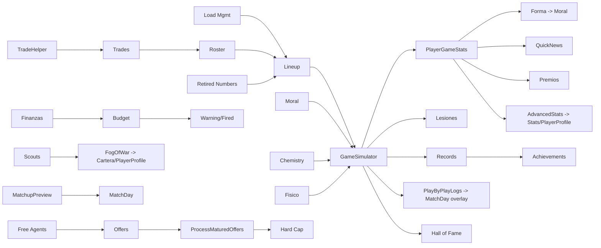

# GAMEPLAY — Tactical Five Mechanics

> Every mechanic with its goal, implementation, data, and exact formulas extracted from code. **[F]** fact, **[D]** deduction, **[H]** hypothesis. Version analyzed: HEAD `81d9e4f` (2026-08-16).

---

## 1. Season structure

| Phase (`SeasonData.phase`) | When | Produced by |
|---|---|---|
| `preseason` | After team selection, before regular season | `SelectTeamController` → `PreseasonController` |
| `regular` | Oct 22 → Apr 15, 82 games/team | `ScheduleGenerator.GenerateSchedule` (fired by `PreseasonController` when `generated==0`) |
| `playin` | 7-8 and 9-10 seeds per conference, then eliminator | `PlayoffsGenerator.GeneratePlayIn` / `CreatePlayInEliminator` |
| `playoff` | 4 rounds, best-of-7, 2-2-1-1-1 | `PlayoffsGenerator.GeneratePlayoffs` / `AdvancePlayoffSeries` |
| `finished` | Season over | Dashboard phase transition → `EndSeason` → `Draft` → `NewSeason` |

**Calendar facts [F]:** `CreateSeason` and `StartNewSeason` initially persist `Sep 5`; `PreseasonController.OnContinue` moves the date to the first preseason game or `Oct 22`. Regular-season gameplay targets Oct 22–Apr 15 and is **41-41 by construction** (82 games/team, 1.230 total, 2-2 in every division pair). Trade deadline reminder is Feb 1; **Deadline Day modal is Feb 7**; All-Star window Feb 8–14; up to 15 games/day; the scheduler avoids back-to-backs above 2.400 km; the main scoring path targets ≤5 games/team/week. — `DatabaseManager.Games.cs`, `DatabaseManager.Records.cs`, `PreseasonController.cs`, `ScheduleGenerator.cs`, `DashboardController.cs`

### Viajes, giras y descanso (F5-03)
- `TravelHelper` guarda coordenadas aproximadas de las 30 sedes y calcula distancias Haversine. `RestDays(prev, next)` son los días completos entre partidos.
- El scheduler usa la sede del partido anterior (no solo la ciudad del equipo) y rechaza un back-to-back si el desplazamiento supera **2.400 km**; además penaliza los viajes largos al elegir día. El test de 30 semillas exige 82/41-41/1.230 y ningún B2B imposible.
- Antes de simular, el pre-lote resta al `fisico` de la plantilla el coste del viaje: tramo corto 0, medio 1, largo 2 y costa a costa 3; cada día de descanso reduce un punto (tres días lo absorben). El desgaste por minutos sigue siendo el de `GameSimulator`.
- El Dashboard muestra en el próximo partido la distancia, los días de descanso y, si aplica, el tramo de gira (`GIRA: N partidos fuera`). MatchDay añade la misma información junto al pabellón.

### NBA Cup (F5-04)
- **Formato:** 6 grupos de 5 equipos (las 6 divisiones). Cada equipo juega **4 partidos de grupo, 2 en casa y 2 fuera**, contra los otros 4 equipos de su división. Son partidos de temporada regular que ya existen en el calendario: se marcan con `series_label="cup-group-..."` y **cuentan una sola vez** (no se duplican).
- **Eliminatoria:** 6 campeones de grupo + 1 wildcard por conferencia (mejor segundo). Se siembra 1–8 por victorias, diferencia y puntos; cuartos `1v8, 2v7, 3v6, 4v5`, luego semifinales y final. Son partidos extra `game_type="cup_playoff"` con `series_label="cup-qf-*"`, `"cup-sf-*"` o `"cup-final"`, y **no tocan `seasons.phase`**.
- **Datos:** `tournament_editions` (edición, estado, campeón, MVP), `tournament_groups` (pertenencia) y `tournament_standings` (W/L, puntos, diferencia, rank). `CupHelper.AdvanceIfNeeded` se ejecuta tras simular el día dentro de la transacción; cuando los 60 partidos de grupo están jugados crea los cuartos, y avanza por rondas hasta el campeón. El MVP sale del mejor `rating` de las estadísticas de la final.
- **UI:** la pestaña **NBA CUP** de Clasificación muestra los 6 grupos, el campeón y el MVP. El calendario etiqueta los partidos de eliminatoria como `NBA CUP`.

### Summer League y camp de desarrollo (F5-05)
- **Ventana:** en `NewSeason`, después del draft y antes de `StartNewSeason`, el jugador recibe un camp post-draft. No toca `seasons.phase`.
- **Convocatoria:** el jugador elige hasta **12** rookies/sophomores elegibles (`is_rookie=1` o edad ≤22 con ≤2 años de servicio), o puede saltar el camp.
- **Partidos:** 3 scrimmages por convocado; minutos 20–27 por partido. Las estadísticas son procedimentales y se guardan en `summer_league_stats` (PJ, minutos, puntos, rebotes, asistencias).
- **Desarrollo acotado:** si acumula ≥45 minutos y `overall < potential`, gana **+1** en su atributo más bajo (nunca supera 99 ni el potencial). Se aplica una sola vez y antes del rollover. Si el jugador ya está en su techo, no hay mejora.
- **Idempotencia:** si ya hay resultados para esa temporada, el camp no se repite tras un fallo/reintento del rollover.

## 2. Match simulation (core mechanic)

**Script:** `GameSimulator.cs` (~1.370 ln). **Data:** `GameData`, `PlayerData` (11 attributes + `morale` + `fisico`), `LineupData` (rotation). **DTOs:** `PlayerStatSnapshot`, `TeamStats`, `PlayByPlayEvent`, `StatDelta`, `PossessionOutcome`, `PossessionTally`, `PossessionState`, `GameResult`.

### Fuente de aleatoriedad (F3-01)
- `GameSimulator.SimulateGame(..., IRandomSource random = null)`: el juego pasa `null` y usa `UnityRandomSource`, un adaptador directo de `UnityEngine.Random`; los tests y herramientas pueden pasar `new SeededRandomSource(seed)` (SplitMix64 local, sin dependencias de Unity).
- La misma fuente se pasa explícitamente por ritmo/posesiones, cambios, tiros, anotación, faltas, rebotes, tiros libres, prórrogas/desempate y chequeo de lesiones. **Misma semilla + mismas entradas = mismo marcador, cuartos, box score y play-by-play.** El test `SimulateGame_MismaSemillaYEntradas_ProduceElMismoResultado` lo verifica.
- El alcance es `GameSimulator`: calendario, draft y RNG de la IA en background continúan usando sus fuentes actuales.

### Team ratings
- Player rating = `clamp(overall + (morale − 50) * 0.1, 0, 99)`.
- Team rating uses the `homePlayers`/`awayPlayers` lists, which include injured players, while active simulation lists filter injuries. Therefore “all healthy players” is the intended rule, not the current implementation [F].
- The simulator applies `+1.5` only when `isMyHomeGame` is true. In the current Dashboard call path this is the user's home game, so AI-vs-AI and the user's away games do not receive a local bonus [F]. Chemistry: home ×0.15, away ×0.10.
- **F3-04:** `pace = clamp(96 + (homeRating + awayRating − 140) * 0.06 + rand(−2, 2) + ajuste de plan + SpeedPaceDelta, 92, 110)`. El centro baja para el ritmo observado de 2024-25; cada periodo conserva posesiones iguales para los dos equipos.

### Possession model (`PossessionState`, `RunPossession`, `PlayPossession`, `RunPossessionChain`)
- **La posesión es la unidad que alterna.** El atacante lo decide una regla explícita (`PossessionState`, F2-02), no el azar: cada periodo lo abre el equipo que no abrió el anterior (`BeginPeriod(n)`: Q1 local, Q2 visitante, Q3 local, Q4 visitante, prórrogas alternando) y, dentro del periodo, el balón cambia al cerrar cada posesión (`NextPossession()`; canasta, pérdida, tapón o rebote defensivo) y **sigue en el mismo equipo si el rebote es ofensivo** (F2-01): `PossessionOutcome.offensiveRebound` encadena otro ataque con `RunPossessionChain`, hasta `MAX_ATTACKS_PER_POSSESSION` (4) por seguridad. `PossessionTally` separa *posesiones* (alternancia) de *posesiones usadas* (ataques): la diferencia son las segundas oportunidades, que ahora puntúan.
- **Equilibrio resultante:** cada periodo regular reparte `teamPoss × 2` posesiones en mitades iguales. La fase final F3-05 puede añadir hasta tres posesiones, por lo que el total del partido ya no garantiza igualdad exacta entre equipos. En la liga sintética F3-04 previa a F3-05 el ritmo medio fue **98,13** y `PTS/POS` ≈ **1,16**.
- Turnover probability: `TurnoverChance(offR, defR, BallSecurity, plan)` = `clamp(GameSimulator.BASE_TURNOVER_CHANCE (0.147) + (defR − offR) * 0.0003 + ForcedTurnoverDelta − (BallSecurity − 70) * 0.0015, 0.02, 0.30)`, donde `BallSecurity` es el bote medio de los manejadores (PG/SG/SF) en pista. La base se ajustó en F3-04 al volumen NBA observado; el bote y el plan siguen moviendo la probabilidad.
- Shooter selection: weighted by `(overall/100)^2.2 * FisicoPenalty`, where `FisicoPenalty = 1` if `fisico ≥ 30`, else `0.75 + (fisico/30)*0.25`.
- Shot type by position (F3-04): PG 45% / SG 51% / SF 43% / PF 38% / C 23% from three, adjusted `+ (three_point − 75)*0.002 + (three_point − shooting) * 0.0015 * iq/100`, clamped 0.10–0.55, × FisicoPenalty. El término de IQ es la **selección de tiro** (F2-04): el jugador listo insiste en su punto fuerte.
- Defense: best `defense` on the floor; `di = (defense − 70) * 0.005`.
- 3PT FG% (F3-04): `clamp((BASE_THREE_POINT_PERCENT 0.400 + (three_point−70)*THREE_POINT_ATTRIBUTE_SLOPE 0.0035) * fp − di, 0.28, 0.51)`.
- 2PT FG% (F3-04): `clamp((BASE_TWO_POINT_PERCENT 0.5165 + (shooting−70)*TWO_POINT_ATTRIBUTE_SLOPE 0.0025) * fp − di*0.25 + FinishingBonus(athleticism), 0.40, 0.67)`, con `FinishingBonus = (athleticism − 70) * 0.0018` (F2-04). Se comprime la pendiente de atributos alrededor del promedio para que el diferencial de OVR no abra brechas de acierto fuera de la distribución NBA.
- And-one: 6% on made 2; el libre adicional lo tira `ShootFreeThrows`. Foul on miss: 12% (3pt) / 8% (2pt). Una falta de dos no concede un tercer tiro adicional.
- Blocks (F3-04): one collective block roll per missed shot, with each defender weighted by `clamp((blocks−60)/800, 0, 0.05) × position multiplier` and total chance capped at 12%. Multipliers: PG 0.20, SG 0.30, SF 0.55, PF 1.15, C 1.30. The successful defender is selected from those weights, not by list order.
- Rebounds (F3-04): both teams use the same `reb^3 × position multiplier × ReboundAthleticismFactor` exponent; the offensive team then receives `OFFENSIVE_REBOUND_WEIGHT_SCALE = 0.42`. This removes the old exponent mismatch (`def reb^3` vs `off reb^2.5`, which penalized attack by ~8× at reb=80) and brings offensive boards toward the NBA share without guaranteeing any rebound. `ReboundAthleticismFactor = clamp(1 + (athleticism − 70) * 0.004, 0.7, 1.4)` (F2-04). **Si gana el ataque, el rebote es ofensivo y la posesión continúa con otro ataque del mismo equipo.** Defensive multipliers: PG 0.45, SG 0.55, SF 0.80, PF 1.20, C 1.35. Offensive multipliers: PG 0.35, SG 0.50, SF 0.75, PF 1.20, C 1.40.
- Assists (F3-04): `BASE_ASSISTED_FIELD_GOAL_CHANCE = 63%` de las canastas llevan asistencia (62% en la G-League), pasador ponderado `passing^3`; es la **única** fuente de asistencias (no hay pisos).
- Turnovers: handler PG/SG/SF weighted `1/FisicoPenalty`; only 50% become steals, steal weight `steals_attr^3`.
- **Faltas:** peso por posición (C 2,0 · PF 1,6 · SF 1,1 · SG 0,9 · PG 0,8) amortiguado por las faltas ya cometidas (`max(0,35; 1 − pf×0,10)`): los interiores faltan más y quien está en problemas de faltas defiende con más cuidado. Falta sin tiro en la penetración (`ReachInFoulChance` = 12,5% + delta del plan defensivo): si deja al rival en bonus son 2 tiros libres; si no, el ataque continúa (no consume posesión extra).

### Faltas, bonus y tiros libres (F2-03)
- **Cómputo:** `FoulState` lleva las faltas de equipo del periodo (se reinician con `BeginPeriod`) y `DefenseFouls.RegisterFoul()` cuenta la falta del equipo que defiende y devuelve si deja al atacante **en bonus**. Umbral: 4.ª falta de equipo del periodo; en los dos últimos minutos del 4.º cuarto y de cada prórroga (`IsClutch`: minuto ≥ 10 en cuartos, ≥ 3 en prórrogas) baja a la 2.ª. En la NBA el umbral normal es la 5.ª: aquí se usa la 4.ª a propósito para acercar `fta` a los valores reales sin inflar el número de faltas.
- **Tiros libres:** un único punto de tiro, `ShootFreeThrows(shooter, shots, out liveRebound)` → `0.75 + (overall−70)×0,002`. Si el **último** libre se falla, `liveRebound = true` y `AttachLiveRebound` resuelve la pelea con `DoReb`: un rebote ofensivo mantiene la posesión (segunda oportunidad) y uno defensivo la cierra. Si el último entra, el balón muere.
- **Expulsión:** `EjectFouledOut` saca de la pista a quien llega a `PERSONAL_FOUL_LIMIT` (6) y mete al mejor suplente por encaje posicional, minutos pendientes y OVR (nunca a otro expulsado ni a quien tiene plan 0); `PickSubstitution` tampoco vuelve a meter a un expulsado. Sin banca disponible el equipo sigue con cuatro y se avisa en el play-by-play.
- **Medición histórica F2-03** (10 partidos, plantilla homogénea): 40 tiros libres y 26 faltas por partido. El baseline de calibración F3-04 usa 30 equipos sintéticos ×82 partidos; resultados vigentes más abajo.

### Atributos con efecto propio (F2-04)
Los once atributos del jugador llegan al `PlayerStatSnapshot` y mueven una métrica concreta. Los cuatro que antes se ignoraban:

| Atributo | Efecto | Fórmula |
|---|---|---|
| `speed` | Ritmo del partido (transición) | `SpeedPaceDelta = (velocidad media de ambos equipos − 70) × 0,15` posesiones |
| `dribbling` | Pérdidas de balón | `BallSecurity` = bote medio de los manejadores en pista; `TurnoverChance` resta `(bote − 70) × 0,0015` |
| `athleticism` | Finalización cerca del aro y rebote | `FinishingBonus = (atl − 70) × 0,0018` al TC de dos; `ReboundAthleticismFactor = clamp(1 + (atl − 70) × 0,004, 0,7; 1,4)` en el peso de rebote |
| `iq` | Selección de tiro | término `(three_point − shooting) × 0,0015 × iq/100` en la probabilidad de triple |

- **Medición vigente** (EditMode F3-04, 20–30 partidos por escenario): velocidad 90 → **101,4** posesiones vs velocidad 45 → **95,1**; bote 95 → **11,9** pérdidas vs bote 45 → **19,7**; atletismo 95 → **56,5 %** en tiros de dos vs 40 → **51,7 %**; IQ 95 → **46,8** triples intentados vs IQ 20 → **40,3** (con el triple como punto fuerte).
- **Dirección de efecto acordada:** un atributo alto siempre mejora su métrica y uno bajo la empeora; los efectos son aditivos y acotados (`clamp`) para que ningún valor 1–99 rompa los rangos del partido.

### Calibración ofensiva F3-04
- Se ajustaron en `GameSimulator` el ritmo base (96), la base de pérdidas (0,147), los porcentajes y pendientes de 2P/3P, la selección por posición (PG45/SG51/SF43/PF38/C23), faltas, asistencias (63%), tapones y rebote ofensivo. Se quitó además la concesión aleatoria de un tercer libre en una falta de dos puntos: no corresponde a las reglas NBA. El rebote ofensivo ya no compara `reb^2.5` con `reb^3`; comparte el exponente defensivo y usa escala de ataque 0,42.
- La mejora se mide con `MonteCarloCalibrationGate.EvaluateOffense`: comprueba media de liga **y** P5/P50/P95 por equipo-temporada para PTS, FG%, 3P%, FTA, pérdidas y asistencias, además de que ningún equipo sintético quede sistemáticamente fuera del rango NBA/tolerancia.
- Resultado reproducible (semilla `20261024`, 30×82): **98,13** posesiones, **113,96** PTS, **45,50%** FG, **35,29%** 3P, **22,79** FTA, **14,70** pérdidas y **26,16** asistencias por equipo-partido; **Gate ofensivo ACEPTADO**, incluidas colas por equipo. REB **44,29** y PF **18,13** también caen en las bandas de media del perfil.
- En la medición de F3-04 el gate general todavía marcaba partidos-jugador perdidos por lesión; F3-06 calibra después esa métrica sin bloquear ni ampliar el gate ofensivo.

### Quarters, rotations, overtime
- 4 quarters via `SimQuarter`; `teamPoss = clamp(round(pace/4 * rand(0.96,1.04)), 22, 28)` **posesiones** por equipo y cuarto (`totalPoss = teamPoss × 2`, mitades iguales). El saque de cada cuarto lo fija `PossessionState.BeginPeriod` (alterno, ver modelo de posesiones). Los ataques pueden superar las posesiones por los rebotes ofensivos.
- **Fase final F3-05:** como los cuartos son de posesiones fijas y el motor no simula un reloj de posesión, al cerrar el 4.º cuarto se comprueba el **marcador acumulado del partido**. Si la diferencia es de 1–6 puntos, se añaden hasta **3 posesiones** alternando desde el equipo que va por detrás; se corta al empate (prórroga), a la remontada o cuando el margen supera 6. No se añaden libres artificiales: cada posesión pasa por `PlayPossession` y sus reglas ordinarias. `PossessionTally.lateExtensionPossessions` expone cuántas se añadieron. El reloj de la crónica se limita a 11,98' para no mostrar tiempos negativos; es una aproximación de final de partido, no una simulación exacta de faltas/tiempos muertos NBA.
- Rotations via `SubSchedule` (Q1/Q3 subs at 4' and 8'; Q2/Q4 at 2',5',8',10.5'). Todo equipo con **plan de minutos** (configurado o estratégico automático, ver más abajo) usa ventanas densas cada 1,5' (7 por cuarto) para poder cumplirlo; solo la G-League y el All-Star mantienen el calendario antiguo. Overtime: 24 possessions (`minsPerPoss = 5/24`), sub at 2.5', saque alterno (`BeginPeriod(5+n)`). Up to 5 OTs.
- Substitution policy: `DoSub` changes 1–2 players at each scheduled stoppage. En modo no vinculante (IA) elige al que sale por minutos sobre su objetivo y al que entra por encaje posicional, minutos pendientes y OVR. **Objetivo por media** (`GetTargetMinutes`): titular ≥90 → 40, ≥85 → 34, ≥80 → 33, ≥75 → 26, por debajo → 20; suplente ≥90 → 32, ≥85 → 28, ≥80 → 22, ≥75 → 14, por debajo → 12; **rol `UltimoRecurso` → suelo (2 min)**. A player with `fisico < 30` has its target reduced by 6 minutes, con suelo de 2 (`MIN_FIXED_MINUTES`). El rol es la escala de `PlayerRoleRules.FromOverall` (seed, draft y migración `role_from_overall`). Interior coverage is preserved when possible; stars are protected from early substitutions and can return later in the game.
- **Rotación vinculante (`planned`):** `GameSimulator.PickSubstitution` (helper puro) respeta el plan —igual con minutos configurados en ROTACIÓN que con el reparto estratégico automático—: sale quien más se pasa de su objetivo (desempate: ratio, plan menor, OVR) y entra, ponderando el encaje posicional (×1.0/×0.85/×0.6), quien tiene minutos pendientes; nunca se reinserta a quien agotó su plan mientras haya relevos con minutos, y el cambio no deja la pista sin interiores. Si nadie tiene minutos pendientes no hay cambio (los de pista completan si la suma no llega a 240). Suelo de **2 min** (`MIN_FIXED_MINUTES`) por jugador con plan > 0; `0` = no juega. La fatiga no altera un plan configurado por el jugador. La protección de estrellas usa los minutos **efectivos** (incluyendo el cuarto en curso) siempre que el partido tenga plan.
- **Origen del objetivo:** `PrepareRotationMetadata` usa `target_minutes` si el jugador tiene minutos fijados en la pantalla ROTACIÓN (`PlayerData.rotation_minutes ≥ 0`); si no (`-1`), aplica la heurística anterior. La fatiga (`fisico < 30`) resta 6 minutos (mínimo 8) solo en los objetivos heurísticos (IA). El equipo del usuario usa minutos configurados; IA, G-League y All-Star usan sus reglas automáticas correspondientes.
- **Rotación estratégica automática (F2-11, IA y equipo del usuario sin configurar):** si **ningún** convocado tiene minutos fijados, `PrepareRotationMetadata` calcula de una vez el reparto de los **240** minutos: un ideal por jugador (`GetAutomaticMinutes`: promesa del rol —Estrella 34 / Titular 27 / Banquillo 15 / Último 2—, ±4 por nivel dentro del rol, −10/−20 % si llega cansado, +2 al titular) y `RotationPlanner.AutoAssign` lo normaliza (rotación corta de 10, suelo 2, suma exacta 240). El plan queda **vinculante** (`planned`), así que la IA usa las mismas ventanas densas y el mismo `PickSubstitution` que el equipo del usuario. La pantalla ROTACIÓN calcula su columna SUGERIDO y su reparto automático con **la misma función**, de modo que lo que se ve es lo que se juega. La G-League (`glLeague`) mantiene la heurística de OVR y el All-Star sigue con sus minutos fijos.
- **Medición F2-11** (12 jugadores homogéneos: 1 estrella, 4 titulares, 7 banquillo; 10 partidos): antes la heurística pedía **319 minutos** de los 240 del partido (+33 %); ahora juega estrella **36,2**, titular **30,1** y banquillo **11,9** por jugador, con la suma del partido en 239–241. Coste: ~+0,3 ms por partido (18–20 ms por día de 15 partidos frente a 15 ms).

### Box score = suma de acciones (sin pisos)
- **Ninguna estadística se reescribe después de simular** (F2-05): el box score es exactamente lo que el jugador hizo en el partido. Se eliminaron los antiguos «pisos elite» que subían asistencias (`passing ≥ 95`), rebotes (`rebounding ≥ 95`), robos (`steals ≥ 90`) y tapones (`blocks ≥ 95`) de todo jugador con ≥ 20 minutos.
- **Invariantes que se cumplen por construcción:** asistencias ≤ canastas anotadas del equipo (solo hay asistencia en una canasta), tapones ≤ fallos del rival (un tapón es un fallo), robos ≤ pérdidas del rival (solo la mitad de las pérdidas acaban en robo) y rebotes ≤ fallos totales + libres fallados (cada rebote sale de un fallo). El `rating` y los dobles-dobles se calculan sobre esas cifras reales.
- **Medición del impacto** (20 partidos, plantillas con atributos elite): de los jugadores con ≥ 20 minutos, 177 quedan por debajo del antiguo mínimo de asistencias, 127 de rebotes, 163 de robos y 61 de tapones; la distribución de líderes se valida en la Fase 3 sin pisos.

### Resultados y paridad F3-05
- `MonteCarloOutcomeGate` valida en 100 temporadas completas (123.000 partidos) victorias medias, dispersión de victorias, mínimos/máximos por temporada, correlación OVR↔victorias y tasa de prórrogas contra la referencia NBA 2024-25. Resultado con semilla `20261024`: **41,00** victorias/equipo-temporada; desviación **14,02**; mínimo medio **15,80**; máximo medio **67,09**; correlación **0,928**; OT **5,11 %** (6.286/123.000). Todas las bandas de F3-05 pasan.
- Para aislar la calibración del motor, el banco usa una liga sintética propia de 15 jugadores: `SYNTHETIC_BASE_OVR=72.08` y `SYNTHETIC_OVR_SPREAD=10.6` (rango de bases 72,08–82,68). La distribución es propia del laboratorio; **no cambia ratings, seed ni franquicias del juego**.

### Lesiones y disponibilidad F3-06
- El riesgo base pasa de 0,8 % a **20 % por jugador a 36 minutos**, conservando el escalado por exposición, físico bajo y recaída: 5 min ≈ 2,78 %, 20 min ≈ 11,11 %, 44 min ≈ 24,44 % (físico normal y sin recaída). No es una probabilidad plana: quien no juega mantiene riesgo 0.
- `CheckInjuries` sigue aplicando la lesión postpartido, pero `InjuryHelper.CanSustainMatchInjury` evita asignar una nueva si deja menos de **cinco jugadores sanos** en la convocatoria que el simulador usará. Las plantillas cortas preexistentes (1–4) y las incomparecencias siguen manejándose como antes.
- Aceptación de 100 temporadas / 123.000 partidos, semilla `20261024`: **392,65** partidos-jugador perdidos por equipo-temporada; P5/P50/P95 = **299/391/490**, dentro de las bandas declaradas (media 326,97–466,97; P5 240–320; P50 329–429; P95 474,05–554,05). El mínimo observado fue **5 jugadores sanos**.
- Duración observada frente a la media ponderada del catálogo: leve **2,57/2,57 días** (137.968 episodios), moderada **9,60/9,59** (150.200), grave **29,69/29,78** (32.789) y crítica **122,39/123,60** (3.329); todos los rangos muestreados quedan dentro de `InjuryCatalog`.
- Con lesiones activas, F3-04, F3-05 y F3-06 pasan juntos: victorias 41,00; SD 14,52; mín. 17,10; máx. 68,26; r=0,957; OT 5,01 %. No se modifica el seed real.

### Persistencia del partido en lote (F2-09)
- **Un partido = unas pocas escrituras.** Las filas de `player_game_stats` se acumulan y se insertan con `DatabaseManager.SavePlayerGameStatsBatch`; los cambios de fatiga/lesión se aplican **en memoria** sobre los `PlayerData` ya cargados y se escriben con `UpdatePlayersBatch`. Antes, cada jugador costaba un `GetPlayerById` + `UpdatePlayer` (físico), otra lectura en el chequeo de lesiones y un `Insert` por fila, todos en autocommit.
- **Dentro de la transacción del día:** ambos helpers usan `bool own = !_db.IsInTransaction`: si el día ya tiene una abierta escriben en ella y **nunca anidan un `BEGIN`**. La semántica es idéntica (mismo `físico`, mismas lesiones, mismas filas); los cambios solo se ven al final del partido, no a mitad.
- **Medición** (360 filas = 15 partidos × 24 jugadores, con WAL como las partidas reales): **426 ms escribiendo una por una vs 2 ms en lote**. Un día de liga ahorra ~0,4 s solo en estadísticas y otro tanto en las actualizaciones de jugadores.

### Plantilla corta e incomparecencia (F2-06)
- **Nunca se inventa el marcador.** Con **1–4 jugadores sanos** se juega con los que hay: el quinteto inicial, las sustituciones y el box score salen de la simulación real, y `GameResult.shortRoster = true` avisa al llamador. El antiguo resultado aleatorio (105–125 / 100–120) ya no existe.
- **Incomparecencia:** si un equipo no tiene **ningún** jugador sano (`homePS.Count == 0` o `awayPS.Count == 0`) no se puede jugar: se resuelve **0–20** para el rival (regla NBA; los 20 puntos se reparten 5 por cuarto), `GameResult.walkover = true`, sin estadísticas de jugador (el equipo que sí se presenta queda con 0 minutos y no genera filas en `player_game_stats`). Si ninguno de los dos puede presentarse, gana el local 20–0.
- **Aviso al jugador:** `DashboardController.NotifyShortRoster` inserta un `MessageData` (`NewsType.PLANTILLA_CORTA`, categoría CLUB) cuando la plantilla corta afecta a su equipo, explicando si ha jugado con N jugadores sanos o si ha habido incomparecencia (propia o del rival).
- **Medición:** 3 vs 4 jugadores (20 partidos, atributos homogéneos) → 117–125 de media; el marcador siempre cuadra con el desglose de tiros. La penalización competitiva por plantilla corta (fatiga/ritmo) se calibra en Fase 3, no con un marcador artificial.

### Rating & double-double
`rating = points + oreb + dreb + ast + stl + blk − (fga−fgm) − (fta−ftm) − to − pf`. ≥3 categories of 10+ → triple-double; ≥2 → double-double. — `GameSimulator.cs:191-205`

### Persisted outputs
- `PlayerGameStats` rows per player; `GameData` updated (scores, quarters, `is_played=1`).
- Incomparecencia (F2-06): el `GameData` se persiste con `is_played=1` y el marcador 0–20, pero **sin filas** de `player_game_stats`, fatiga ni lesiones (no se jugó).
- Records checked (`CheckAndUpdateRecords`; skipped for All-Star).
- Fatigue: `fisico -= round(minutes*0.30)` (×1.5 on true back-to-back via `game_day-1` check), floor 0; recovered +8/day **only on rest days** (days the team has no game).
- Injuries: probabilidad por partido según la **exposición** (`InjuryHelper.MatchRiskPerGame`): base 0,20 a 36 minutos y proporcional por debajo (5 min ≈ 2,78 %, 20 min ≈ 11,11 %, 44 min ≈ 24,44 %), ×`1 + (30−fisico)*0.15` si `fisico < 30` y + riesgo de recaída si viene de un alta forzada; 0 minutos ⇒ 0. El sorteo es **postpartido** (no altera minutos ni resultado) y respeta cinco sanos mínimos al asignar lesiones. 27 tipos ponderados (`InjuryCatalog`, ver "Lesiones y parte médico").

### Play-by-play en vivo (Vista de Partido)
- Toggle **Vista de Partido** en los modales de Configuración: `Directa` (0) o `Play-by-play` (1), persistido en `PlayerPrefs TF_SimMode` (`UIScreenController.GetSimMode()`). Solo aplica al flujo día a día (no fast sim).
- **Captura bajo demanda (F2-08):** el llamador pasa `capturePlayByPlay` a `SimulateGame` (`DashboardController` lo pone a `GetSimMode()==1`, y el All-Star nunca). En **Directa** no se construyen snapshots ni deltas por posesión ni la lista de crónica (`GameResult.playByPlay == null`): el resultado es idéntico y se ahorra todo el coste de algo que se descartaba. Medición de un día de 15 partidos (simulación pura): **15 ms en directa vs 33 ms con crónica**.
- `GameSimulator` captura la crónica sin alterar el resultado: `PlayByPlayEvent` (quarter, texto en español, marcador acumulado, `timeElapsed`, deltas `StatDelta` por jugador). `CaptureBox`/`DiffBox` generan los deltas tras cada posesión + minutos por jugador; hay meta-eventos de inicio de cuarto/prórroga y fin de partido. Solo se guarda en `GameResultCache.PlayByPlayLogs[game.id]` cuando `GetSimMode()==1`.
- Overlay inmersivo en `MatchDay`: nombres + logos, marcador acumulado, reloj `mm:ss`, barra de progreso 0–100%, **boxscore en vivo** por equipo (12 columnas) reordenado por VAL descendente y totales recalculados desde los jugadores.
- Velocidades **x1/x3/x5/x10** (persistidas en `TF_PbpSpeed`; base 2 s/evento) y botón **SALTAR** (avanza al final reconstruyendo el boxscore; al acabar cambia a **IR AL RESUMEN**). — `MatchDayController.cs`
- **Broadcast narrado (E4):** `PlayByPlayNarrator` (puro) reescribe cada jugada cruda con comentario **en español y con personalidad**, según el tipo (triple, dos, tapón, pérdida, tiros libres, rebote, 2+1) y el contexto (marcador apretado, paliza, prórroga). No altera el resultado ni las stats: solo la presentación del `ev.text` en el overlay de `MatchDay`.

### Previa / pronóstico (Matchup Preview)
`MatchupPreview.Compute(home, away, isHome, managerId, seasonId)` (`Stats/MatchupPreview.cs`): calcula ratings de equipo (misma fórmula que el simulador + bonus de química y casa) + **forma reciente** (`(avgRating − 50) * 0.25` sobre los últimos 5 partidos jugados) → probabilidad de victoria `1/(1+exp(−diff*0.08))`. Declara FAVORITO solo si `|prob−0.5| > 0.005`. Estrellas = top 3 OVR de cada equipo. Se muestra en `MatchDayController.ShowMatchupPreview` (entre el banner y el boxscore).

### Plantilla corta
Si un equipo no llega a cinco sanos se simula con los disponibles y, sin ninguno sano, se aplica incomparecencia 0–20 (ver «Plantilla corta e incomparecencia» en §2). No existe ya marcador aleatorio de respaldo.

## 3. Lineups & rotations

- `LineupData.slot`: 0 = starter, 1 = bench, 2 = inactive. `slot_index` orders them.
- `AutoSeedLineup` builds a default rotation (starters by position, bench by role). `EnsureLineupSeeded(teamId, players)` (compartido por Quinteto y Rotación) lo crea si la tabla está vacía, borra filas de jugadores que ya no están y mete a los nuevos en NO CONVOCADOS (máx. 5).
- **Pantalla ROTACIÓN** (`GameScreen.Rotation`, `RotationController`): reparto manual de los **240 minutos** de un partido (5 × 48) entre los 12 convocados.
  - Se guarda en **`team_lineup.rotation_minutes`** (migración `ALTER TABLE ... DEFAULT -1`); **`-1` = automático**, `0..48` = fijo. No se guarda en `players` (hay un campo transitorio `[Ignore] PlayerData.rotation_minutes` para dárselo al simulador).
  - `GetActivePlayers(_myTeam.id)` copia el valor a cada jugador convocado → `InitPS` lo mete en `PlayerStatSnapshot.target_minutes` (`fixed_minutes = true`) → `PrepareRotationMetadata` lo aplica (suelo 2) y `PickSubstitution` lo respeta de verdad.
  - Columna **SUG.** = `GameSimulator.GetSuggestedMinutes(player, starter)` → `GetAutomaticMinutes` (rol + nivel + forma física): la misma función con la que el simulador reparte los 240.
  - Panel **MINUTOS POR POSICIÓN** (solo lectura): suma de minutos por posición primaria y secundaria, escala relativa a 48.
  - **AUTO (240)** reparte los 240 minutos con `RotationPlanner.AutoAssign` (proporcional a los objetivos, **suelo 2 min** —el mismo que aplica el simulador— y tope 48; la suma es exactamente 240) entre una **rotación corta** (`ROTATION_SIZE = 10`: solo los 10 mejores objetivos reparten minutos; el fondo se queda en el suelo). **RESET** pone todos los minutos a `0` (reparto desde cero); `0` es un valor real, no el centinela `-1` de automático, que solo queda en una convocatoria nunca tocada. Si el total configurado es 0 el equipo vuelve al reparto automático.
  - **Referencia = cuota de 240:** las sugerencias por jugador (heurística por media/rol) **no suman 240**, así que compararlas en bruto daba negativos a todos los convocados (imposibles de cuadrar). La columna **SUGERIDO** y los **±** se calculan contra la **cuota de 240** del jugador (`RotationPlanner.AutoAssign` sobre sus ideales, suelo 2, tope 48): en automático **todos los deltas son 0** y con reparto manual los deltas suman 0 (siempre cuadrables). El tooltip muestra el ideal bruto (*"Ideal del simulador: X min · cuota de 240: Y min"*).
  - **Estado automático (sin plan positivo):** si ningún convocado tiene plan (todos `-1` o `0`) la pantalla lo marca ("REPARTO AUTOMÁTICO (240)") y la **primera vez que el usuario toca un slider se fija ese reparto** y luego se aplica el cambio. Así lo mostrado y lo jugado coinciden desde ese momento.
  - **Convocatoria al crear la partida:** al pulsar **CONTINUAR** en Preseason (partida nueva) se genera la convocatoria como el botón **CONVOCATORIA AUTOMÁTICA** (`EnsureLineupSeeded`), con los minutos de rotación en automático.
  - **Aviso antes de simular:** junto a los avisos de lesionados/quinteto vacío, el Dashboard comprueba la rotación **cada día que juega tu equipo** (también durante la simulación rápida, que se pausa): si `RotationPlanner.Evaluate` no la da por lista (ni 240 exactos y válidos, ni todo en automático) muestra **ROTACIÓN INCOMPLETA** con el detalle ("faltan 9", "te pasas por 10"…), **IR A ROTACIÓN** (dorado) y **ASIGNAR AUTOMÁTICAMENTE** (verde, `DatabaseManager.AutoAssignRotationMinutes` = reparto de 240 con suelo 2, persistido, igual que el botón AUTO). Los convocados no disponibles (lesionados/G-League) no cuentan.
  - Solo cuentan en los totales los convocados jugables (`injury_days == 0` y `g_league_assigned != 1`).
- **Moral post-partido** (`UpdatePlayersMoraleAfterGame`): los minutos esperados de cada jugador son ahora su `target_minutes` efectivo (configurado o heurístico); si es 0, se usa la tabla fija por rol (Estrella 40 / Titular 28 / Banquillo 10 / Último 3).
- `GetActivePlayers(teamId)` returns the active 12 used in simulation (starters first → `GameResultCache.GameStarters`).
- Dashboard pre-game checks: empty starter slots, injured starters, and **load management** open modal prompts.
- **Load management** (`DashboardController.cs:899-923`): if `TF_LoadMgmt_Enabled` (PlayerPrefs, toggled in `QuintetoController`) and the team has a real back-to-back, the modal lets you rest up to 2 tired players (bench/inactive for one game); `_loadMgmtIsB2B`/`_loadMgmtTiredPlayers`.
- **Simulación rápida** (`CalendarController` → "SIMULAR HASTA FECHA"): `FastSimRoutine` (`DashboardController.cs:1324`) avanza días con `ProcessGameDayRoutine(fastSim:true)`; spinner gira continuo, botón **DETENER** activo; pausa ante ofertas maduradas (modal IR A QUINTETO / SEGUIR SIMULANDO) y traspasos entrantes (`ShowNextPendingTradeOffer`); al terminar modal "SIMULACIÓN COMPLETADA".
- **Calendario de la temporada (`seasons.current_date`):** el calendario avanza **un día por día** y `game_day` es el índice relativo al 22/10, así que la fecha **siempre** es la del día `current_game_day + 1` (día 8 → 30/10). `DatabaseManager.GetActiveSeason` **sanea la columna en memoria** si no cuadra (`EnsureSeasonDate`): sin eso el "día pendiente" (`DashboardController.FindNextGameDay`) se calcularía sobre una fecha equivocada y el botón "DÍA DE PARTIDO" y el "IR AL PARTIDO" de la previa no aparecerían. La base de datos se repara sola en el siguiente commit del día. La pretemporada queda intacta: sus amistosos tienen días negativos y su propia fecha. Mapeo fecha↔día en `CalendarHelper` (`DateToGameDay` / `GameDayToDate`).
- All-Star rosters: `BuildAllStarRoster("East"|"West")`.

## 4. Contracts & salary cap

Constants (2026-27, fallback `TradeHelper.cs`): cap `164,961,000`, luxury `200,428,000`, 1st apron `209,015,000`, 2nd apron `221,686,000`, NT-MLE `15,044,000`, T-MLE `6,064,000`, BAE `5,477,000`, minimum 0 años `1,357,763`, two-way `678,882`. La fuente viva es `CbaTable` + `league_settings`: 2024-25..2026-27 son cifras oficiales de la NBA, 2027-28..2034-35 son proyecciones de RealGM y después se proyecta +5 % anual. No se modela repeater tax.

### Salario mínimo por experiencia (F4-08)
- `CbaTable.Season.MinimumFor(years)` publica cuatro bandas: **0, 1, 2 y 3+ años** de servicio. En 2026-27 son `1.357.763`, `2.185.116`, `2.449.421` y `2.537.526` $; las temporadas proyectadas escalan con los ratios oficiales.
- `TradeHelper.MinimumSalary(settings, years)` es la única puerta de consulta: usa `league_settings.season_start_year` y la fila CBA correspondiente. `minimum_salary` guarda solo el mínimo de 0 años para compatibilidad y UI.
- Se aplica al **enviar y madurar** ofertas FA/renovaciones, al máximo de un equipo por encima del 2.º apron, a la QO/cap holds, al buyout y a los fichajes de la IA (`CanAISignExternal`). Los contratos two-way y los rookies no usan esta escala.
- **Contratos legacy:** los firmados bajo el suelo interno anterior de 2 M se conservan (no se reescriben nóminas del usuario); el auditor los cuenta como informativos y el mínimo de su experiencia se exige al renovar. El seed actual tiene 56 contratos de 2 M en esa situación; los 14 que estaban por debajo de 2 M ya se corrigieron en F1-04. El antiguo dato de «9 contratos» del plan estaba desactualizado.

### Max offer (`RosterController.GetMaxOfferBreakdown`)
1. `maxByExp`: experience = `max(0, years_of_service)`; ≤6yr → `cap × 25%`, ≤9yr → `cap × 30%`, else `cap × 35%`.
2. Own-team renewal tiers by `seasons_with_team`: ≥3 → full Bird → `maxByExp`; 2 → Early Bird → `max(salary×1.75, cap×10.5%)`; else → Non-Bird → `salary×1.20`.
3. **External FA: `birdMax = 0`** (no Bird rights). **FA propio reciente** (`IsOwnRecentFA`: `team_id==0 && last_team_id==myTeam && seasons_with_team>0`) → Bird rights.
4. `capSpaceMax = salary + max(0, cap − payroll)`.
5. Over cap: exceptions only — ≤1st apron → NT-MLE (ProManager: **Taxpayer MLE only**), ≤2nd apron → T-MLE, else minimum.
6. `finalMax = min(maxByExp, rawMax)`.

### Offer resolution (`ProcessMaturedOffers`, after 7 days)
Acceptance via `CalculateAcceptScore` (see `SYSTEMS.md §S9`); roll `Random(1,101) ≤ score`. Legality re-checked at maturity. **Contract options:** TO/PO toggles (mutually exclusive) on renewal and FA offers → `guaranteed_years = max(0, offer_years − 1)`; `FormatContractYears` renders `3 años (Team Option)` / `2 años + Player Option` in messages.

### Trades (`TradeHelper.ValidateTrade` / `EvaluateTrade`)
Apron rules, centralized in `TradeHelper.GetMaxIncomingSalary` (the exact returned limit is also shown in validation errors): 2nd apron or hard-capped above 1st (no aggregation, incoming ≤ outgoing); between 1st and 2nd (incoming ≤110% outgoing); below 1st (`2×+250K` for outgoing <7.5M / `out+7.5M` for <29M / `125%+250K` otherwise). The $250K adjustment is applied only once in the applicable bracket. Picks tradable (`draft_picks.current_team_id`) with **protection & swaps** (`protected_from`, `is_swap`, `swap_original_team_id`). **Multi-año:** cada equipo posee los drafts de `year_end..year_end+3` (8 picks al inicio: 4 R1 + 4 R2); las rondas futuras no tienen posición (se resuelve al draftear por el `original_team_id`) y `PickBonus` las descuenta por año (−2/año R1, −1/año R2, mín. 1). S&T of own FA via `MarketController.ProcessSATrade` (Bird max → sign + immediate trade → two `TradeData`; receiver under hard cap; `teamASignSalaries`/`teamBSignSalaries` in validation).

### Cap sheet (Finances → «CAP SHEET»)
Proyección de nómina efectiva vs cap/apron/espacio, contratos garantizados/opciones a 5 años (cap proyectado por la tabla CBA de cada temporada) y cap holds activos del año actual. La nómina de cap suma contratos estándar + holds; excluye salarios two-way y evita doble conteo cuando el jugador ya firmó. Los holds son compromisos de cap, no nómina mensual ni impuesto. Finanzas permite renunciar cada hold (el jugador pasa a UFA).

### Derechos de agente libre y cap holds (F4-05, simplificados)
- Service time: `years_of_service` sube una vez por temporada de equipo. Legacy saves se estiman por edad/antigüedad (no es historial CBA oficial; editable desde Editor).
- Al expirar contrato u opción, 0–3 años de servicio → **RFA**, 4+ → **UFA**. Two-way queda UFA y no crea hold.
- Oferta cualificante: `max(salario mínimo de su experiencia, salario anterior × 1,25)`. Cap hold RFA = QO; UFA = 120 % del salario anterior, o 150 % si tuvo ≥3 temporadas con el equipo. Se persiste en `team_cap_holds` hasta firmar o renunciar derechos.
- Market etiqueta el tipo y QO. Si un jugador acepta una oferta externa como RFA, el equipo anterior iguala automáticamente si el jugador tiene 80+ OVR o el salario no supera 150 % de la QO, y su plantilla/capacidad legal permiten sostener el contrato. La decisión de IA y las reglas de QO/holds son una **abstracción de diseño**, no el procedimiento NBA exacto; F4-07 versionará las cifras CBA.

## 5. Economy

### Tamaño de mercado (`teams.market_size`)
- Nuevo campo 0-100 (E3): los grandes mercados llenan más el pabellón y pagan mejores contratos
  de patrocinio/TV, incluso con malos resultados. Reglas puras en `MarketEconomy`
  (`MarketNormalized`, `DealValueMultiplier`). Rango real: Nueva York 98 / LA Lakers 96 → Memphis 56
  / New Orleans 50. En partidas antiguas se rellena por reputación (`28 + reputación × 14`).

### Asistencia elástica (E3) — `MarketEconomy.EstimateHomeAttendance`
- **Demanda** (`Demand01`) = `0.34 + winPct×0.20 + mercado×0.10 + atractivoRival×0.09 + winPctRival×0.05`
  (+`confianzaAfición×0.13` **solo** en partidos del usuario en casa) × objetivo × racha × ruido(±10 %).
  El **atractivo del rival** es su reputación (0-1) y también cuenta su récord.
- **Precio:** el precio de referencia `FairTicketPrice` sube con mercado y reputación; subir el
  precio por encima castiga la ocupación (`AttendancePriceFactor`, saturación al alza: barato
  como máximo +10 %, caro decayendo exponencialmente). El aforo final es
  `capacity × demanda × factorPrecio`, capado a `capacity`.
- **Racha** (últimos 10: 0.85–1.10) y **cumplimiento del objetivo** de temporada siguen aplicando.
- La misma fórmula la usa el resumen de partido y la vista previa. `ProcessGameFinances` guarda la
  asistencia en `game_attendance`.

### Income per home game (`ProcessGameFinances`)
- `attendance = CalculateAttendance(...)` (fórmula E3 arriba).
- `ticketRevenue = attendance × ticket_price × arenaMultiplier` (por reputación del PABELLON, 1.03–1.20).
- Sponsor `home_game_income` y TV `home_game_income` **escalan con fama y mercado**
  (`ContractMarket.SponsorHomeGameIncome` → 0.70x-1.50x según reputación + mercado).
- All recorded as `FinanceRecord` (types 1/3/4) and added to `TeamData.budget`.

### Monthly
- `ProcessMonthlyPayroll` on `payrollDays = {1,31,61,91,121,151,181}`: player salaries `sum/12` (type 7) + employees `sum/12` (type 8), each guarded against double-pay per day. **Luxury tax on the same days** (`ProcessTeamLuxuryTax`): `annualTax = CalculateLuxuryTax(sum(player salaries), luxury_threshold)`; if >0 deduct `annual/12` (type 10). — `DashboardController.cs:5032-5153`
- `ProcessSubscriptionRevenue` (game days 10–12 ≈ Nov 1): `numSubscribers = clamp(capacity * (0.5 + (2000 − subscription_price)/10000) * (1 + wins_first4*0.05) * (0.7 + reputation/5*0.6) * (0.90 + market/100*0.25) * rand(0.85–1.15), 0, capacity)`; income = subscribers × price (type 2). **E3:** un gran mercado vende más abonos (×0.90-1.15).

### One-off
- **Arena renovations** (`ArenaController`): Grada General +3000/$10M/3wk; Tribuna +2000/$20M/5wk; VIP +1000/$35M/8wk; discounted by PABELLON reputation (0.80–0.97); max capacity 50,000.
- **Loans** (`LoansController`): amount/debt/interest/monthly payment (type 9).
- **Luxury tax** (`TradeHelper.CalculateLuxuryTax`): brackets above threshold — `(5M,1.5),(5M,1.75),(5M,2.5),(5M,3.25),(∞,3.75)`; charged monthly `annual/12` (type 10).
- **Buyout with stretch** (`RosterController.ConfirmBuyout`): `remaining = salary × contract_years`; `stretchYears = contract_years × 2`; `annual = remaining/stretchYears` (last year takes remainder); player → FA; TYPE_BUYOUT (11) records per year.
- **Budget warnings:** budget red 3+ times (2 in ProManager) → fired modal (`CheckBudgetWarning`).
- **Sponsors/TV renegotiation (E3):** max 3 sponsors, max 3 TV; `initial_income` + `home_game_income`; contratos por años. **Al expirar** (`RenewMarketDealsForTeam`, en `StartNewSeason`), el equipo busca sustituto disponible con probabilidad `0.45 + mercado×0.35 + reputación×0.20` (`MarketEconomy.ShouldRenewDeal`): los grandes mercados casi siempre renuevan; los pequeños pueden quedarse sin contrato. Los importes base de la oferta se escalan por fama al firmar.

## 6. Roster management

- **Renewals** (`RosterController`): salary spinner 1M..max, years 1–5; TO/PO toggle buttons; `GetMaxOfferBreakdown` shown; warnings over luxury tax.
- **Dismissal / buyout** (`RosterController`): `DESPEDIR` (type 6 severance) / `RESCINDIR CONTRATO` (stretch buyout).
- **FA market** (`MarketController`): FAs sorted by `GetCalculatedAverage()` desc; salary/years spinners; accept-score preview; TO/PO toggles; legality enforced. **Fog-of-war** in evaluation for un-scouted FAs (see §13).
- **Trade block** (`RosterController`): `players.on_trade_block` — mark players as TRANSFERIBLE; shown in Market.
- **Trajectory / PlayerProfile**: player career + season stats screens.

## 7. Training

Assign player+attribute, `duration_days`; `ProcessTraining()` completes them on game days; `CompleteTrainingAndApply` adds +2 to the attribute (reflection) and recalculates `overall` (cap `potential`).

## 8. Soft systems

### Morale (0–100)
Per-game delta (clamped −3..+3): role minutes satisfaction (Estrella 40', Titular 28', Banquillo 10', Último 3') + form (avg last-5 rating: ≥28→+2 … ≤10→−2) + streak (win%≥0.7→+1, ≤0.3→−1) + contract (1yr→−1) + injury (−2). Morale <20 → complaint messages; <10 → demands trade. (`UpdatePlayersMoraleAfterGame`)

### Fan confidence (0–100)
Win: +4 home / +2 away (+1 if margin ≤5 or ≥20). Loss: −3 home / −2 away (−1 if margin ≤5 or ≥20). (`UpdateFanConfidence`)

### Team chemistry
`CalculateTeamChemistry(teamId, gameDay)` recomputed after games for involved teams; seeded personalities/relationships evolve with games (`UpdateRelationshipsAfterGame`); affects simulations and accept scores.

### Personality & relationships
8 personality types; relationship `bond` 1–99 between player pairs; seeded per team; evolved after games.

### Injuries & fatigue
Fatigue lowers performance (`FisicoPenalty`) and raises injury risk; injured players skip sims; recovery +8/day on rest days with inbox messages; psychologist (staff) affects morale.

### Ciudad: proyectos y eventos (F7-05)
TheCity aporta una capa ligera de gestión, no una economía paralela. Los proyectos se pagan desde `teams.budget`, tardan 8–12 días y tienen niveles: **entorno del pabellón** (+4 % de asistencia en casa por nivel), **centro de rendimiento** (+2 físico en días de descanso por nivel), **programa de afición** (confianza al completar) y **centro de medios** (confianza + moral del vestuario). Los eventos (queja vecinal, campaña de abonados, visita escolar, ola de calor, rueda de prensa) aparecen como máximo uno pendiente, se generan en el ciclo diario con una oportunidad cada 6 días y ofrecen dos decisiones con coste/confianza/moral/físico acotados. Todo se persiste en `city_projects`/`city_events`; los avisos van por `MessageData` y los efectos se aplican en la transacción del día (`CityService.Advance`).

## 9. League AI

- `AiMarketService.ProcessAITransfers` (cycle every ≥10 game days, **3-5 game days during deadline week Feb 1-8**; transfer window Sep 1–Feb 8): AI teams fill weak spots — <12 players sign FA; otherwise attempt an AI trade (max 3 per cycle). Each team has a **strategy** (`TeamStrategy`: Contend / Balanced / Rebuild via `GetTeamStrategy`): Contend (top 4 conference or 2+ stars OVR≥85) denser (0.45, 6-day cooldown), hunts upgrades up to OVR 90 including a future pick, protects young (age<26, OVR≥82); Rebuild (bottom 4 or young without stars) sells veterans ≥30 for young/picks (`TrySellVeteran`), 8-day cooldown; Balanced 15-day cooldown. Offers to the player strategy-aware (`PickTradeTarget`/`BuildOfferPackage`). Deadline contenders offer extra picks; titles prefixed `[DEADLINE]`.
- `AiMarketService.ProcessStarFreeAgentSignings`: top FAs (avg > 80) sign with strongest teams; priority Contend > Balanced > Rebuild; Rebuild never signs OVR≥85.
- `EndSeasonController.ProcessAITeamRenewals`: AI renews its expiring players.
- `StartNewSeason` refills AI rosters to 15 (best teams first), trims to 17 max, aging/progression, updates caps from `CbaTable`, re-signs TV/sponsors. **En NewSeasonController**, antes del control de plantilla >17 del equipo del manager, `CheckRosterAndStart` decrementa un año de contrato y pasa a FA a los no renovados (misma semántica que `StartNewSeason`, que salta ese decremento para el equipo nuevo del manager).

## 10. Draft

- 60 picks (2 rounds), lottery odds NBA 2024+ (`{0.140×3, 0.125, 0.105, 0.090, 0.075, 0.060, 0.045, 0.030, 0.020, 0.015, 0.010, 0.005}`), class quality roll (weak −3 / normal / strong +2 / historic +4), generational talents, procedural rookies (attributes, **salario por escala de pick y temporada** (`RookieScale`), 4-year contracts, jersey via `AssignJerseyNumber`, rookie photos). `EndSeasonController` runs it; `NewSeasonController` continues. Picks resolve protections and swaps via `BuildSlotOwners`.

### Escala salarial de rookie (F4-06)

- `RookieScale.SalaryFor(pickNumber, seasonStartYear, isTwoWay)` es la **fuente única** del salario de draft; `DraftGenerator.AssignPick` la usa con `DraftPickSlot.DraftYear` (año del draft = temporada de debut).
- Tabla base 2025-26: primera ronda picks 1–30 estrictamente decreciente (13,8 M → 2,7 M); segunda ronda 31–60 decreciente cerca del mínimo (2,0 M → 1,42 M). Cada temporada posterior escala con el crecimiento del cap de `CbaTable`; las anteriores a la base no se descuentan. Importes redondeados a 10.000. El two-way usa el salario de la temporada en la tabla CBA.
- Un contrato **two-way** ignora el pick y usa el salario two-way de la temporada en `CbaTable`; la ventaja de un prospecto generacional queda en OVR/potencial, no en el salario.

## 11. Awards, records, legacy & progression

- Monthly awards (Manager/Jugador/Rookie del Mes) via `EvaluateMonthlyAwards` (1st of Dec–Apr).
- Season-end records: `SaveSeasonEndRecords` (MVP, ROY, best defender, sixth man, most improved, All-NBA/rookie quintets, All-Star teams, finals MVP, champion).
- **Player honor counters** (`players.*`, migrated, default 0): `rings` (+1 campeón), `finals_mvps` (+1 MVP Finales = mejor rating medio del campeón), `finals_played` (+1 a ambos finalistas), `season_mvps` (+1 MVP regular con ≥65 partidos). Shown in `PlayerProfile`/`Trajectory` headers (CAMPEONATOS / FINALES / MVP / MVP FINALS).
- **Season quintets** (`QuintosController`): "Mejor Quinteto" (All-Star) + "Mejor Quinteto de Rookies" (5 players each, one per position by primary *or* secondary, min 65/40 games, best avg rating, regular games only). If no candidate reaching the minimum covers a position, the slot is filled with the best available at that position (≥1 game played) so no position is left empty. Note: **only the first team** is produced (`GetBestPerPosition`, `DatabaseManager.Records.cs:1857`).
- **Hall of Fame** (`HallOfFameHelper`): induction if 1 ring OR 1 Finals MVP OR ≥30k pts OR ≥15k reb OR ≥10k ast (career totals). Candidates = retiring players (age ≥40) who `WouldInduct`; inducted in `StartNewSeason` (`TryInductIntoHallOfFame`); ~100 preloaded legends from `HallOfFameSeeder`. Displayed in `Palmares` (HOF panel) and `EndSeason` (Fame panel).
- **Retired numbers** (`DorsalesController`): seed of 53 legends + 17 active veterans (`RetiredNumberSeeder`/`VeteranRetiredNumberSeeder`); `ShouldRetireNumber` (WouldInduct + seasons_with_team ≥10); `TryRetireNumber` at retirement; `AssignJerseyNumber` reserves retired numbers (1–99, avoids taken). Screen shows current roster numbers + retired.
- Career stats archived per season (`UpdateHistoricalPlayerStatsFromSeason`, `player_season_stats`). **F6-03:** PlayerProfile/Trajectory muestran la evolución por temporada (PTS/P, TS%, EFI/48) y la comparan con la media de liga; Stats añade tres tarjetas de tendencia de liga con el delta frente a la temporada anterior. Todo sale de `player_season_stats` + `player_game_stats`, sin datos aproximados. **F6-01:** el archivo guarda FGM/FGA, 3PM/3PA, FTM/FTA, TO, OREB y DREB además de los totales; eFG% y TS% se derivan de esos datos con `AdvancedStatsHelper`, no de aproximaciones. La migración `player_season_stats_shooting_splits` rellena los splits de temporadas cuyos `player_game_stats` aún existen.
- Records: historical + team + season single-game via `CheckAndUpdateRecords`; **record-break achievements** hooked inside it.
- Aging/progression (`StartNewSeason`): first-year rookies age and progress like other players; they alone skip contract-year decrement. Players receive age-band deltas + position-based athletic decline + mentoring, retirements ≥40 and contract expiry → FA.

## 12. Player values & role

- `PlayerRoleRules.FromOverall` is the shared role source for team seed/draft/migration: ≥90 Estrella / ≥83 Titular / ≥74 Banquillo; below is UltimoRecurso. The `AddFA` seed helper intentionally uses lower thresholds (≥80/≥70/≥60).
- `PlayerData.GetCalculatedAverage()` delegates to `PlayerRating`: the mean of 11 attributes is rounded and capped by `potential`. Training, progression, mentoring and migrations recalculate `overall` after attribute changes.
- `secondary_position` = adjacent position (PG→SG, SF→PF, PF→C, C→PF); **SG toma Base si `height_cm < 198` y Alero si `≥ 198`** (migration `UPDATE`, `DatabaseManager.cs:405-424`).

## 13. Fog of war (ojeadores)

`FogOfWarHelper` (`Stats/FogOfWarHelper.cs`, `BAND_WIDTH = 5`):
- `CanViewRatings(player, myTeamId, scoutedIds)`: visible if player is on your team or in your `scoutedIds`.
- Hidden → OVR shown as a **range band** `{low}-{low+5}` (deterministic offset per player `(id*2654435761 % 5)`), role hidden (`?`), and the 11-attribute grid replaced by a "attributes locked" panel. Season/advanced stats remain visible.
- Scouts: completing a scout adds the player to `scoutedIds`; the scout card reveals all 11 attributes + salary + contract years. Scout duration by reputation: 5→3d, 4→5d, 3→8d, 2→12d, 1→16d, else 20d.
- Consumers: `CarteraController` (FA market), `PlayerProfileController`.

## 14. Advanced analytics

`AdvancedStatsHelper`: **eFG%** `(fgm + 0.5*fg3m)/fga*100`; **TS%** `points / (2*(fga + 0.44*fta)) * 100`; **EFI/48** = `eff/minutes * 48` (eficiencia propia por 48 minutos; **no es el PER oficial**); `CalcEff` = `pts+reb+ast+stl+blk − (fga−fgm) − (fta−ftm) − tov`. Shown in `Stats` (league leaders) y `PlayerProfile` (season cards).

## 15. GM achievements (Logros)

- Persisted per slot in `gm_achievements` (`UNIQUE(manager_id, type)`, `INSERT OR IGNORE` idempotent).
- **28 logros** en 6 categorías (Primeros Pasos, Temporada, Jugador Premiado, Playoffs, Carrera, Mercado) — catálogo en `AchievementCatalog.All`.
- Hooks: `EvaluateGameDay` (partido/victoria/rachas/victorias temporada), `EvaluateSeasonEnd` (playoffs/campeonato/bicampeón/dinastías/premios/hitos carrera), `EvaluateSignStarFA`/`EvaluateSignAndTrade`/`EvaluateTradeStar` (mercado), `EvaluateRecordBreak` (récords). `BackfillCareer` silencioso al abrir Logros.
- Toast de desbloqueo en el Dashboard (cola `_pendingToasts`, consumida en `Update`).
- UI: `Logros` con tabs por categoría, grid de 6 columnas y contador `X/total`.

## 16. IR / two-way contracts / G-League (Propuesta D)

`GLeagueHelper` (`Scripts/Core/GLeagueHelper.cs`) + constantes en `TradeHelper` (`TWO_WAY_SALARY = 578_000`, `MAX_TWO_WAY = 2`, `IR_MIN_DAYS = 90`, `IsEligibleForTwoWay` = edad ≤23, `IsEligibleForIR` = `injury_days ≥ 90`).

### Lesiones y parte médico (E2)

- **Catálogo (`InjuryCatalog`, puro):** 27 lesiones con `family`, rango de días, peso en el sorteo,
  **gravedad** (`Leve`/`Moderada`/`Grave`/`Crítica`) y `relapseRisk`. El simulador sortea con
  `InjuryCatalog.Pick(roll)` y los días con `InjuryHelper.RollDays`.
- **Riesgo por partido (`InjuryHelper.MatchRiskPerGame(minutos, físico, riesgo), F2-07/F3-06`):**
  base **0,20 a 36 minutos** de exposición y proporcional al resto (5 min ≈ 2,78 %, 20 min ≈ 11,11 %,
  44 min ≈ 24,44 %), ×`1 + (30−fisico)*0.15` si `fisico < 30` y **+ `RelapseChancePerGame`** si el jugador
  viene de un alta forzada (`recovery_risk > 0`), con tope 1. **0 minutos ⇒ 0 lesiones.** El sorteo es
  **postpartido**: no altera minutos, rotación ni resultado, y la noticia de la bandeja lo dice
  («la lesión se ha detectado al término del último encuentro»). `CanSustainMatchInjury` impide que
  una nueva lesión deje menos de cinco sanos en la convocatoria del encuentro siguiente.
- **Pronóstico y progreso:** la lesión guarda `players.injury_total_days` (duración total de la
  "temporada" de la lesión) y `injury_days` (restantes). El parte médico muestra gravedad,
  pronóstico (`InjuryCatalog.Pronostico`), barra de **recuperación** (`InjuryHelper.RecoveryProgress`)
  y el historial de las últimas lesiones del jugador (`injury_history`, en Perfil).
- **Evolución diaria** (pre-lote, hilo de fondo): `InjuryHelper.EvolveDays` resta 1 día (2 si el jefe
  de servicios médicos tiene reputación ≥4 y la lesión es leve/moderada, acelerado con ≥5); las
  graves/críticas con `fisico < 40` pueden estancarse/retroceder un día (nunca por encima del
  pronóstico). Al completar la recuperación se cierra el expediente en `injury_history` ("recuperado")
  y se limpia la IR.
- **Alta forzada (volver antes de tiempo):** el botón **FORZAR ALTA** (parte médico) devuelve al
  jugador de inmediato a cambio de un **riesgo de recaída** (`players.recovery_risk`, 0-100, calculado
  con `InjuryHelper.ForceReturnRisk` a partir de los días que faltaban y la gravedad). **Solo se puede
  forzar entre 2 y 7 días restantes** (`InjuryHelper.CanForceReturn`; con ≤1 día o con >7 días el botón
  queda en **SIN FORZAR** y `ForceReturnFromInjury` lo ignora). Ese riesgo se guarda en el historial como
  "alta_forzada". **Mientras exista riesgo**, cada partido que juega suma `InjuryHelper.RelapseChancePerGame`
  a la probabilidad de lesionarse (`risk/100 × 0.60`, ×1.5 si `fisico < 50`, tope 0.75; el modal muestra la
  **probabilidad real por partido** además del % nominal) y, si cae, la lesión es la **recaída**
  (`InjuryHelper.Relapse`): misma familia y una gravedad mayor (o la misma agravada +25 % si ya era la
  peor). El riesgo **solo puede materializarse jugando partido** (no en descanso/entrenamiento).
  Descansar reduce el riesgo (`RiskDecayForDay`: −25 sin partido, −10 jugando); al llegar a 0 desaparece.
- **Pantalla LESIONADOS:** lista a los lesionados **y** a los que volvieron antes de tiempo (en
  vigilancia, sin baja pero con riesgo); muestra gravedad, pronóstico, progreso y el tratamiento
  (reduce días según la reputación del médico). El riesgo pendiente también aparece en el detalle de
  Plantilla.

### IR (reserva de lesionados)
- `players.is_on_ir` (0/1). Botón PONER/SACAR IR en `InjuredController` (`SetPlayerIR`). PONER IR exige elegibilidad y limpia `g_league_assigned`; al SACAR IR, un jugador estándar requiere hueco entre las 15 plazas estándar y un two-way conserva su cupo two-way.
- **Cupo activo:** la IR queda aparte; `GetRosterCount(teamId)` excluye IR y two-way. El jugador estándar recuperado vuelve a ocupar plaza estándar; un two-way recuperado no consume ninguna de ellas.
- **Recuperación:** en el pre-lote diario (hilo de fondo), al curarse (`injury_days ≤ 0`) se limpia `is_on_ir`. La IA corrige por separado excedentes de plazas estándar (>15) y two-way (>2); si el usuario supera las 15 plazas estándar recibe el modal `ShowPendingIRReleaseModal` para liberar a alguien (buyout `TYPE_BUYOUT`). FastSim pausa ante este modal.

### Contratos two-way
- `players.is_two_way` / `offers.is_two_way` (0/1). Contrato de **salario fijo** `TWO_WAY_SALARY` y **2 años**, máx 2 por equipo (`MAX_TWO_WAY`), solo edad ≤23 (`IsEligibleForTwoWay`). El diseño mantiene este máximo propio de 2.
- **Cupos separados:** máximo 15 plazas estándar (`MAX_STANDARD_ROSTER`) + 2 contratos two-way (`MAX_TWO_WAY`); `MAX_ROSTER=17` es el total activo combinado de referencia. `GetRosterCount` devuelve estándar activo; `GetTwoWayCount` devuelve contratos two-way asignados incluso si están en IR; `GetTotalRosterCount` suma las categorías activas y excluye IR. El salario two-way no reduce el payroll mostrado, aunque no aplica al chequeo de cap al firmar.
- Su única ventaja mecánica: **la firma salta la validación del salary cap**. `SendFAOffer`/`ProcessMaturedOffers`, si `is_two_way == 1`, no comparan el salario contra el cap ni aplican excepciones/aprons. Por eso el toggle dice "No afecta al salary cap", pero eso aplica a la validación de la oferta, no al payroll posterior.
- Para que un two-way no juegue en NBA hace falta asignarlo a G-League (`g_league_assigned = 1`); ser two-way por sí solo no lo excluye (`GetActivePlayers` excluye `injury_days` y `g_league_assigned`, no `is_two_way`).
- Oferta FA del usuario: toggle TWO-WAY en `MarketController` (limpia TO/PO, fija salario/años, salta validación de cap en `SendFAOffer`). `ProcessMaturedOffers` salta los checks de cap si `offer.is_two_way == 1` y copia `player.is_two_way` al firmar.
- Traspasos conservan el tipo two-way y validan cada cupo del equipo receptor; un two-way no se convierte silenciosamente en plaza estándar. Two-way sigue siendo elegible para simulación, salvo que esté lesionado o asignado a G-League.
- IA: `TrySignFreeAgent` firma como two-way cuando las 15 plazas estándar están llenas pero quedan plazas two-way; rookies de 2ª ronda (`DraftGenerator`) con `is_two_way = 1` si el equipo tiene <2.

> **`MIN_SALARY` vs `TWO_WAY_SALARY`** — no son el mismo concepto ni una incoherencia. `MIN_SALARY` (2 000 000) es el piso de un contrato de plantilla regular. `TWO_WAY_SALARY` (578 000) es un importe fijo de un tipo de contrato aparte ("beca de desarrollo"): es menor porque su ventaja es saltarse el chequeo del cap al fichar; coexisten en `TradeHelper` porque representan regímenes distintos.

### G-League (liga de desarrollo)
- `players.g_league_assigned` (0/1). Botones ASIGNAR G / G-LEAGUE en `RosterController` (`GLeagueHelper.CanAssign` = sano, no IR, no ya asignado; `HasEnoughActive` exige ≥12 activos tras asignar). Al asignar, el jugador sale de la convocatoria activa (slot 2 inactivo).
- **Desarrollo:** gancho semanal en `ProcessGameDayRoutine` (`ProcessGLeagueDevelopment`, cada 7 días): +1 en un atributo aleatorio hasta `potential`, recalculando `overall`.
- **Exclusión de la NBA:** jugadores G-League no juegan ni se alinean — filtro `g_league_assigned == 0` en `GetActivePlayers` (simulación), `AutoFixInjuredLineup`, `QuintetoController` (no seleccionables a slots 0/1, badge "G"), `MatchDayController` (previa) y All-Star. Al ir a FA (expiración de contrato, opción rechazada, trim) se limpian `is_two_way`/`is_on_ir`/`g_league_assigned`.

### G-League como competición completa
La G-League es una liga paralela real con calendario, partidos simulados, clasificación y playoffs. **Nunca toca `seasons.phase`** ni el estado NBA.

- **Filiales y prospectos:** tabla `gleague_teams` (30 filiales reales, una por franquicia, conferencia Este/Oeste, escudos en `Art/Resources/Teams/GLeague/{size}`) y `gleague_players` (**11 prospectos/filial**, edades 19-23, OVR ~45-62, potencial ≤85; se siembran una vez por slot vía `EnsureGLeagueSeeded`). Los prospectos NO viven en `players`.
- **Codificación de ids (invariante):** en `games`, los partidos GL guardan `home_team_id`/`away_team_id = id_filial + GLeagueHelper.GAME_TEAM_ID_OFFSET (1000)`. Así ninguna query histórica que compare contra ids NBA (1..30) puede confundir un partido del filial (`UpdateManagerStats`, QuickNews, MatchDay, Results…). Descodificar siempre con `GLeagueHelper.DecodeGlTeamId`.
- **Calendario:** `GLeagueScheduleGenerator` — doble vuelta intra-conferencia (**28 partidos/filial**) por rotación circular, intercalando jornadas Este/Oeste (~7 partidos/día), SOLO en días que ya tienen partidos NBA, del 1 nov al 20 mar, pausa All-Star. Se genera junto al calendario NBA en `PreseasonController.OnContinue` bajo `season.generated == 0`. `game_type="gleague"`.
- **Simulación diaria:** `DashboardController.ProcessSingleGame` deriva a `ProcessGLeagueGame`: convocatoria = prospectos + asignados sanos del equipo matriz (top 12 por OVR; prospectos mapeados a `PlayerData` transitorios con id = fila + `PROSPECT_ID_OFFSET (500000)`), química 50/50, `GameSimulator.SimulateGame(..., persistToDb:false)` → **no escribe player_game_stats ni aplica records/fatiga/lesiones/moral**. Solo se actualiza el GameData y se acumulan `gleague_season_stats` por partido (`AddGLeagueGameStat`, games += 1).
- **Aislamiento diario:** los partidos GL comparten `game_day` con la NBA (subset), así que `FindNextGameDay`, FastSim y la transacción atómica no cambian. Se excluyen de `QuickNewsGenerator`, `AchievementService.EvaluateGameDay`, `GameResultCache.SimulatedGameIds` (pantalla GameResults queda NBA-only) y finanzas.
- **Playoffs:** `GLeaguePostSeason.AdvanceIfNeeded` (dentro de la transacción diaria, tras transiciones NBA): cuando termina la liga regular GL genera QF (1v8·4v5·2v7·3v6 por conferencia, top 8 según clasificación), y avanza SF → Final de Conferencia → Gran Final cuando cada ronda está completa, fechadas en el siguiente día pendiente. **Cada serie es al mejor de 3 (primero a 2 victorias); el mejor seed es local en los partidos 1 y 3, el peor en el 2.** Todos los partidos de una serie comparten `series_label`. Campeón → `gleague_champions` + noticia (`sender_type=2`). Labels: `gl-qf-east-N`, `gl-sf-{conf}-{a,b}`, `gl-cf-{conf}`, `gl-final`; `game_type="gleague_playoff"`. Red de seguridad `CompletePostSeason` (al abrir SeasonSummary) garantiza un campeón aunque el bucle diario no procese cada ronda. `SeriesScoreForTeam`/`SeriesResult` dan el parcial.
- **Clasificación:** `GLeagueStandings.Compute` (puro, Win% → dif → PF → id) calculada en memoria desde `gleague` jugados; nunca se persiste.
- **UI (pantalla GLeague, 4 pestañas):** PLANTILLA (asignados/elegibles, contenido original) · RESULTADOS (solo GL: próximo partido del filial + últimos días agrupados por fecha, filial resaltado) · CLASIFICACIÓN (sub-tabs Este/Oeste, corte playoff tras el 8º) · ESTADÍSTICAS (top-10 promedio de PTS/REB/AST/ROB/TAP). El Calendar muestra etiquetas "G-LEAGUE"/"G-LEAGUE PLAYOFF" y resalta el filial en el detalle del día.

---

## Narrative engine (storylines) — Fase 4

Los **hilos narrativos** convierten los resultados reales en situaciones con continuidad
(se abren, escalan y se cierran) y consecuencias. Viven en la tabla `storylines`
(persistentes; el histórico sobrevive al rollover) y los gestiona `StorylineService`
(estado) + `StorylineCatalog` (detectores **puros** y testables) a partir de un
`StorylineContext` construido 1 vez por día y solo para el equipo del usuario.

- **Ciclo:** `Start` → `Escalate` → `Resolve`. Cada transición escribe una noticia de
  **PRENSA** (`MessageData`) y aplica consecuencias.
- **Presupuestos:** máximo **4 hilos activos** por equipo; cada tipo tiene **cooldown**
  (10-25 días) antes de poder reabrirse (**por protagonista** en los tipos de jugador);
  los efectos se clampean por día
  (moral ±3, química ±3, afición ±5) para no duplicar lo que ya mueven los partidos
  (moral por forma/rol, afición por resultado).
- **Hilos por jugador:** `jugador_caliente` y `sequia` admiten **varios hilos a la vez**
  (hasta 2 protagonistas cada uno, `StorylineCatalog.MAX_PLAYER_HILOS`), porque cada
  `storyline` lleva su `subject_player_id`: la sequía de un jugador no tapa la de otro.
  El resto de tipos son de equipo (sujeto 0) y siguen siendo únicos.
- **Tipos y umbrales** (`StorylineCatalog`):
  | Tipo | Señal | Umbral |
  |---|---|---|
  | `racha_positiva` / `bache` | racha del equipo | 5 victorias/derrotas (escala cada 5) |
  | `jugador_caliente` | puntos por partido | 3 partidos seguidos ≥27 (escala cada 2) |
  | `sequia` | puntos por partido | 3 partidos seguidos por debajo de **su** umbral: `max(3, 45 % de su media anotadora de la temporada)`; exige ≥12 min de media y no aplica a `UltimoRecurso` |
  | `descontento` | moral + minutos vs rol | moral <35 y <50% de los minutos esperados |
  | `rumor_traspaso` | trade block / contrato expirante | expirante con moral <40 o en el mercado |
  | `baja_estrella` | lesión | OVR ≥85 y ≥7 días de baja |
  | `presion_gm` | afición y confianza | afición <30 y trust <45 |
  | `caza_playoffs` | rank de conferencia | ≤25 partidos restantes y rank ≥7 |
  | `crisis_economica` | presupuesto | presupuesto <0 o ≥2 avisos |
  | `revancha_playoffs` | serie en curso vs historial | rival que nos eliminó antes (peso doble si fue en las Finales) |
  | `dinastia` | `season_records` | 3+ títulos en 8 temporadas; escala con cada título |
  | `hito_alcanzado` | `player_milestones` (del día) | hito de carrera alcanzado hoy (un hilo por protagonista, dura el día) |
- **Elegibilidad de los hilos de jugador:** el umbral de sequía es **relativo** (un
  especialista defensivo de 5 puntos no está "seco" cada noche; una estrella de 30 sí lo
  está al anotar 14), se exige protagonismo (≥12 min de media en los últimos partidos) y
  se excluye al `UltimoRecurso`. Los partidos sin minutos (DNP) no cuentan ni rompen la
  racha: la racha se mide sobre partidos jugados; el que no juega es historia de
  `descontento`, no de `sequia`.
- **Desempate:** a igual racha, se narra la del jugador **más relevante** (mayor OVR; a
  igual OVR, la media más alta).
- **Visibilidad:** pestaña **HISTORIA** en Palmarés (activos + histórico con línea
  temporal) y un **badge** en el panel de noticias del Dashboard con el hilo activo.
- **Solape con `QuickNewsGenerator`:** las rachas del equipo del usuario las narra el
  motor (QN sigue con las del resto de la liga).

## Hitos de legado (carrera por jugador) — E1

- **Carrera = histórico + temporada en curso + honores**, todo por `player_id`:
  `historical_player_stats` (temporadas anteriores, ya indexado por id) + los agregados de la
  temporada actual (todos los tipos de partido) + `players.rings/finals_mvps/season_mvps` y las
  convocatorias All-Star (`all_star_roster` de la partida + `allstar_appearances_seed`).
- **Catálogo** (`MilestoneCatalog`, puro): puntos (10k/15k/20k/25k/30k), rebotes (5k/10k/15k),
  asistencias (2.5k/5k/7.5k/10k), robos (1k/2k), tapones (500/1k/2k), triples (1k/2k/3k),
  partidos (500/1k), dobles-dobles (200/400), triples-dobles (20/50), All-Star (3/5/10),
  MVP de temporada (1/2/3), anillos (1/2/3) y MVP de las Finales (1/2). Los redondos son `major`
  (más efecto y noticia destacada). Progreso y "próximo hito" en `MilestoneHelper` (puro).
- **Detección diaria** (`MilestoneService.EvaluateDay`, dentro del día simulado, justo antes del
  motor de narrativa): registra en **`player_milestones`** cada hito nuevo (una vez) y emite una
  **noticia agrupada por jugador** ("Hito histórico: X" · `NewsType.LEGADO`, icono de récord).
  **Línea base silenciosa**: la primera vez por partida se registran sin noticia los hitos que los
  jugadores ya cumplen (p. ej. las leyendas del seed) para no soltar un aluvión el día 1.
- **Narrativa:** tipo `hito_alcanzado` (hilo por jugador, dura el día del hito): título "Hito
  histórico: X", efecto de moral/afición (mayor si es `major`) y **sin noticia propia** (la emite
  `MilestoneService` para no duplicar); se cierra en silencio cuando el día pasa.
- **Salón de la Fama:** `HallOfFameHelper.ShouldInduct` añade **10× All-Star** o **3× MVP de
  temporada** como criterios de inducción (además de anillo/MVP Finales/30k pts/15k reb/10k ast).
- **UI:** chips de hitos conseguidos + **próximo hito con barra de progreso** en **Trayectoria** y
  **Perfil**; en el **Salón de la Fama** (Palmarés) la fila lleva el nº de hitos en el tooltip.

## Quintetos de la temporada (pantalla Quintos)

- La pantalla **MEJORES QUINTETOS DE TEMPORADA** muestra el **primer** y el **segundo** quinteto
  de la temporada y de rookies (`QuintetPicker`, puro: por posición PG/SG/SF/PF/C, aceptando la
  secundaria, el mejor por rating medio **sin repetir jugador** entre posiciones ni quintetos;
  mínimos de partidos 65 / 40, los mismos que el primero).
- **Ningún puesto queda vacío**: si en una posición no hay ningún jugador que alcance el
  mínimo de partidos (p. ej. solo hay 6 pivots rookie en la liga y ninguno llega a 40), el
  puesto se rellena con el **mejor disponible de esa posición con al menos 1 partido jugado**
  (`GetBestPerPositionTeams(..., allowFallback: true)` → `QuintetPicker.Pick(candidatos, n, respaldo)`).
  El respaldo nunca desplaza a un jugador que sí cumple el mínimo. El singular
  `GetBestPerPosition` (que usa el logro de All-Star de `AchievementService`) **no** aplica
  respaldo: un jugador con pocos partidos no debe completar un logro de All-NBA.
- Un **toggle en la cabecera** (PRIMER QUINTETO / SEGUNDO QUINTETO) cambia ambos paneles a la
  vez; al entrar en la pantalla siempre se muestra el primero. Títulos, subtítulos y badges se
  actualizan al mostrar el segundo.
- El **segundo quinteto es solo informativo**: no se escribe en `quintet_records` (Historial de
  Quintetos) ni afecta a las Apariciones de la pestaña QUINTETOS de Palmarés, que se siguen
  alimentando solo del primer quinteto (y del seed histórico).

## Mercado de buyout (rescindidos)

- **Al rescindir** (buyout) un jugador pasa a la agencia libre con **contrato a 0** y su nuevo
  precio es el **mínimo de su experiencia** (`TradeHelper.MinimumSalary`): el equipo que le corta sigue pagando el resto como
  `dead_money` (stretch), igual que en la NBA. Se marca `players.waived_game_day` con la
  jornada de la rescisión. **Su contrato de rescindido es de ese mínimo y 1 año**
  (`BuyoutMarketRules.ContractYears`), no de varios años: una estrella no puede quedarse
  cobrando el mínimo durante 3 temporadas.
- **La IA le busca destino de inmediato** (`DashboardController.ProcessBuyoutMarket`, en el
  lote de fondo) **solo si tiene 75+ de media** (`BuyoutMarketRules.MinOverall`); por debajo
  queda como agente libre normal y decide el mercado general (los equipos con hueco eligen
  antes a los mejores de cada posición). A partir de esa jornada, los destinos —**contender &gt; balanced &gt;
  rebuild**; a igual estrategia, el equipo con menos jugadores en su posición; luego mejor
  plantilla y más **prestigio**— se ordenan con `BuyoutMarketRules.RankDestinations` y entre
  los **3 mejores postores** se sortea el destino de forma **ponderada** (`PickSuitor`: el 1º
  tiene el doble de probabilidad que el 2º y el triple que el 3º). El elegido le firma **por el
  mínimo** (hueco de plantilla y encaje en `TradeHelper.CanAISignExternal`), genera el
  `TradeData` de agencia libre y una **noticia** ("Mercado de buyout: X firma con Y").
- **Fichajes de la IA con excepciones:** tanto el pase de estrellas como el general usan la
  regla completa (`CanAISignExternal`: espacio de tope → MLE → mínimo) y **asignan el salario
  nuevo** al firmar. Antes el pase de estrellas exigía espacio de tope puro (nadie sobre el
  cap podía fichar) y heredaba el salario viejo (bombas de nómina).
- **Precio al expirar:** cuando un contrato llega a 0 en el rollover, el precio pedido no se
  queda anclado al salario viejo: si está por debajo de su valor de mercado
  (`TradeHelper.MarketValueByOvr`: 85+ → 35 % del tope, 80+ → 30 %, 75+ → 25 %) se sube a ese
  valor. Así el jugador que firmó por el mínimo deja de ser barato para siempre.
- **Renovación por su calidad:** en `CalculateAIRenewalOffer`, si su valor de mercado es **3× o
  más** que su salario actual (`TradeHelper.ShouldRenewAtMarket`, típico de un rescindido que
  firmó por el mínimo), la oferta va a valor de mercado **sin el tope no-Bird del 120 %**:
  para una estrella eso es su **máximo por experiencia** (25/30/35 % del tope según años). El
  resto de jugadores mantiene sus topes Bird.
- **Re-firma con Bird rights:** un FA reciente cuyo último equipo conserva sus derechos
  (`ProcessOwnFreeAgentResignings`: expiró contrato o declinó su opción) puede volver a él con
  un contrato acorde a su valor, aunque el equipo esté por encima del tope (límite del 2º
  apron, igual que las renovaciones). Corre antes que el resto de pases de FA, para que el
  equipo con derechos tenga la primera oportunidad.
- La marca `waived_game_day` se limpia al firmar (`MovePlayerToTeam`, ofertas aceptadas) y en
  el rollover.

## Rivalidades y dinastías

- **Registro de series:** cada serie de playoffs se guarda **al cerrarse** en `playoff_series`
  (`PlayoffsGenerator.AdvancePlayoffSeries`): `games` se purga en el rollover, así que el
  histórico de cruces no se puede reconstruir después. Idempotente por
  `(manager_id, season_id, label)`; el play-in no se registra.
- **Rivalidad (`RivalryHelper`, puro):** agrega los cruces con cada rival → series, balance
  V-D, cruces en Finales, último enfrentamiento y una **intensidad** = `series×10 +
  finales×20 − |balance|×2` (+15 si el último cruce fue en las 3 últimas temporadas). A igual
  intensidad desempata el número de series. `LastEliminationBy` devuelve el último verdugo.
- **Prestigio y dinastía (`DynastyHelper`, puro):** derivados de `season_records`, sin esquema
  nuevo: `Prestigio = títulos×3 + finales×2 + títulos de conferencia`. `IsDynasty` = **3+
  títulos en una ventana de 8 temporadas**.
- **Hilos:** `revancha_playoffs` se abre al cruzarse en una serie con el equipo que nos eliminó
  antes (escalón 2 si fue en las Finales) y se cierra cuando esa serie deja de estar en juego;
  `dinastia` se abre al alcanzar la ventana de títulos y escala con cada título nuevo (cooldown
  30 días; el rollover cierra los hilos como `abandoned`, así que se reanuncia cada temporada).
- **Cierre por salida del protagonista:** si un jugador con hilo abierto sale del equipo
  (traspaso, buyout, agente libre o retiro), el hilo se cierra con `resolution = departed`
  y con mensaje "el jugador salió del equipo". Se cierra **al instante** en el traspaso/buyout
  (`StorylineService.CloseSubjectStorylines`) y `ProcessDay` lo re-verifica cada día como red
  de seguridad (cierre silencioso: sin noticia ni efectos). El **badge** del Dashboard además
  filtra los hilos cuyo protagonista ya no está en la plantilla, así que nunca se ve uno obsoleto.
- **UI:** pestaña **RIVALIDADES** en Palmarés (ranking de prestigio/dinastías de la liga +
  rivalidades de mi equipo) y una línea de rivalidad en el **PRONÓSTICO** de la previa cuando el
  partido es de playoffs y hay historia previa.

## Cross-mechanic interaction diagram

## Open questions

- Does the psychologist actually accelerate injury recovery via `treated`? `ProcessPsychologistMorale` suggests morale-only [H].
- `GetBestPerPosition` only produces the FIRST All-Star/Rookie quintet — is a second team intended? [H] The UI labels say "Mejor Quinteto de la Temporada".
- `MatchupPreview.RecentFormBonus` only considers the manager's team's last-5 games for both sides (away teams use the same manager's context). Possible imprecision [D].

## Current behavior deviations

- `[F]` Luxury tax is persisted as `amount = -monthlyTax` in `DashboardController.ProcessTeamLuxuryTax`, while `DatabaseManager.GetTotalExpenses` sums record types `>= 5` without normalizing sign. Finance totals can therefore overstate the balance.
- `[D]` `CalculateAttendance` is called after the current game has been marked played; its recent win percentage may include the game whose attendance is being calculated.
- `[F]` `FastSimRoutine` contains `yield return` statements between `BeginTransaction` and `Commit`. This contradicts the intended one-frame atomic day pipeline and is a data-integrity risk until fixed and tested.

## Additional open questions

- ¿El bonus de cancha debe aplicarse a cualquier equipo local o solo al equipo del manager?
- ~~¿La exclusión de rookies en `StartNewSeason` es intencional o un bug de progresión/contratos?~~ — **resuelta (B41):** rookies progresan; solo omiten el decremento de contrato en su primera temporada.
- ~~¿La fórmula de `overall` debe truncar (`sum / 11`) o redondear matemáticamente?~~ — **resuelta (F0-04):** `PlayerRating` redondea la media y la capa por potencial.
- ¿El signo negativo del impuesto de lujo es intencional para un gráfico concreto o debe normalizarse en `GetTotalExpenses`?

## Simulación de rebotes y tapones

- `[F]` Before this adjustment, rebound assignment used only the `rebounding` attribute and block assignment used the first defender in iteration order to pass an independent probability check. This allowed high-attribute guards to lead team rebounding or blocking.
- `[F]` Elite-stat floors now also use the corresponding position multipliers, so an elite guard can still contribute but interior players receive the intended statistical priority.
