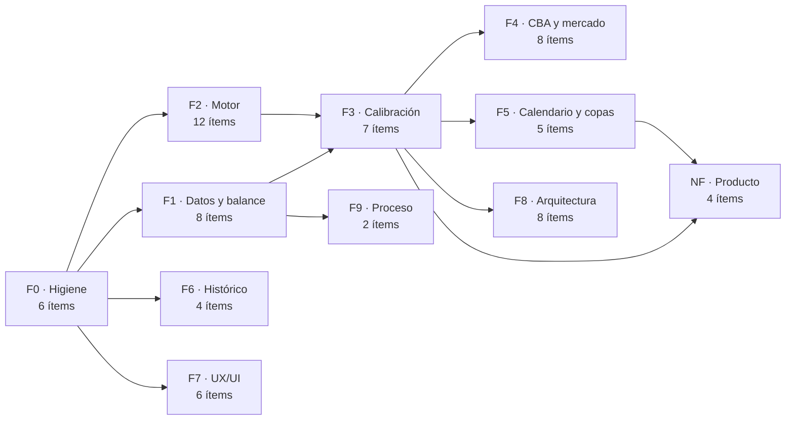

# MEJORAS — Plan de acción derivado de la auditoría 2026-10-23

> **Documento de trabajo vivo.** Cada mejora es una casilla marcable. Se marca `[x]` al terminar y se anota fecha + commit en la **§12 Bitácora**.
> **Origen:** `Docs/AUDITORIA_2026-10-23.md` (commit auditado `e76bf723`).
> **Fecha de creación:** 23 de octubre de 2026.
> **Criterio de orden:** primero lo que hace *verdadero* el juego (datos e invariantes), después lo que lo hace *medible* (calibración), después lo que lo hace *más profundo* (reglas, competiciones, features) y por último lo que lo hace *mantenible* (arquitectura, UI, proceso).

---

## 0. Cómo usar este documento

1. **No se salta el orden de fases salvo lo indicado como paralelizable.** La Fase 3 (calibración) sobre un motor con las posesiones rotas (Fase 2) produce números que parecen buenos y no lo son.
2. Cada ítem tiene: **ref. auditoría**, **esfuerzo** (S < 1 día · M 1–5 días · L 1–3 semanas · XL > 3 semanas), **criterio de hecho** verificable y **punto de partida** en el código.
3. Un ítem solo se marca `[x]` si su criterio se cumple **y** está cubierto por un test o por una comprobación reproducible. "Funciona en mi máquina" no es un criterio.
4. Las fases tienen **puerta de salida**: si no se cumple, no se pasa a la siguiente.
5. Los ítems marcados `[!]` son **decisiones de diseño pendientes** (§11): no son código, son una respuesta que hay que escribir antes de tocar nada.

### Tablero de progreso

| Fase | Contenido | Ítems | Hechos |
|---|---|---:|---:|
| **0** | Higiene y quick wins | 6 | 6 |
| **1** | Datos y balance del seed | 8 | 8 |
| **2** | Motor de simulación | 12 | 10 |
| **3** | Calibración y reproducibilidad | 7 | 5 |
| **4** | Mercado, CBA y economía | 8 | 0 |
| **5** | Calendario y competiciones | 5 | 0 |
| **6** | Histórico y estadísticas | 4 | 0 |
| **7** | UX/UI, resoluciones e idioma | 6 | 0 |
| **8** | Arquitectura y rendimiento | 8 | 0 |
| **9** | Proceso y documentación | 2 | 0 |
| **NF** | Apuestas de producto (sin fecha) | 4 | 0 |
| | **TOTAL** | **70** | **29** |

### Grafo de dependencias

---

## 1. Fase 0 — Higiene y quick wins

**Objetivo:** dejar de generar datos incorrectos y poder medir el estado real sin depender de abrir el juego.
**Por qué primero:** los seis ítems son baratos y desbloquean la verificación de todo lo demás. Sin el auditor de seed (F0-01) la Fase 1 se hace a ciegas; sin la fórmula única (F0-04) cada nueva operación puede volver a introducir la discrepancia.

- [x] **F0-01 · Auditor de seed de solo lectura (test EditMode)**
  - *Ref:* `DB-04` · *Esfuerzo:* S · *Depende:* —
  - *Criterio:* un test recorre todo el seed y falla con informe si hay IDs duplicados, atributos fuera de `[1,99]`, OV distinto del recalculado, `potential < overall`, plantillas fuera de rango, salarios por debajo del mínimo o abreviaturas de equipo desconocidas.
  - *Punto de partida:* `DatabaseManager.Seeding.cs`; patrón de test en `Tests/Editor/SaveSlotInitTests.cs`.
  - *Hecho (2026-10-23):* `Tests/Editor/SeedAuditorTests.cs` — siembra una partida temporal y audita equipos, jugadores y prospectos con reglas de error y avisos catalogados. La primera ejecución reprodujo los hallazgos manuales (235 OV, 86 atributos bajos, 3 plantillas fuera de rango) y **destapó el bug de G-League** (ver F0-04). F0-04 elevó OVR incoherente a error; el tamaño de roster permanece como aviso conocido mientras el usuario edita manualmente el seed (F1-02). El total de casos actual se obtiene con `python3 Tools/project_status.py`.

- [x] **F0-02 · Test diagnóstico de invariantes de calendario (solo reporta)**
  - *Ref:* `CAL-02` · *Esfuerzo:* S · *Depende:* —
  - *Criterio:* un test genera calendario para una temporada sintética y publica en el fallo: partidos totales, partidos por equipo, localías por equipo y parejas faltantes. En esta fase **no** se arregla el generador (eso es F5-01/F5-02); sirve de línea base reproducible.
  - *Punto de partida:* `ScheduleGenerator.cs:10`; `Tests/Editor/CalendarHelperTests.cs`.
  - *Hecho (2026-10-23):* `Tests/Editor/ScheduleGeneratorDiagnosticTests.cs` genera una temporada 2026-27 en slot temporal con semilla fija y restaura `UnityEngine.Random.state`. Informe: **1.230/1.230** partidos, **82 por equipo**, 435/435 cruces completos; pero la localía está muy sesgada (**27–55** por equipo, solo 5 equipos en 41/41). Se deja como línea base para F5-01/F5-02; no se toca `ScheduleGenerator`. Suite EditMode: **373/373**.

- [x] **F0-03 · Corregir el margen salarial duplicado de `TradeHelper`**
  - *Ref:* `ECO-02` · *Esfuerzo:* S · *Depende:* —
  - *Criterio:* el límite del 110% se define una sola vez; existen tests justo por debajo, igual y por encima del umbral en las tres ramas (por encima del 2º apron, entre 1º y 2º, por debajo del 1º) y el texto de error coincide con el número aplicado.
  - *Punto de partida:* `TradeHelper.cs:59–76`; `Tests/Editor/TradeHelperTests.cs`.
  - *Hecho (2026-10-23):* `TradeHelper.GetMaxIncomingSalary` es la fuente única para el límite y su mensaje. Se eliminó el +$250K extra por debajo del primer apron y el buffer del tramo 110% (los docs CBA describen 110% exacto); el mensaje ahora indica el máximo aplicado. Tests bajo/igual/sobre los tres niveles y tests de los dos cortes de salario. Suite EditMode: **372/372**.

- [x] **F0-04 · Una sola fórmula de `overall`**
  - *Ref:* `ROST-01` · *Esfuerzo:* S · *Depende:* —
  - *Criterio:* existe una única función (p. ej. `PlayerData.CalculateOverall(attrs, potential)`) usada por seeder, draft, editor, migraciones y tests; desaparece la división entera manual; un test verifica que los 606 registros del seed dan el mismo OV antes y después.
  - *Punto de partida:* `DatabaseManager.Seeding.cs:26–27` vs `PlayerData.cs:71–85`.
  - [!] **Hallazgo nuevo del auditor (2026-10-23):** `GLeagueSeeder.cs:94–96` calcula `Mathf.Min(potential, sumaAtributos) / 11`, es decir **`potential / 11`** (la suma nunca es menor que el potencial). Los **360** prospectos de la G-League tienen `overall` 5–7 en vez de ~48–59 hasta que un `RecalculateOverall` los arregla en el primer día de desarrollo. Entra en el alcance de F0-04, y al cerrarlo hay que subir `PLAYER-OVR` y `GLEAGUE-OVR` de aviso a **error** en `SeedAuditorTests.KnownWarnings`.
  - *Hecho (2026-10-23):* `Scripts/Data/PlayerRating.cs` (`FromSum`/`FromAttributes`) es la única implementación; `PlayerData` y `GLeaguePlayerData` delegan en ella, igual que el seed de jugadores y agentes libres, el seed de G-League y las migraciones `overall_recalc`/`gleague_overall_recalc` (esta última nueva, repara las partidas viejas). 235 OV del seed y los 360 de G-League corregidos; `Tests/Editor/PlayerRatingTests.cs` (6 casos) fija la fórmula y que ambos modelos coincidan. `PLAYER-OVR` y `GLEAGUE-OVR` pasan de aviso a **error** en el auditor: al cerrar F0-04 el informe tenía **0 errores · 103 avisos**. Suite EditMode de ese punto: **368/368**.

- [x] **F0-05 · Fuente canónica de versión, rama y conteos**
  - *Ref:* `ARC-04` · *Esfuerzo:* S · *Depende:* —
  - *Criterio:* un único sitio declara HEAD, rama, número de tests y número de pantallas; `AGENTS.md`, `PROJECT_OVERVIEW.md`, `AUDITORIA_FINAL.md` y `MEMORY.md` dejan de contradecirse o remiten a esa fuente.
  - *Punto de partida:* `AGENTS.md:6`, `Docs/PROJECT_OVERVIEW.md:5`, `Docs/AUDITORIA_FINAL.md:7–10, 44–53`.
  - *Hecho (2026-10-23):* `Tools/project_status.py` deriva rama/HEAD y versiones del producto/editor desde Git y sus archivos fuente; cuenta casos EditMode (`[Test]`, `[TestCase]`, `[UnityTest]`) y pantallas `GameScreen`, y valida el registro contra los `UIDocument` y los `case` de `ScreenManager.GoTo`. Falla ante `[TestCaseSource]` no soportado o desincronización de pantallas. `Docs/PROJECT_STATUS.md` explica el comando. `AGENTS.md`, `PROJECT_OVERVIEW.md`, `AUDITORIA_FINAL.md`, `.agent/MEMORY.md` y documentos de arquitectura remiten a la fuente; cifras en auditorías fechadas quedan identificadas como snapshots históricos.

- [x] **F0-06 · Inventario de licencias y atribuciones**
  - *Ref:* `PERF-04` · *Esfuerzo:* S · *Depende:* —
  - *Criterio:* existe un manifiesto con, por cada asset de terceros (fuentes, fotos, escudos, pabellones, audio, librerías: `sqlite-net`, `StandaloneFileBrowser`, TMP), origen, licencia y atribución. No es asesoramiento legal: es trazabilidad.
  - *Punto de partida:* `Assets/StandaloneFileBrowser/LICENSE.txt` es el único manifiesto actual; el resto no está documentado.
  - *Hecho (2026-10-23):* `Docs/THIRD_PARTY_ASSETS.md` inventaría dependencias, fuentes y grupos de arte; separa licencia local/upstream verificada de procedencia desconocida. Registra MIT (`StandaloneFileBrowser`, `sqlite-net`), dominio público SQLite, Unity Companion License/TMP, OFL (Liberation Sans, Barlow, Saira) y los avisos EmojiOne. **No se presenta como clearance legal:** photos, logos, jerseys, arenas, audio, Kindergarten y `Ookii.Dialogs.dll` quedan `Pendiente`; indica evidencia requerida y bloqueo de distribución hasta resolver/reemplazar. El manifiesto está enlazado desde `AGENTS.md`.

**Puerta de salida F0:** los 6 ítems cerrados y una ejecución de EditMode en verde con el auditor de seed incluido.

---

## 2. Fase 1 — Datos y balance del seed

**Objetivo:** que el estado inicial de una partida cumpla las reglas que el propio juego declara.
**Por qué ahora:** cualquier calibración de la Fase 3 se hace sobre estas plantillas. Normalizar después invalida todas las medidas tomadas antes.

- [x] **F1-01 · Definir la media descriptiva del equipo (sin objetivo fijo de 85)**
  - *Ref:* `ROST-02` · *Esfuerzo:* S · *Depende:* —
  - *Definición acordada por producto:* la media del equipo es la media aritmética de los `overall` de sus jugadores; cada `overall` es la media redondeada de los 11 atributos, capada por `potential` (`PlayerRating`). Para la métrica de roster se consideran todos los jugadores con `team_id` del equipo (`GetPlayersByTeam`), no solo el quinteto ni una lista fija de 15. Las pantallas pueden redondear la media para mostrarla.
  - **No hay un objetivo/regla de que cada equipo deba llegar a 85.** El valor 85 de la auditoría era una premisa incorrecta; el rango medido es descriptivo, no un incumplimiento ni una orden de normalizar a todos los equipos.
  - *Hecho (2026-10-23):* decisión registrada en `.agent/MEMORY.md` y reflejada en `Docs/AUDITORIA_2026-10-23.md`. F1-02/F1-03 deben mantener esta definición y no aplicar un suelo universal de media 85.

- [x] **F1-02 · Composición de plantillas: el seed como fuente canónica**
  - *Ref:* `ROST-03` · *Esfuerzo:* M · *Depende:* F1-01, F0-04
  - *Decisión:* `DatabaseManager.Seeding.cs` es la fuente canónica y la mantiene el usuario a mano. **14–17 es la referencia de juego** (`TradeHelper.MAX_ROSTER` = 17; mínimo jugable 12), **no una validación del auditor**: el tamaño de plantilla se publica como dato (`RosterOutOfRange`), nunca como hallazgo ni error. Los límites two-way siguen en `TradeHelper.MAX_TWO_WAY` y sí son error. El repo no tiene ninguna fuente externa de plantillas, así que el auditor solo puede validar consistencia interna (ids, nombres, `overall`, salario, posición), no pertenencia a equipo.
  - *Hecho (2026-10-23):* el auditor separa estándar/two-way, excluye IR del conteo activo y publica el desglose por equipo. `ROSTER-SIZE` ya no es hallazgo y sale de `KnownWarnings`; `PlantillaCorta_SeInformaSinAviso` y `PlantillaEnRango_NoSeInforma` fijan el comportamiento con datos sintéticos, así que **no se rompen** cuando el usuario edite las plantillas.
  - *Estado del seed:* 479 asignados + 129 FA = 608; **27 de 30 equipos en 14–17**; quedan ATL 18, DEN 18 y PRT 13. Ajuste manual opcional del usuario (2 fuera, 1 dentro); no bloquea el plan. Efecto de juego: con 18 activos el equipo no puede fichar ni recibir traspasos hasta bajar a 17; con 13 el margen de lesiones y de asignación a G-League (mínimo 12 activos) queda muy justo.
  - *Verificación (2026-10-23):* **EditMode 383/383**; auditor **0 errores · 14 avisos** (solo `PLAYER-SALARY-FLOOR`, F1-04) y `Plantillas fuera de 14-17: 3` como dato informativo.

- [x] **F1-03 · Revisar distribución de OVR y estrellas de los 30 equipos**
  - *Ref:* `ROST-02` · *Esfuerzo:* L · *Depende:* F1-01, F1-02, F0-04
  - *Decisión:* las medias del roster son **descriptivas**; no hay objetivo común ni regla de máximo de estrellas por franquicia. Un jugador tiene rol Estrella desde OVR 90 (`PlayerRoleRules.FromOverall`), pero cada jugador se evalúa individualmente y se permiten varias estrellas en un mismo equipo. No se modifica ningún OVR ni se reasigna ningún jugador.
  - *Medición del seed actual (30 equipos, 479 jugadores asignados):* media de equipo entre **72,38 y 83,36** (rango 10,98 puntos); media simple de las 30 medias **76,83**. Hay **18 jugadores con OVR ≥90**; NYK y PHI tienen 2, OKC tiene 3. **21 equipos** tienen al menos dos jugadores con OVR ≥85; ese umbral es usado por la clasificación estratégica de la IA, no es un límite.
  - *Conclusión:* no se encontró una regla explícita que incumpla el seed. Las diferencias de calidad y la concentración de estrellas quedan aceptadas como diseño; no normalizar a 85 ni imponer unicidad. ROST-02 queda resuelto como decisión de diseño. Verificado sobre los OVR canónicos derivados de atributos, no sobre el parámetro `ovr` redundante del helper `Add`.

- [x] **F1-04 · Revisar contratos fuera de rango**
  - *Ref:* `ECO-07` · *Esfuerzo:* M · *Depende:* F1-02
  - *Criterio:* salarios inferiores al mínimo interno de $2M deben ser rookie/two-way explícitos o corregirse; Embiid debe coincidir con su cap hit 2026-27, registrar el año/estructura y documentar la base legal del máximo; la nómina seed de Houston debe quedar bajo el segundo apron del juego y se compara también con el umbral NBA 2026-27.
  - *Punto de partida:* 14 registros por debajo de $2M (8 asignados + 6 FA), todos sin marca rookie/two-way; HOU $274,4M frente al apron del juego de $241,686M; Embiid $65M × 5 años, sin año de firma.
  - *Hecho (2026-10-23):* los 14 salarios subieron al mínimo interno de $2M (+$10,9M agregados). El auditor convierte futuras excepciones no-rookie/no-two-way en ERROR, valida opciones/garantías y no deja avisos catalogados.
  - *Contratos reales 2026-27, por decisión del usuario:* se actualizaron 13 salarios/cap hits de Houston desde Spotrac (Durant, Smart, Şengün, Thompson, VanVleet, Smith Jr., Eason, Sheppard, Bogdanović, Capela, Adams, Tate y Thornton). Se actualizaron también años/opciones donde constan. El payroll del HOU seed queda en **$207,164,502**: $34,521,498 bajo el apron interno ($241,686,000) y $14,521,498 bajo el apron NBA 2026-27 ($221,686,000). No se movió ningún jugador.
  - *Embiid:* Joel firmó una extensión máxima de 3 años el 20-09-2024, con PO en 2028-29. Para 2026-27, cap hit **$57,985,752** (3 años restantes, 2 garantizados + PO), el 105% de su salario 2025-26 de $55,224,526; supera el 35% del cap 2026-27 ($57,736,350) y constituye el máximo aplicable. Se corrigió el seed desde $65M/5 años. La suma de cap hits de los tres años es $187,873,836.
  - *Límite de verificación:* Aaron Holiday, Jeff Green y Tristen Newton siguen con sus entradas/salarios originales porque no constan con contrato activo 2026-27 en la fuente de Houston; se conserva el seed manual y no se reasignan. Por tanto $207,164,502 es payroll de las entradas seed, no una copia exacta del roster NBA (Spotrac reporta $200,413,923 de active roster). La base de datos solo tiene un campo `salary`; para las excepciones de mínimo de Bogdanović/Tate se guarda el cap hit, no la base cash. El juego mantiene sus topes internos (no se normalizan en F1-04); los valores oficiales 2026-27 se registran para comparación.
  - *Fuentes:* [NBA: topes 2026-27](https://www.nba.com/news/nba-salary-cap-2026-27-season); [NBA: extensión de Embiid](https://www.nba.com/news/philadelphia-76ers-sign-joel-embiid-to-multi-year-contract-extension); [Spotrac: cap table Houston 2026-27](https://www.spotrac.com/nba/houston-rockets/cap/_/year/2026); [Spotrac: Embiid](https://www.spotrac.com/nba/player/_/id/15355/joel-embiid).
  - *Verificación:* EditMode **386/386**; auditor del seed **0 errores · 0 avisos**. Tests fijan el contrato de Embiid y que HOU quede bajo ambos aprons.

- [x] **F1-05 · Definir escala de atributos y validarla**
  - *Ref:* `ROST-04` · *Esfuerzo:* M · *Depende:* F0-01
  - *Decisión:* rango legal universal **1–99** para los 11 atributos, sin un mínimo adicional por posición. Un valor bajo puede ser una debilidad válida y no se eleva a 25 automáticamente.
  - *Reglas distintas, no contradictorias:* `PlayerAttributeScale` centraliza el rango legal; **30** es suelo de generación de perfiles de draft/G-League y **25** es suelo de estimación/revelado de scouting. No son mínimos legales del jugador.
  - *Decisión:* los 86 valores `<25` se conservan; **83 son blocks, 2 three_point y 1 steals**. Son válidos dentro de 1–99 y se muestran como información, no como aviso de defecto. Los suelos 30 (generación) y 25 (scouting) quedan separados del mínimo legal.
  - *Hecho (2026-10-23):* `PlayerAttributeScale` centraliza rango legal y límites de proceso; editor/progresión/draft/G-League/scouting los aplican correctamente. El desarrollo G-League ya no salta un atributo bajo directamente a 30. `PlayerAttributeScaleTests` y regresión de G-League incluidos. **EditMode: 381/381; auditor: 0 errores · 17 avisos** (en ese momento aún incluía los 3 de roster de F1-02).

- [x] **F1-06 · Validador de plantilla antes de clonar el template**
  - *Ref:* `ROST-03`, `ECO-05` · *Esfuerzo:* M · *Depende:* F1-02
  - *Criterio original cumplido:* un template recién sembrado o un slot nuevo con hallazgos ERROR no se publica/no arranca, y el rollback impide dejar un clon parcial. Los desvíos informativos (tamaño roster y atributos legales <25) no bloquean.
  - *Implementación:* `SeedAudit` pasó de `Tests/Editor` a `Scripts/Data`; valida el template construido, lo clonado y el slot completo. La recuperación automática de templates preexistentes obsoletos/corruptos se añadió en F1-08.
  - *Pruebas de origen:* el reporte sintético con ERROR y el rollback del slot inválido; las antiguas pruebas que esperaban rechazar el template se reemplazaron por pruebas de reconstrucción en F1-08. **EditMode al cerrar F1-06: 389/389**.

- [x] **F1-07 · Coherencia entre seed y documentación de datos**
  - *Ref:* `DB-04`, `ARC-04` · *Esfuerzo:* S · *Depende:* F1-02
  - *Criterio cumplido:* `DATA_MODEL.md` y `GAMEPLAY.md` reflejan conteos y roles del seed actual; los encabezados por franquicia coinciden con sus llamadas `Add`; no quedan cifras actuales contradictorias en docs ni en código. Los snapshots históricos de la auditoría se identifican como tales.
  - *Correcciones:* `SeedPlayers` tiene **480** llamadas `Add` (479 asignados + 1 agente libre, John Konchar); `SeedFreeAgents` tiene **128** `AddFA`; total **608** (479 asignados + 129 FA). Distribución de equipo: 13–18; 27/30 entre 14–17. Se corrigieron encabezados DET 16, PHX 17, PRT (no POR) 13, SAC 15 y SAS 16; umbrales de rol, fórmula `overall` y progresión rookie; se sustituyeron conteos aproximados y thresholds obsoletos en `DATA_MODEL.md`/`GAMEPLAY.md`.
  - *Criterio de mantenimiento:* esos totales son el snapshot actual, no una cuota; el seed de plantillas lo mantiene el usuario y sus cifras deberán recalcularse al editarlo. El auditor sigue mostrando el tamaño sin imponerlo.
  - *Verificación:* script de conteo confirma que todos los encabezados de equipo coinciden; auditor **0 errores · 0 avisos**; EditMode **389/389**.

- [x] **F1-08 · Recuperar templates obsoletos y resumir errores de alta**
  - *Ref:* `DB-04`, `ECO-05`, `SAV-02` · *Esfuerzo:* M · *Depende:* F1-06
  - *Criterio cumplido:* un template sin huella, con huella antigua o que falle auditoría se reconstruye desde el seed antes de crear el archivo del slot; el temporal solo se publica tras validar y el template previo queda como `.bak`. Los errores del seed recién generado siguen bloqueando. La G-League no bloquea la validación del template porque no se clona; se siembra en cada slot.
  - *Implementación:* `db_meta.seed_fingerprint` usa SHA-256 estable de `teams`, `players` y `league_settings`; `SeedBaseline.Fingerprint` tiene una prueba contra un seed limpio. `InitSaveSlot` asegura el template antes de abrir la DB del slot. `overall_recalc_v2` repara saves antiguas. El modal muestra un resumen con errores por regla y dos ejemplos; la consola conserva el informe completo.
  - *Corrección (2026-10-24):* la huella se comprobaba antes de auditar y **bloqueaba** la construcción, así que cualquier edición del seed impedía crear partidas y abrir el Editor. Ahora el orden es sembrar → auditar → sellar → publicar; una huella distinta solo avisa con el hash nuevo y reconstruye. El reset del Editor (`RebuildTemplateDb`) construye en `.tmp` y publica con backup + replace atómico, sin borrar el template anterior. El test de EditMode sigue exigiendo actualizar la constante tras revisar el seed.
  - *Pruebas:* huella, template sin sello, sello antiguo, inválido, reconstrucción previa al slot y del reset, G-League excluida, edición válida preservada y migración v2. **EditMode: 396/396**.

**Puerta de salida F1:** auditor de seed en verde sobre los datos nuevos, template con huella vigente y una partida nueva creada desde cero sin errores del validador.

---

## 3. Fase 2 — Motor de simulación

**Objetivo:** que el marcador sea la consecuencia de la secuencia de posesiones y de los atributos, no de estadísticas añadidas después.
**Por qué ahora:** es la deuda funcional más visible. Añadir contenido (Fase 5) o calibrar (Fase 3) antes de esto multiplica el trabajo.

- [x] **F2-01 · Un rebote ofensivo conserva la posesión**
  - *Ref:* `SIM-01` · *Esfuerzo:* L · *Depende:* —
  - *Criterio:* tras un OREB el mismo equipo vuelve a atacar dentro de la misma posesión; tras un rebote defensivo cambia el balón. Test determinista: fallo → OREB → nuevo lanzamiento del mismo equipo. El contador de posesiones distingue posesión y *possession used*.
  - *Punto de partida:* `GameSimulator.cs:847–854` termina la posesión sin cambiar el atacante.
  - *Implementación:* `PossessionOutcome.offensiveRebound` lo fija `DoReb` (rebote ofensivo) y `RunPossessionChain` repite el ataque del **mismo** equipo hasta `MAX_ATTACKS_PER_POSSESSION` (4). `PlayPossession` centraliza la posesión (puntos, play-by-play, minutos de la ventana una sola vez) y el bucle de `SimQuarter`/`SimOvertime` alterna el balón tras cada posesión (la apertura de cada periodo la fija desde F2-02 `PossessionState.BeginPeriod`, sin moneda). `PossessionTally` separa posesiones (alternancia) de ataques (*possession used*) y `GameResult.possessions` lo expone como diagnóstico (no se persiste).
  - *Pruebas:* `GameSimulatorTests` (`RunPossessionChain` OREB/DREB/tope, contadores por partido y `PTS = 2·FG2M + 3·FG3M + FT`). Medición con 30 partidos y plantillas homogéneas: 102,2 posesiones por equipo, 105,6 ataques, 113,6 puntos, 6,8 segundas oportunidades.

- [x] **F2-02 · Modelo explícito de alternancia de posesiones**
  - *Ref:* `SIM-02` · *Esfuerzo:* L · *Depende:* F2-01
  - *Criterio:* el atacante se decide por regla (cambio tras tiro anotado, rebote defensivo o pérdida; continúa tras OREB), no por moneda; la diferencia de posesiones entre equipos queda en un margen acotado y testeado; existen tests de distribución de posesiones y puntos por partido.
  - *Punto de partida:* `GameSimulator.cs:713–744` (`Random.value < 0.5f` por evento).
  - *Implementación:* `PossessionState` (clase pública dentro de `GameSimulator`) sustituye a la moneda: `BeginPeriod(n)` da el saque al equipo que no abrió el periodo anterior (Q1 local, Q2 visitante, Q3 local, Q4 visitante, prórrogas alternando) y `NextPossession()` cambia el balón al cerrar cada posesión; el rebote ofensivo no cambia de dueño porque lo resuelve `RunPossessionChain`. `SimulateGame` crea un único estado para todo el partido y lo pasa a `SimQuarter`/`SimOvertime`, que lo siembran con su número de periodo (`BeginPeriod(qNum)`) y acumulan en su `PossessionTally`. Ya no queda ninguna tirada de azar en el bucle de posesiones.
  - *Pruebas:* `GameSimulatorTests` +5 tests → `PossessionState_BeginPeriod_AlternatesTheTipOff`, `PossessionState_NextPossession_HandsTheBallToTheOtherTeam`, `SimulateGame_PossessionsAreBalanced_BetweenBothTeams` (10 partidos, diferencia ≤ 1), `SimulateGame_PointsPerPossession_StaysInRange` (30 partidos) y `SimulateGame_SecondChanceAttacks_DoNotExceedOffensiveRebounds`. Medición con 30 partidos y plantillas homogéneas: 203,9 posesiones por partido (diferencia máxima 0), 1,127 puntos por posesión (6891 pts / 6116 pos → 114,9 puntos por equipo).

- [x] **F2-03 · Tiros libres, faltas de equipo y expulsión**
  - *Ref:* `SIM-04` · *Esfuerzo:* L · *Depende:* F2-01
  - *Criterio:* el último FT fallado genera rebote vivo; existe bonus de faltas de equipo; seis faltas expulsan y fuerzan sustitución; FTA/PF por equipo entran en el rango objetivo de la Fase 3.
  - *Punto de partida:* `GameSimulator.cs:797–844`, `DoFoul` `:1035–1042`.
  - *Implementación:* `FoulState` (faltas de equipo por periodo, reinicio en `BeginPeriod`) + `DefenseFouls.RegisterFoul()` (cuenta la falta del que defiende y dice si deja al rival en bonus). Umbral la 4.ª falta de equipo del periodo y la 2.ª en los últimos dos minutos del 4.º cuarto y de las prórrogas (`IsClutch`). Nueva falta sin tiro en la penetración (`ReachInFoulChance` = 5 % + delta del plan defensivo): en bonus son 2 tiros libres y, si no, el ataque continúa sin consumir una posesión extra. Los libres se tiran en un único punto (`ShootFreeThrows`) y el último fallado deja el balón vivo (`AttachLiveRebound` → `DoReb`, con segunda oportunidad si es ofensivo). `DoFoul` reparte por posición con amortiguación por faltas acumuladas y `EjectFouledOut` expulsa al sexto foul metiendo al mejor suplente (encaje posicional, minutos pendientes, OVR); `PickSubstitution` ya no puede reinsertar a un expulsado.
  - *Pruebas:* 10 tests nuevos → `DefenseFouls_GivesFreeThrowsFromTheFourthTeamFoul`, `DefenseFouls_InClutchTheBonusArrivesOnTheSecondFoul`, `FoulState_TeamFouls_ResetEveryPeriod`, `IsClutch_CoversTheLastTwoMinutesOfTheFourthAndOvertime`, `ShootFreeThrows_LastMissLeavesTheBallLive`, `ShootFreeThrows_ThreeShots_NeverLeaveTheBallLiveIfAllGoIn`, `EjectFouledOut_SixFoulsBringTheBestBenchReplacement`, `EjectFouledOut_WithoutBench_LeavesTheTeamWithFour`, `FoulWeight_PrefersInteriorsAndDiscouragesFoulTrouble` y `SimulateGame_NobodyExceedsSixPersonalFouls`. Medición con 10 partidos y plantillas homogéneas: **40 TL intentados y 26 faltas personales por partido**, y 1 expulsión por cada ~10 partidos.

- [x] **F2-04 · Dar efecto a los cuatro atributos ignorados**
  - *Ref:* `SIM-03` · *Esfuerzo:* L · *Depende:* F2-02
  - *Criterio:* `speed`, `dribbling`, `athleticism` e `iq` se copian al snapshot y tienen un efecto declarado y testeado (transición, pérdidas, finalización/rebote, selección de tiro). Tests de sensibilidad: subir 10 puntos en un atributo mueve la métrica asociada en la dirección esperada.
  - *Punto de partida:* `GameSimulator.cs:8–26` y `InitPS:345–366` no los incluyen.
  - *Implementación:* los cuatro atributos entran en `PlayerStatSnapshot` y en `InitPS`. `speed` → ritmo (`SpeedPaceDelta` = `(velocidad media − 70) × 0,15` posesiones, sumado a `pace`). `dribbling` → pérdidas (`BallSecurity` = bote medio de los manejadores PG/SG/SF en pista; `TurnoverChance` resta `(bote − 70) × 0,0015` y acota 0,02–0,30). `athleticism` → finalización (`FinishingBonus` = `(atl − 70) × 0,0018` al TC de dos) y rebote (`ReboundAthleticismFactor` = `clamp(1 + (atl − 70) × 0,004, 0,7; 1,4)` en `ReboundWeight`). `iq` → selección de tiro (término `(three_point − shooting) × 0,0015 × iq/100` en `ShotType`, que pasa a ser público para testear). Todos los efectos están acotados para que ningún valor 1–99 salga de rango.
  - *Pruebas:* 9 tests nuevos → `SpeedPaceDelta_MovesTheTempo`, `SimulateGame_FasterTeams_PlayMorePossessions`, `TurnoverChance_DropsWithBallHandling`, `BallSecurity_UsesTheBallHandlers`, `SimulateGame_GoodBallHandling_LosesFewerTurnovers`, `Athleticism_ImprovesFinishingAndReboundWeight`, `SimulateGame_MoreAthleticism_FinishesBetterAtTheRim`, `ShotType_HighIqShootsMoreFromHisStrength` y `SimulateGame_SmartTeams_TakeTheShotThatSuitsThem`. Medición (plantillas homogéneas): velocidad 90 → **104,9** posesiones vs 45 → **98,4**; bote 95 → **7,1** pérdidas vs 45 → **15,5**; atletismo 95 → **55,9 %** TC2 vs 40 → **52,4 %**; IQ 95 → **44,1** triples intentados vs IQ 20 → **38,3**.

- [x] **F2-05 · Eliminar los pisos artificiales de estadísticas**
  - *Ref:* `SIM-07` · *Esfuerzo:* M · *Depende:* F2-01, F2-02
  - *Criterio:* desaparecen los mínimos forzados de asistencias/rebotes/robos/tapones; el box score de un jugador es la suma de sus acciones. La distribución se valida en F3 sin pisos.
  - *Punto de partida:* `GameSimulator.cs:213–245`.
  - *Implementación:* se elimina el bloque posterior a la simulación que reescribía el box score de los élites (`passing ≥ 95` → asistencias, `rebounding ≥ 95` → rebotes, `steals ≥ 90` → robos, `blocks ≥ 95` → tapones, todos para ≥ 20 minutos). El box score queda como la suma exacta de las acciones del partido y el `rating`/dobles-dobles se calculan ya sobre esas cifras. Las cuatro métricas se sostienen solas porque el motor solo las produce dentro de una jugada real (asistencia solo en canasta, tapón solo en fallo, robo solo en la mitad de las pérdidas, rebote solo de un fallo). Se documentó el 55 % de canastas asistidas como única fuente de asistencias.
  - *Pruebas:* 2 tests nuevos → `SimulateGame_NoStatisticIsRaisedToAnEliteFloor` (plantillas con atributos elite; docenas de jugadores-partido quedan por debajo del antiguo mínimo en las cuatro métricas) y `SimulateGame_BoxScoreOnlyCountsRealActions` (asistencias ≤ canastas, tapones ≤ fallos rivales, robos ≤ pérdidas rivales, rebotes ≤ fallos + libres fallados). **EditMode 427/427**. Medición del impacto en 20 partidos: 177 jugadores-partido por debajo del antiguo suelo de asistencias, 127 de rebotes, 163 de robos y 61 de tapones.

- [x] **F2-06 · Resolver la plantilla corta sin marcador sintético**
  - *Ref:* `SIM-05` · *Esfuerzo:* M · *Depende:* —
  - *Criterio:* con menos de cinco sanos no se inventa un 105–125/100–120: se fuerza una alineación válida (con aviso al jugador) o se simula con los disponibles generando box score coherente. Nunca se persiste un partido sin estadísticas.
  - *Punto de partida:* `GameSimulator.cs:90–117`.
  - *Implementación:* se elimina el corte con marcador aleatorio. Con **1–4 sanos** el partido se simula con los disponibles (quinteto, sustituciones y box score reales) y `GameResult.shortRoster` lo marca. Solo si un equipo no tiene **ningún** jugador sano se resuelve por **incomparecencia 0–20** (regla NBA) con `GameResult.walkover = true` y sin estadísticas de jugador; si ninguno se presenta, gana el local 20–0. `DashboardController.NotifyShortRoster` avisa al jugador con un `MessageData` (`NewsType.PLANTILLA_CORTA`, categoría CLUB, icono de enfermería) cuando la plantilla corta afecta a su equipo; el All-Star queda excluido. `shortRoster` viaja también en el resultado normal.
  - *Pruebas:* `SimulateGame_ShortRoster_NeverEndsInTie` reescrito (1 jugador por equipo, 100 partidos: se simula de verdad, nunca empata, el marcador suma los puntos individuales), `SimulateGame_ShortRoster_ProducesRealBoxScore` (3 vs 4: tiros y minutos reales), `SimulateGame_NoHealthyPlayers_IsAForfeit` (0 sanos → 0–20 sin stats; todos lesionados → 20–0) y `SimulateGame_FullRosters_AreNotFlaggedAsShort`. **EditMode 430/430**. Medición: 3 vs 4 jugadores da 117–125 de media y el marcador siempre cuadra con el desglose de tiros.

- [x] **F2-07 · Riesgo de lesión proporcional a la exposición**
  - *Ref:* `SIM-06` · *Esfuerzo:* M · *Depende:* F2-05
  - *Criterio:* la probabilidad depende de minutos jugados, intensidad/físico y riesgo de recaída; un jugador con 0 minutos no se lesiona; se documenta si la lesión es postpartido o intra-partido y la UI lo refleja.
  - *Punto de partida:* `GameSimulator.cs:324–327, 1263–1296`.
  - *Implementación:* el riesgo deja de ser plano. `InjuryHelper.MatchRiskPerGame(minutos, físico, riesgo de recaída)` (puro) calcula la probabilidad por partido: base **0,008 a 36 minutos** de exposición y proporcional al resto (5 min ≈ 0,11 %, 20 min ≈ 0,44 %, 44 min ≈ 0,98 %), ×`1 + (30−fisico)*0.15` con `fisico < 30`, más `RelapseChancePerGame` si el jugador viene de un alta forzada, con tope 1. **0 minutos ⇒ 0** (además del corte explícito en `CheckInjuries`). El sorteo sigue siendo **postpartido** — no toca minutos ni resultado — y `NewsTexts.Lesion` lo dice ahora explícitamente («la lesión se ha detectado al término del último encuentro: el jugador lo terminó…»). Constantes `INJURY_REFERENCE_MINUTES`/`INJURY_BASE_PER_GAME` como fuente única.
  - *Pruebas:* 5 tests nuevos en `InjuryHelperTests` → 0 minutos sin riesgo, proporcionalidad (36 min = base, 18 = mitad, 5 < 20 < 36 < 44 y 40 min > 8× el riesgo de 5), físico bajo ×2,5 exacto, recaída sumada a la base y tope ≤ 1. **EditMode 435/435**. Medición: 5 min 0,111 % · 20 min 0,444 % · 36 min 0,800 % · 44 min 0,978 % por partido.

- [x] **F2-08 · Captura de play-by-play bajo demanda**
  - *Ref:* `PERF-01` · *Esfuerzo:* M · *Depende:* —
  - *Criterio:* si el modo es directo no se construyen snapshots, deltas ni narración; el flag de captura se pasa desde el llamador. Medición antes/después de un día de 15 partidos documentada.
  - *Punto de partida:* `GameSimulator.cs:137–138, 501–555`; filtrado tardío en `DashboardController.cs:1878–1879`.
  - *Implementación:* `SimulateGame` recibe `capturePlayByPlay` (default `false`). Si es `false`, `GameResult.playByPlay` es **null**, no se crean los meta-eventos y `PlayPossession` **no llama** a `CaptureBox`/`DiffBox` ni calcula deltas: solo simula la jugada. `DashboardController` pasa `game.game_type != "allstar" && UIScreenController.GetSimMode() == 1`; la G-League, la postseason y las pruebas usan el valor por defecto. El resultado, los minutos y las estadísticas son idénticos en ambos modos.
  - *Pruebas:* `SimulateGame_WithoutCapture_DoesNotBuildTheChronicle` (crónica null y marcador = suma de puntos), `SimulateGame_WithCapture_BuildsTheChronicle` (último evento «¡Fin del partido!», deltas presentes y mismo marcador) y `SimulateGame_CaptureCost_IsMeasured` (calentamiento + mejor de 3 de un día de 15 partidos). **EditMode 438/438**. Medición: **15 partidos → 15 ms en directa vs 33 ms con crónica** (~1,2 ms por partido de sobrecoste eliminado, ≈55 % del tiempo de simulación pura).

- [x] **F2-09 · Persistencia de fatiga, lesiones y stats en lote**
  - *Ref:* `PERF-02` · *Esfuerzo:* M · *Depende:* F2-08
  - *Criterio:* un partido no hace un `Update` por jugador; los cambios se acumulan y se escriben una vez, dentro de la transacción del día.
  - *Punto de partida:* `GameSimulator.cs:298–320, 1263–1294`.
  - *Implementación:* `SimulateGame` construye `playersById` con los `PlayerData` que ya recibe (sin `GetPlayerById` por jugador) y acumula en `changedPlayers` los cambios de físico y lesión; `CheckInjuries` muta ese mismo objeto y lo marca. Las filas de `player_game_stats` se acumulan en `statRows`. Al terminar, **dos** escrituras: `DatabaseManager.SavePlayerGameStatsBatch` (`InsertAll`) y `UpdatePlayersBatch` (`UpdateAll`). Ambos helpers viven en `DatabaseManager` (`Records.cs`/`Players.cs`) y usan `bool own = !_db.IsInTransaction`: dentro de la transacción del día escriben en ella y nunca anidan un `BEGIN`. Antes: ~24 `GetPlayerById` + 24 `UpdatePlayer` (físico) + 24 lecturas (lesiones) + 24 `Insert` por partido, cada uno en autocommit.
  - *Pruebas:* `BatchPersistenceTests.Batch_GuardaStatsYJugadoresEnUnaSolaEscritura` (los dos helpers persisten de verdad y funcionan dentro de una transacción ya abierta) y `EscrituraPorFila_EsMasCaraQueElLote` (medición con WAL). **EditMode 440/440**. Medición (360 filas = día de 15 partidos): **426 ms una por una vs 2 ms en lote**. Sin cambio de semántica: mismo físico, mismas lesiones, mismas estadísticas.

- [ ] **F2-10 · Ampliar el plan de partido con decisiones medibles**
  - *Ref:* `TAC-01` · *Esfuerzo:* L · *Depende:* F3-01, F3-04
  - *Criterio:* 3–5 decisiones nuevas (p. ej. cobertura del P&R, presión en transición, carga al rebote ofensivo) cada una con efecto declarado y medido; ninguna opción es decorativa.
  - *Punto de partida:* `GamePlan.cs:8–57`; consumo en `GameSimulator.cs:713–887`.

- [x] **F2-11 · Rotación estratégica para la IA**
  - *Ref:* `TAC-02` · *Esfuerzo:* M · *Depende:* F2-07
  - *Criterio:* la IA reparte minutos por rol y forma física, no solo por OVR, y respeta promesas de minutos con efecto en moral. Se compara con la rotación del usuario en el informe de calibración.
  - *Punto de partida:* `DashboardController.cs:841–886`.
  - *Implementación:* `PrepareRotationMetadata` detecta el equipo **sin minutos configurados** (toda la IA y el equipo del usuario que nunca tocó ROTACIÓN) y reparte los 240 de una vez: `GetAutomaticMinutes` da el ideal de cada jugador (promesa del rol Estrella 34 / Titular 27 / Banquillo 15 / Último 2, ±4 por nivel dentro del rol, −10/−20 % si llega cansado, +2 al titular) y `RotationPlanner.AutoAssign` lo normaliza (rotación corta de 10, suelo 2, suma exacta 240). El plan se marca `planned` y el simulador lo trata como **vinculante** (ventanas densas de cambio + `PickSubstitution`), también para la IA. `GetSuggestedMinutes` delega en la misma función, así que la columna SUGERIDO y el reparto automático de la pantalla ROTACIÓN coinciden con lo que se juega. La moral ya medía contra `target_minutes`: ahora la expectativa es una promesa calculada y no un ideal inalcanzable. La G-League (×0,75) y el All-Star (`AssignAllStarMinutes`) siguen con la heurística antigua.
  - *Pruebas:* `RotacionAutomatica_ReparteExactamenteLos240`, `RotacionAutomatica_RespetaLaPromesaDelRol`, `RotacionAutomatica_CuentaLaFormaFisica`, `RotacionAutomatica_GLeagueMantieneLaHeuristica`, `RotacionAutomatica_ElPartidoRespetaElPlan` y `RotacionAutomatica_Medicion`. **EditMode 446/446**. Medición (12 homogéneos: 1 estrella, 4 titulares, 7 banquillo; 10 partidos): antes la heurística pedía **319 min de 240** (+33 %); ahora reparte estrella **36,2**, titular **30,1**, banquillo **11,9** por jugador, con la suma del partido en 239–241. Coste ~+0,3 ms/partido (día de 15 partidos: 15 → 18-20 ms).

- [ ] **F2-12 · Especialidades de staff con efecto trazable**
  - *Ref:* `TAC-03` · *Esfuerzo:* L · *Depende:* F2-10
  - *Criterio:* cada especialidad (desarrollo, defensa, recuperación, scouting) modifica una métrica concreta y visible; el jugador puede explicar por qué su equipo mejora. Se retira el bonus genérico único.
  - *Punto de partida:* `DashboardController.cs:5300–5313`; `CoachScheme.cs`.

**Puerta de salida F2:** partido reproducible con la misma semilla (F3-01 ya implementado) y balance de acciones coherente: `PTS = 2·FG2M + 3·FG3M + FT`, `REB = OREB + DREB`, `POS` cuadra con tiros, pérdidas y rebotes.

---

## 4. Fase 3 — Calibración y reproducibilidad

**Objetivo:** poder afirmar con datos que el motor produce una NBA creíble, y demostrarlo en cada cambio.
**Por qué ahora:** es la única forma de saber si F2 mejoró algo. Sin esta fase, todo lo anterior es opinión.

- [x] **F3-01 · Fuente de aleatoriedad inyectable**
  - *Ref:* `ARC-03` · *Esfuerzo:* L · *Depende:* —
  - *Criterio:* el simulador recibe un `IRandomSource` (o equivalente); con la misma semilla y las mismas entradas el resultado es idéntico; el juego real usa la fuente de Unity, los tests una determinista.
  - *Punto de partida:* `GameSimulator.cs:95, 134`, `ScheduleGenerator.cs:34`, `DraftGenerator.cs:441`.
  - *Implementación:* `GameSimulator.SimulateGame` acepta `IRandomSource random = null`; `null` usa `UnityRandomSource` (adaptador 1:1 de `UnityEngine.Random`) y `SeededRandomSource` implementa SplitMix64 con estado local. El source se pasa explícitamente por todo el call-chain del partido: ritmo, posesiones, cambios, decisiones de tiro, anotación, faltas, rebotes, tiros libres, prórrogas, desempate e lesiones. No quedan llamadas directas a `UnityEngine.Random` en `GameSimulator`. El camino de juego mantiene el adaptador de Unity; calendario, draft y RNGs de IA en background no entran en el alcance de este ítem.
  - *Pruebas:* `SimulateGame_MismaSemillaYEntradas_ProduceElMismoResultado` compara marcador, cuartos, box score y crónica; `SeededRandomSource_RepiteLaSecuenciaIncluyendoLosRangos` cubre la secuencia y rangos del generador. **EditMode 448/448**.

- [x] **F3-02 · Banco de calibración (Monte Carlo) y laboratorio**
  - *Ref:* `ARC-03` · *Esfuerzo:* L · *Depende:* F3-01
  - *Criterio:* un runner simula N partidos/temporadas sin UI y emite un informe con media, desviación y percentiles de ritmo, puntos, FG%, 3P%, FTA, TO, AST, REB, PF, victorias y días de baja. En Editor, sin escribir en la partida del jugador.
  - *Punto de partida:* no existe; `SimulateGame(..., persistToDb:false)` es el punto de entrada.
  - *Implementación:* `MonteCarloRunner.Run(MonteCarloConfig)` crea una liga sintética en memoria (plantillas de 12 con `overall` derivado por `PlayerRating`) y calendario round-robin circular repetible; ejecuta N temporadas con `SeededRandomSource` y `persistToDb:false`. La opción `simulatePlayerStateWhenNotPersisting` permite evolucionar fatiga/lesiones en los `PlayerData` transitorios sin tocar la DB; el runner modela descanso, recuperación, disponibilidad, victorias, días-jugador y partidos-jugador perdidos. `MonteCarloReport.ToMarkdown()` resume cada métrica con N, media, desviación típica poblacional y P5/P50/P95. Menú Unity **Tactical Five → Laboratorio Monte Carlo** genera `Library/TacticalFive/MonteCarloReport.md`, fuera de los saves y del control de versiones. Los rosters y el calendario son de laboratorio, no el seed ni el generador NBA.
  - *Pruebas:* `MonteCarloRunnerTests` (métricas/unidades, semilla reproducible, validación de liga y una temporada completa de 30 equipos × 82 partidos = **1.230**). **EditMode 453/453**. Informe de humo: `Docs/MONTE_CARLO_LAB.md`; la tabla no fija todavía rangos de aceptación (F3-03/F3-04).

- [x] **F3-03 · Fijar rangos objetivo y umbrales de aceptación**
  - *Ref:* §5 de la auditoría · *Esfuerzo:* S · *Depende:* F3-02
  - *Criterio:* tabla versionada de métrica → rango aceptable → tolerancia, con fuente declarada (temporadas NBA de referencia, no "a ojo"). Un partido/una temporada fuera de rango hace fallar el test de calibración.
  - *Nota:* los rangos de la §5 de la auditoría son aproximados y deben sustituirse por una fuente citada.
  - *Implementación:* perfil iniciado como **`NBA-2024-25-v1`** en `MonteCarloCalibrationProfile`: medias de temporada 2024-25 para ritmo, PTS, FG%, 3P%, FTA, TO, AST, REB y PF; medias + P5/P50/P95 de victorias por equipo y partidos-jugador perdidos por lesión. F3-04 lo versiona a **`NBA-2024-25-v2`** para incluir percentiles equipo-temporada y bandas min–max por equipo para la ofensiva. Cada fila lleva tolerancia absoluta y fuente. Referencias: Basketball-Reference (league averages + standings) y RotoWire, basado en BBall Index (lesiones). `MonteCarloCalibrationGate.Evaluate` devuelve todos los hallazgos; `AssertAccepted` lanza si una media/cola cruza el límite; `MonteCarloReport.ToMarkdown` añade tabla y PASS/FALLO al informe. `PlayerDaysOut` calendario queda informativo: la fuente de lesiones publica partidos perdidos, por eso se añadió `PlayerGamesMissed`, comparable con man-games lost.
  - *Resultado de la línea base sintética (semilla 20261024):* **11 hallazgos** explícitos (ritmo, puntos, 3P%, pérdidas, rebotes, faltas, colas de victorias y lesiones). El baseline no se maquilla para pasar: son los objetivos que F3-04/F3-06 deben alcanzar. FTA, FG%, asistencias y media de victorias están dentro. La tolerancia es una banda de aceptación de ingeniería, no un intervalo de confianza.
  - *Pruebas:* `MonteCarloCalibrationTests` comprueba fuentes/unidades, límites inclusivos, fallo de media y fallo de cola; `AssertAccepted` se prueba lanzando para el caso fuera de rango. **EditMode 457/457**. Detalle, límites numéricos y links en `Docs/MONTE_CARLO_LAB.md`.

- [x] **F3-04 · Calibrar el juego ofensivo**
  - *Ref:* `SIM-02`, `SIM-04`, §5 · *Esfuerzo:* L · *Depende:* F3-02, F3-03, F2-01..F2-05
  - *Criterio:* puntos, FG%, 3P%, FTA, TO y AST por equipo dentro de rango en P50 y P5–P95; ningún equipo de la liga simulada queda fuera de forma sistemática por diseño del motor.
  - *Implementación:* `MonteCarloRunner` publica estadísticas agregadas por equipo-temporada y un desglose estable por equipo. `MonteCarloCalibrationGate.EvaluateOffense/AssertOffenseAccepted` verifica medias de liga, P5/P50/P95 team-season y bandas min–max por franquicia para las seis métricas ofensivas. El perfil se versiona a **`NBA-2024-25-v2`** para esos nuevos límites. Ajustes en `GameSimulator`: ritmo base 96, pérdidas base 0,147, selección de tiro posicional +5 pp, tasas/pendientes 2P/3P, asistencias 63%, FTA mediante balance entre faltas de tiro y faltas sin tiro, y rebote ofensivo (mismo exponente en defensa/ataque + factor 0,42, eliminando la penalización de ~8×). Se quita el tercer libre aleatorio en faltas de dos puntos; se comprime la respuesta de FG% a los atributos para reducir colas por OVR sin normalizar rosters del juego.
  - *Resultado:* temporada sintética reproducible de 30×82 (semilla `20261024`): 98,13 posesiones; **113,96 PTS, 45,50% FG, 35,29% 3P, 22,79 FTA, 14,70 TO y 26,16 AST** por equipo-partido. El **gate ofensivo pasa** en medias, percentiles y chequeo por equipo; también quedan dentro las medias de REB (44,29) y PF (18,13). El gate global conserva **4 hallazgos de partidos perdidos por lesión** (scope F3-06); no se ocultan ni bloquean el gate ofensivo. **EditMode 458/458**.

- [x] **F3-05 · Calibrar resultados: victorias, paridad y prórrogas**
  - *Ref:* §5 · *Esfuerzo:* M · *Depende:* F3-04
  - *Criterio:* tras 100 temporadas completas, la distribución de victorias y la correlación OV↔victorias son creíbles; la tasa de prórrogas y el reparto de la liga (récords extremos) están dentro de rango.
  - *Implementación:* gate `MonteCarloOutcomeGate` con bandas de la NBA 2024-25 — victorias medias 41,00 ±0,50; desviación típica 13,130118 ±4 (9,13–17,13); mínimo medio por temporada 8–22; máximo medio 62–75; correlación Pearson OVR↔victorias 0,60–0,98; **tasa de prórrogas 3,38–6,38 %** (60 partidos con OT de los 1.230 de la NBA). El test `Run_CienTemporadas_CalibraVictoriasParidadOVRYProrrogas` corre **100 temporadas** (123.000 partidos) y exige el gate vacío.
  - *Diagnóstico:* el motor **no producía empates**: un cuarto se juega un número fijo de posesiones y no hay modelo de reloj ni de fase final, así que la masa del histograma de márgenes era plana (~3 % por punto, margen medio 18,7 vs ~11 de la NBA) y solo el 1,7 % de los partidos acababa en empate al final del reglamento.
  - *Solución:* **fase final** en `SimQuarter` (`qNum == 4`): si al cerrar el 4.º cuarto el partido está abierto (**1–6 puntos de marcador acumulado** — no del cuarto, error que anuló la fase en la primera versión), se añaden hasta `LATE_EXTENSION_MAX_POSS` (= 3) posesiones alternando al equipo por detrás y al líder (última posesión / juego de faltas con posesión corta), cortando al **empate** (→ prórroga), a la **remontada** o al límite de margen. Sin tiros libres extra (el volumen de FT ya está calibrado en F3-04) y con el reloj del log capado en 11,98'. Además, la liga sintética del laboratorio comprime su dispersión (`MonteCarloConfig.SYNTHETIC_OVR_SPREAD` 11,0 → **8,6** con `SYNTHETIC_BASE_OVR` **73,36**, mismo OVR medio) para reproducir la paridad de la NBA; es una calibración del **banco**, no del seed ni del motor. El informe gana métricas de paridad: `GameMargin`, `CloseGameRate` e histograma de márgenes.
  - *Resultado:* semilla `20261024`, **100 temporadas**: victorias 41,00; desv. **14,02**; mín. **15,80**; máx. **67,09**; r(OVR,W) **0,928**; **OT 5,11 %** (6.286/123.000) — todas las filas del gate en verde. En el diagnóstico ofensivo de 5 temporadas, la compresión de dispersión devuelve el **gate F3-04 a ACEPTADO**: P95 de puntos por equipo-temporada 125,43 (banda ≤126,295) y máximo por equipo 126,27 (banda ≤127,9). 2 tests nuevos (fase final y gate de 100 temporadas; `[Timeout(600000)]`, corrida ~200 s). **EditMode 460/460**.

- [ ] **F3-06 · Calibrar lesiones y disponibilidad**
  - *Ref:* `SIM-06` · *Esfuerzo:* M · *Depende:* F2-07, F3-04
  - *Criterio:* partidos perdidos por lesión por equipo y temporada dentro de rango; la duración media por gravedad es coherente con `InjuryCatalog`; ningún equipo queda sin poder alinear cinco.

- [ ] **F3-07 · CI: compilación + EditMode + auditorías en cada cambio**
  - *Ref:* `PERF-03` · *Esfuerzo:* M · *Depende:* F0-01, F3-02
  - *Criterio:* un runner aislado ejecuta build, 334+ tests, auditor de seed y test de invariantes de calendario; un fallo bloquea la integración. Sin `.asmdef`, documentar la limitación o crear la separación de assemblies.

**Puerta de salida F3:** informe de calibración adjunto con las métricas de la tabla objetivo, y CI en verde ejecutando el banco de calibración reducido.

---

## 5. Fase 4 — Mercado, CBA y economía

**Objetivo:** que las reglas de plantilla y dinero sean una sola verdad, compartida por IA, usuario y validadores.
**Paralelizable con F3:** no depende de la calibración del motor.

- [ ] **F4-01 · Un único evaluador de traspasos**
  - *Ref:* `ECO-03` · *Esfuerzo:* M · *Depende:* —
  - *Criterio:* `MarketController` deja de usar `TradeHelper.EvaluateTrade` para valorar y pasa por `TradeValueHelper` (o su sucesor); la validación legal (cap, apron, cupos) queda separada de la valoración de valor. Existe un test que compara la misma oferta evaluada desde ambos lados.
  - *Punto de partida:* `MarketController.cs:1726–1734`; `TradeValueHelper` ya usado en `DashboardController` (`:6216, 6534–6609`).

- [ ] **F4-02 · Traspaso del usuario y S&T transaccionales**
  - *Ref:* `ECO-04` · *Esfuerzo:* M · *Depende:* F4-01
  - *Criterio:* contratos, hard cap, jugadores, dorsales, picks, historial y mensajes se escriben dentro de una transacción; un fallo deja el estado intacto y muestra error. En el S&T, la revalidación ocurre **después** de fijar los salarios nuevos.
  - *Punto de partida:* `MarketController.cs:2022–2057, 2074–2135, 2155–2233`.

- [ ] **F4-03 · Reescribir las restricciones de apron con casos del CBA**
  - *Ref:* `ECO-01` · *Esfuerzo:* L · *Depende:* F1-02
  - *Criterio:* cada restricción (por encima del 1º, entre 1º y 2º, 2º apron, hard cap por NT-MLE) es una regla independiente con conteo de jugadores **entrantes y salientes**; existe una tabla de casos documentada y testeada, incluyendo el caso "recibir varios jugadores" y "enviar varios".
  - *Punto de partida:* `TradeHelper.cs:47–77, 145–171`.

- [ ] **F4-04 · Separar plazas estándar y two-way**
  - *Ref:* `ECO-05` · *Esfuerzo:* M · *Depende:* F1-02
  - *Criterio:* el modelo conoce 15 plazas estándar + N two-way + IR; firmar, traspasar, volver de IR y simular respetan la separación. `GetRosterCount` deja de mezclar conceptos.
  - *Punto de partida:* `TradeHelper.cs:14–17, 126–162`; `DatabaseManager.Players.cs`.

- [ ] **F4-05 · Derechos de agente libre: RFA/UFA, cap holds y service time**
  - *Ref:* `ECO-06` · *Esfuerzo:* XL · *Depende:* F4-03, F4-04
  - *Criterio:* un jugador tiene tipo de agente libre y años de servicio; los cap holds entran en la nómina efectiva; se puede igualar una oferta a un RFA y el mercado lo entiende. Tests de cap sheet completo.
  - *Punto de partida:* `PlayerData.cs:31–37` solo tiene contrato, opciones y años.

- [ ] **F4-06 · Escala salarial de rookie por puesto de draft**
  - *Ref:* `ECO-06` · *Esfuerzo:* M · *Depende:* F4-05
  - *Criterio:* el salario de un rookie depende del número de elección y de la temporada, no de un `Random.Range` por rango; existe tabla por año y test de monotonía decreciente con el pick.
  - *Punto de partida:* `DraftGenerator.cs:439–493`.

- [ ] **F4-07 · Parametrizar el CBA por temporada**
  - *Ref:* `ECO-07` · *Esfuerzo:* L · *Depende:* F1-04
  - *Criterio:* cap, tax, aprons y MLE salen de una tabla por temporada con cifras verificadas contra fuente oficial; deja de ser +5% fijo. Incluye repeater tax si se decide modelarlo.
  - *Punto de partida:* `TradeHelper.cs:7–18`; crecimiento en `DatabaseManager.Records.cs:3531–3543`.

- [ ] **F4-08 · Mínimo salarial por experiencia**
  - *Ref:* `ECO-07`, `F1-04` · *Esfuerzo:* S · *Depende:* F4-07
  - *Criterio:* el mínimo depende de años de servicio (0, 1, 2, 3+); los 9 contratos sembrados por debajo del mínimo universal quedan justificados o corregidos.
  - *Punto de partida:* `TradeHelper.MIN_SALARY` único.

**Puerta de salida F4:** un cap sheet calculado por el juego coincide con un cap sheet calculado a mano para tres equipos de prueba (uno por encima del 2º apron, uno entre aprons, uno por debajo del cap).

---

## 6. Fase 5 — Calendario y competiciones

**Objetivo:** que el calendario sea válido por construcción y que existan las competiciones NBA que faltan.
**Depende de F3** para no añadir partidos a un motor sin calibrar.

- [ ] **F5-01 · Localías 41/41 y balance divisional**
  - *Ref:* `CAL-01` · *Esfuerzo:* M · *Depende:* F0-02
  - *Criterio:* cada equipo juega 41 en casa y 41 fuera; cada pareja divisional se reparte 2-2; el test de F0-02 pasa a exigente (falla, no reporta).
  - *Punto de partida:* `ScheduleGenerator.cs:28–46, 167–180`.

- [ ] **F5-02 · Scheduler robusto y fail-fast**
  - *Ref:* `CAL-02` · *Esfuerzo:* M · *Depende:* F5-01
  - *Criterio:* cada partido se identifica individualmente (no por pareja orientada); el greedy registra los que no pudo colocar; si el resultado no son 1.230 partidos y 82 por equipo, la generación falla y **no** marca la temporada como generada.
  - *Punto de partida:* `ScheduleGenerator.cs:48–60, 73–105`.

- [ ] **F5-03 · Viajes, giras y días de descanso**
  - *Ref:* `CAL-03` · *Esfuerzo:* L · *Depende:* F5-02
  - *Criterio:* el calendario modela tramos de gira y descansos, la fatiga los refleja y el jugador puede verlos; sin back-to-backs imposibles por distancia.
  - *Punto de partida:* `ScheduleGenerator.cs:62–105, 184–225`.

- [ ] **F5-04 · NBA Cup**
  - *Ref:* `RET-01` · *Esfuerzo:* L · *Depende:* F5-02
  - *Criterio:* fase de grupos + eliminatoria con criterios de clasificación, calendario propio y estadísticas/premios separados; **no** toca `seasons.phase`; los partidos de grupo no se cuentan dos veces en la temporada regular sin decisión explícita.
  - *Datos:* `games.game_type` nuevo + `series_label`; tablas `tournament_editions`, `tournament_groups`, `tournament_standings`.

- [ ] **F5-05 · Summer League y camp de desarrollo**
  - *Ref:* `RET-01` · *Esfuerzo:* L · *Depende:* F5-04
  - *Criterio:* ventana post-draft con partidos de rookies/sophomores, minutos asignables y efecto acotado en desarrollo; el jugador decide convocatoria. No altera la fase de temporada.

**Puerta de salida F5:** calendario generado 30 veces seguidas cumpliendo 82/41-41/1.230 sin excepciones, y una temporada completa simulada con Cup y Summer League sin romper playoffs ni premios.

---

## 7. Fase 6 — Histórico y estadísticas

**Objetivo:** que la carrera de un jugador sea reconstruible y comparable, no solo un total de puntos.

- [ ] **F6-01 · Splits de tiro y pérdidas en `player_season_stats`**
  - *Ref:* `RET-02` · *Esfuerzo:* M · *Depende:* —
  - *Criterio:* se archivan FGM/FGA, 3PM/3PA, FTM/FTA, TO, OREB/DREB; eFG% y TS% se derivan de datos guardados, no de aproximaciones. Migración aditiva con backfill de temporadas anteriores donde sea posible.
  - *Punto de partida:* `DatabaseManager.cs:1133–1152`.

- [ ] **F6-02 · Resolver el rótulo/fórmula de PER** `[!]`
  - *Ref:* §8 pregunta 7 · *Esfuerzo:* S · *Depende:* —
  - *Criterio:* o se implementa el PER oficial, o se renombra la métrica propia y se explica en el tooltip. No puede llamarse PER y no serlo.
  - *Punto de partida:* `AdvancedStatsHelper.CalcPER`; `StatFormat.PerTip`.

- [ ] **F6-03 · Tendencias y comparativas en la UI de estadísticas**
  - *Ref:* `RET-02` · *Esfuerzo:* M · *Depende:* F6-01
  - *Criterio:* Stats/PlayerProfile/Trajectory muestran evolución por temporada y comparación con la liga usando solo datos persistidos; sin gráficos 3D, solo tablas, sparklines o barras.
  - *Punto de partida:* `StatsController.cs`, `PlayerProfileController.cs`, `TrajectoryController.cs`.

- [ ] **F6-04 · Integridad del histórico por `player_id`**
  - *Ref:* invariante 15 de `MEMORY.md` · *Esfuerzo:* S · *Depende:* F6-01
  - *Criterio:* ninguna consulta nueva resuelve carreras por nombre; las filas huérfanas (`player_id = 0`) siguen las reglas de `HistoricalStatsRules`; test que detecta adopciones ambiguas.
  - *Punto de partida:* `HistoricalStatsRules`, `historical_player_stats`.

**Puerta de salida F6:** una carrera de 10 temporadas se reconstruye íntegra desde histórico + temporada en curso + honores, con eFG/TS calculados.

---

## 8. Fase 7 — UX/UI, resoluciones e idioma

**Objetivo:** consistencia con las convenciones del proyecto y funcionamiento fuera de 1920×1080.
**Paralelizable desde el inicio:** no bloquea nada.

- [ ] **F7-01 · Migrar `rgba()` a `rgb()`**
  - *Ref:* `UX-01` · *Esfuerzo:* M · *Depende:* —
  - *Criterio:* 0 usos de `rgba()` en `Assets/_TacticalFive/UI` (hoy 790 en 46 USS); la transparencia se consigue con `opacity` o color sólido sobre fondo conocido; revisión visual de las pantallas afectadas.
  - *Punto de partida:* `GlobalVariables.uss:6` y siguientes.

- [ ] **F7-02 · Migrar `-unity-text-transform` a `text-transform`**
  - *Ref:* `UX-01` · *Esfuerzo:* S · *Depende:* —
  - *Criterio:* 0 usos de `-unity-text-transform` (hoy 229 en 38 USS) y 0 de `-unity-text-align` si se decide unificar; las mayúsculas se aplican con `text-transform: uppercase`.

- [ ] **F7-03 · Pruebas multi-resolución y tamaños mínimos**
  - *Ref:* `UX-02` · *Esfuerzo:* M · *Depende:* —
  - *Criterio:* revisadas 1280×720, 1366×768, 1920×1080, 2560×1440 y ultrawide; documentado qué pantallas rompen y corregidas con mínimos y escalado; los modales nunca exceden el viewport.
  - *Punto de partida:* `ProjectSettings.asset:45–47`; anchos fijos como `TheCity.uss:34–54`.

- [ ] **F7-04 · Una sola abstracción de scroll**
  - *Ref:* `UX-05` · *Esfuerzo:* M · *Depende:* F7-03
  - *Criterio:* un único componente/helper de scroll sustituye las implementaciones duplicadas; las 12 pantallas con `ScrollView` nativo se migran o se justifica por qué se quedan; listas grandes se virtualizan.
  - *Punto de partida:* `CustomScrollbar.cs` y los `BindScrollBar` repetidos en controllers.

- [ ] **F7-05 · Decidir el futuro de `TheCity`** `[!]`
  - *Ref:* `UX-04` · *Esfuerzo:* M · *Depende:* —
  - *Criterio:* o se documenta como hub de navegación (y se simplifica), o se convierte en pantalla de gestión con estado persistente. No se deja como está sin decisión escrita.
  - *Punto de partida:* `TheCityController.cs:4–38`; `TheCity.uxml:18–55`.

- [ ] **F7-06 · Extraer textos y preparar localización**
  - *Ref:* `UX-03` · *Esfuerzo:* L · *Depende:* F7-03
  - *Criterio:* los literales de UXML/C# salen de una fuente única con claves; el español es el idioma base y añadir otro no requiere tocar controllers.
  - *Punto de partida:* `Packages/manifest.json` sin paquete de Localization.

**Puerta de salida F7:** 0 `rgba()`, 0 `-unity-text-transform`, 5 resoluciones verificadas y checklist visual firmada.

---

## 9. Fase 8 — Arquitectura y rendimiento

**Objetivo:** que el código permita cambiar una regla sin tocar cinco sitios, y que una carrera larga siga siendo rápida.
**Depende de F3:** refactorizar sin tests de comportamiento es adivinar.

- [ ] **F8-01 · Extraer la economía del `DashboardController`**
  - *Ref:* `ARC-01` · *Esfuerzo:* L · *Depende:* F3-07
  - *Criterio:* nómina mensual, abonos, patrocinio, TV, luxury tax y asistencia viven en un servicio con tests; el controller solo llama y pinta.
  - *Punto de partida:* `DashboardController.cs:7763+`, `8288–8473`.

- [ ] **F8-02 · Extraer el mercado IA**
  - *Ref:* `ARC-01` · *Esfuerzo:* L · *Depende:* F4-01, F8-01
  - *Criterio:* `ProcessAITransfers`, `TryFindAITrade`, `TrySellVeteran`, S&T y fichajes de estrellas salen del controller a un servicio con estrategia inyectada y tests propios.
  - *Punto de partida:* `DashboardController.cs:5316–6860`.

- [ ] **F8-03 · Extraer el pipeline del día**
  - *Ref:* `ARC-01` · *Esfuerzo:* XL · *Depende:* F8-01, F8-02
  - *Criterio:* el día se compone de pasos nombrados (pre-lote, simulación, bookkeeping, transiciones) con orden explícito y test de secuencia; el controller queda como orquestador delgado.
  - *Punto de partida:* `ProcessGameDayRoutine`, `FastSimRoutine`.

- [ ] **F8-04 · Dividir `DatabaseManager.Records.cs`**
  - *Ref:* `ARC-01` · *Esfuerzo:* M · *Depende:* F3-07
  - *Criterio:* rollover, premios, histórico y progresión quedan en partials separadas por dominio sin cambiar firmas públicas; los tests siguen en verde.
  - *Punto de partida:* 4.448 líneas en un archivo.

- [ ] **F8-05 · Índices según consultas reales**
  - *Ref:* `DB-02` · *Esfuerzo:* M · *Depende:* —
  - *Criterio:* `EXPLAIN QUERY PLAN` sobre una partida de 10 temporadas; añadidos índices compuestos donde haya full scan en consultas del día o de standings; documentado qué se añadió y por qué.
  - *Punto de partida:* 16 `[Indexed]`, índices manuales en `DatabaseManager.cs:503–515`.

- [ ] **F8-06 · Migraciones que no oculten fallos**
  - *Ref:* `DB-03` · *Esfuerzo:* M · *Depende:* F8-05
  - *Criterio:* cada migración registra su resultado; `user_version` solo avanza si las obligatorias han ido bien; un fallo bloqueante impide abrir la partida con mensaje claro en vez de dejarla a medias.
  - *Punto de partida:* `DatabaseManager.cs:518–523, 1130–1157, 1200–1269`.

- [ ] **F8-07 · Timeout de lotes de fondo explícito**
  - *Ref:* `ARC-02` · *Esfuerzo:* S · *Depende:* —
  - *Criterio:* `WaitForBackgroundBatch` devuelve si terminó o no; el llamador decide (esperar más, cancelar y abortar el cambio de slot, error visible). Nunca se continúa escribiendo en el mismo fichero desde dos conexiones.
  - *Punto de partida:* `DatabaseManager.cs:193–239`.

- [ ] **F8-08 · Integridad referencial y borrados en cascada explícitos**
  - *Ref:* `DB-01` · *Esfuerzo:* L · *Depende:* F8-06
  - *Criterio:* tablas nuevas con FK o con validador equivalente; borrado de partida/slot deja 0 huérfanos verificables; test de integridad que recorre las relaciones declaradas.
  - *Punto de partida:* 0 FK y 0 `PRAGMA foreign_keys`.

**Puerta de salida F8:** `DashboardController` por debajo de ~3.000 líneas, día y economía con tests propios, y un día de 15 partidos medido antes/después.

---

## 10. Fase 9 — Proceso y documentación

**Objetivo:** que este documento no se quede obsoleto como los anteriores.

- [ ] **F9-01 · Sincronizar la base de conocimiento con el estado real**
  - *Ref:* `ARC-04` · *Esfuerzo:* S · *Depende:* F0-05
  - *Criterio:* `AGENTS.md`, `PROJECT_OVERVIEW.md`, `MEMORY.md`, `SKILLS.md`, `DATA_MODEL.md` y `AUDITORIA_FINAL.md` reflejan HEAD, número de tests, número de pantallas y features realmente incluidas; ninguna cifra contradice el código.
  - *Punto de partida:* `AGENTS.md:6` (HEAD `81d9e4f`), `PROJECT_OVERVIEW.md:5` (`8460d21`), auditoría previa con 290 tests frente a 334.

- [ ] **F9-02 · Ritual de cierre de fase**
  - *Ref:* proceso · *Esfuerzo:* S · *Depende:* —
  - *Criterio:* cada fase cerrada deja: ítems marcados, entrada en la §12 con fecha y commit, puerta de salida verificada y docs actualizados en el mismo commit.

**Puerta de salida F9:** una fase completa cerrada siguiendo el ritual, con su entrada en la bitácora.

---

## 11. Apuestas de producto (sin fecha)

No forman parte del plan de corrección; son decisiones de producto que la auditoría deja planteadas. Se abordan **después** de F3 y F5.

- [ ] **NF-01 · Fantasy draft e importación de rosters**
  - *Ref:* `RET-03` · *Esfuerzo:* L
  - *Criterio:* flujo con preview, mapeo de equipos/atributos y validación de cap/contratos antes de aplicar; nunca escribe parcialmente.

- [ ] **NF-02 · Economía de franquicia ampliada**
  - *Ref:* §6 auditoría · *Esfuerzo:* L
  - *Criterio:* merchandising, reparto de ingresos y renovación de derechos con reporte por canal, sin doble contabilización con el presupuesto actual.

- [ ] **NF-03 · Accesibilidad**
  - *Ref:* `UX-03` · *Esfuerzo:* M
  - *Criterio:* navegación por teclado, tamaño de texto y contraste revisados; al menos una alternativa a la lectura de tablas densas.

- [ ] **NF-04 · Modo sandbox / liga editable**
  - *Ref:* `RET-03` · *Esfuerzo:* L
  - *Criterio:* reglas de liga editables (cap, número de equipos, calendario) con validación, separado del modo carrera.

---

## 12. Decisiones pendientes (bloquean ítems)

Estas preguntas no son código: son respuestas que hay que escribir antes de ejecutar el ítem que bloquean.

| # | Pregunta | Bloquea | Responsable |
|---|---|---|---|
| D3 | ¿Qué temporada/edición del CBA se modela? | F4-03, F4-07, F4-08 | Diseño |
| D4 | ¿Se mantiene el límite propio de 2 two-way o se copia el CBA? | F4-04 | Diseño |
| D5 | ¿Motor de resultados estadístico o aleatoriedad opaca? | F3-01, F3-02 | Técnico |
| D6 | ¿"PER" es el PER oficial o una métrica propia? | F6-02 | Diseño |
| D7 | ¿`TheCity` es hub o sistema de gestión? | F7-05 | Producto |
| D8 | ¿Solo español y 1920×1080, o multi-idioma y multi-resolución? | F7-03, F7-06 | Producto |

**D1 resuelta (F1-01):** “media de equipo” es la media de los OVR canónicos de todos los jugadores asignados; 85 no es un mínimo ni un objetivo de balance.
**D2 resuelta:** `DatabaseManager.Seeding.cs` contiene los jugadores con los que empieza la partida (plantillas y agentes libres). El usuario actualizará manualmente esos datos cuando cambien las plantillas; el total no es fijo y puede añadir/quitar jugadores y sus fotos. El snapshot actual contiene 479 asignados y 129 FA. **Consecuencia (F1-02):** el tamaño de plantilla no se valida — 14–17 es referencia de juego y el auditor lo publica como dato informativo.

---

## 13. Lo que NO hay que hacer

Recogido de las invariantes del proyecto y de los errores que esta auditoría habría inducido si se hubieran "arreglado" mal:

- **No sustituir el motor por posesiones por una distribución de resultados.** El problema es la secuencia, no el enfoque.
- **No añadir pantallas ni competiciones antes de F3.** Se acumula contenido sobre un motor sin calibrar.
- **No normalizar todas las plantillas a media 85:** no es un objetivo del juego; una distribución desigual no es un defecto por sí misma.
- **No reintroducir comparaciones de valor ad hoc en traspasos.** `TradeValueHelper` es la fuente única (invariante 27 de `MEMORY.md`).
- **No limpiar los offsets de la G-League** creyendo que son un bug (invariante 12).
- **No añadir una columna `rotation_minutes` a `players`**: es transitoria `[Ignore]` (invariante 14).
- **No tocar `_db` fuera del main thread** ni abrir conexiones propias.
- **No añadir `yield return` dentro de la transacción del día.**
- **No marcar migraciones como aplicadas si fallaron.**
- **No convertir una media descriptiva o una meta no declarada en defecto.** Corregir solo incumplimientos medidos contra reglas explícitas.

---

## 14. Bitácora

| Fecha | Fase | Ítems cerrados | Commit | Notas |
|---|---|---|---|---|
| 2026-10-23 | — | — | `e76bf723` | Creación del plan a partir de `AUDITORIA_2026-10-23.md`. |
| 2026-10-23 | F0 | `F0-01` | `a9f351ba` | Auditor de seed (`SeedAuditorTests`, 26 casos). Reproduce el informe y añade el bug de `overall` de G-League. Suite EditMode: **360/360 en verde**. |
| 2026-10-23 | F0 | `F0-04` | `a9f351ba` | Fórmula única del `overall` en `PlayerRating`; arreglado G-League (OV 5–7 → el de sus atributos) y añadida la migración `gleague_overall_recalc`. Auditor: **0 errores · 103 avisos**. Suite EditMode: **368/368**. |
| 2026-10-23 | F0 | `F0-03` | `e87a5db5` | Matching salarial con límite único y error con cifra exacta; corregido buffer duplicado. Suite EditMode: **372/372**. |
| 2026-10-23 | F0 | `F0-02` | `d07ca502` | Diagnóstico determinista del calendario: 1.230 partidos, 82 por equipo y todos los cruces; localía 27–55. El generador queda intacto para F5. Suite EditMode: **373/373**. |
| 2026-10-23 | F0 | `F0-05` | *(sin commitear)* | Añadido `Tools/project_status.py` y `Docs/PROJECT_STATUS.md`; elimina snapshots actuales de HEAD/rama/counts y enlaza cifras históricas. Validación: 373 tests y 49 pantallas con registro sincronizado. |
| 2026-10-23 | F1 | `F1-01` | *(sin commitear)* | Definida y documentada la media descriptiva por roster; retirado 85 como requisito/objetivo uniforme. `.agent/MEMORY.md` y la auditoría aclaran la premisa previa. |
| 2026-10-23 | F1 | `F1-05` | *(sin commitear)* | Rango legal 1–99; las debilidades <25 quedan permitidas e informativas. Se distinguen del suelo de generación 30 y del límite de estimación de scouting 25. **EditMode: 381/381**. |
| 2026-10-23 | F1 | `F1-02` | *(sin commitear)* | El seed de plantillas se declara fuente canónica y lo mantiene el usuario; 14–17 pasa de validación a dato informativo (`RosterOutOfRange`). `ROSTER-SIZE` sale de hallazgos y de `KnownWarnings`. Dos tests con datos sintéticos fijan el comportamiento sin depender del seed. **EditMode: 383/383; auditor 0 errores · 14 avisos**. |
| 2026-10-23 | F1 | `F1-03` | *(sin commitear)* | Medias canónicas de equipo 72,38–83,36; media simple 76,83. No hay regla de unicidad de Estrellas; se permiten varios jugadores ≥90 por franquicia. ROST-02 se cierra sin tocar ratings ni roster. |
| 2026-10-23 | F1 | `F1-04` | *(sin commitear)* | Aplicado mínimo interno a 14 salarios; actualizados los cap hits Houston verificables y Embiid a contrato real 2026-27; HOU queda bajo el apron del juego y NBA. Auditoría: **0 errores · 0 avisos; EditMode 386/386**. Se documentan tres entradas HOU seed sin contrato activo y la diferencia entre topes internos y oficiales. |
| 2026-10-23 | F1 | `F1-06` | *(sin commitear)* | `SeedAudit` runtime valida template existente/nuevo, pre-clone y slot final; los errores bloquean con informe y el clon transaccional revierte. Pruebas de rechazo del template/slot inválidos. **EditMode 389/389**. |
| 2026-10-23 | F1 | `F1-07` | *(sin commitear)* | Reconciliados conteos `Add`/`AddFA`, umbrales de rol y encabezados por equipo con el seeder; `DATA_MODEL.md` actualizado y snapshots antiguos identificados como históricos. **389/389**. |
| 2026-10-24 | F1 | `F1-08` | *(sin commitear)* | Template auto-reparable por huella/auditoría, backup y replace atómico; auditoría excluye G-League no clonada; migración `overall_recalc_v2`; resumen de modal y pruebas de regresión. **EditMode 396/396**. |
| 2026-10-24 | F1 | `F1-08` (fix) | *(sin commitear)* | La huella deja de bloquear: build siembra → audita → sella → publica y una huella distinta solo avisa con el hash nuevo; el test EditMode mantiene la revisión. Reset del Editor atómico en `.tmp` + `.bak`. Huella del seed nuevo fijada (`0f00e6f…`, tras limpiar espacios y `"  Pickett"`) y plantillas finales del usuario verificadas. **EditMode 396/396**. |
| 2026-10-23 | F0 | `F0-06` | *(sin commitear)* | Añadido `Docs/THIRD_PARTY_ASSETS.md`: licencias verificadas y pendientes, con origen/atribución por dependencia y grupos de assets; deja explícito que no es autorización legal. |
| 2026-10-24 | F2 | `F2-01` | *(sin commitear)* | El rebote ofensivo conserva la posesión: `RunPossessionChain` repite el ataque del mismo equipo (`MAX_ATTACKS_PER_POSSESSION` 4) y el bucle alterna el balón tras cada posesión, así que un DREB/canasta/pérdida lo cambia de dueño. `PossessionTally` separa posesiones de ataques (*possession used*) y se expone en `GameResult` como diagnóstico. Tests de cadena, contadores y `PTS = 2·FG2M + 3·FG3M + FT`. **EditMode 401/401**; medición: 102,2 posesiones y 113,6 puntos por equipo. |
| 2026-10-24 | F2 | `F2-02` | *(sin commitear)* | `PossessionState` elimina la moneda del motor: `BeginPeriod(n)` da el saque alterno por periodo (Q1 local, Q2 visitante, Q3 local, Q4 visitante, prórrogas alternando) y `NextPossession()` cambia el balón al cerrar cada posesión; el estado vive todo el partido (cuartos y prórrogas) y `PossessionTally` acumula en él. Tests de alternancia, equilibrio de posesiones (diferencia medida 0), puntos por posesión y segundas oportunidades ≤ OREB. **EditMode 406/406**; medición con 30 partidos: 203,9 posesiones y 114,9 puntos por equipo (1,127 PPP). |
| 2026-10-24 | F2 | `F2-03` | *(sin commitear)* | Faltas de equipo con bonus por periodo (`FoulState`/`DefenseFouls`, 4.ª falta y 2.ª en `IsClutch`), falta sin tiro en la penetración (2 TL en bonus; si no, el ataque continúa), tiros libres en un único punto (`ShootFreeThrows`) con **rebote vivo si el último se falla** (`AttachLiveRebound` → `DoReb`, segunda oportunidad si es ofensivo), reparto de faltas por posición con amortiguación y **expulsión a la sexta** con relevo automático (`EjectFouledOut`; `PickSubstitution` ya no reinserta expulsados). 10 tests nuevos. **EditMode 416/416**; medición con 10 partidos: 40 TL y 26 faltas personales por partido, 1 expulsión. |
| 2026-10-24 | F2 | `F2-04` | *(sin commitear)* | Los cuatro atributos que el motor ignoraba ahora llegan al snapshot (`InitPS`) y mueven una métrica concreta: `speed` → ritmo (`SpeedPaceDelta`, 0,15 posesiones por punto sobre 70), `dribbling` → pérdidas (`BallSecurity` + `TurnoverChance`, 0,0015), `athleticism` → finalización de dos (`FinishingBonus`, 0,0018) y peso de rebote (`ReboundAthleticismFactor`, 0,7–1,4) e `iq` → selección de tiro (término `(triple − tiro2) × 0,0015 × iq/100`). 9 tests nuevos (sensibilidad pura y de partido). **EditMode 425/425**; medición: velocidad 90 → 104,9 posesiones vs 45 → 98,4; bote 95 → 7,1 pérdidas vs 45 → 15,5; atletismo 95 → 55,9 % TC2 vs 40 → 52,4 %; IQ 95 → 44,1 triples vs IQ 20 → 38,3. |
| 2026-10-24 | F2 | `F2-05` | *(sin commitear)* | Se elimina el bloque de «pisos elite» que reescribía el box score tras simular (asistencias por `passing ≥ 95`, rebotes por `rebounding ≥ 95`, robos por `steals ≥ 90`, tapones por `blocks ≥ 95`, todos con ≥ 20 min). El box score es ya la suma exacta de las acciones del partido y el `rating`/dobles-dobles se calculan sobre cifras reales. Invariantes garantizadas por construcción: asistencias ≤ canastas, tapones ≤ fallos rivales, robos ≤ pérdidas rivales y rebotes ≤ fallos + libres fallados. 2 tests nuevos. **EditMode 427/427**; en 20 partidos con atributos elite, 177 jugadores-partido bajan del antiguo suelo de asistencias, 127 de rebotes, 163 de robos y 61 de tapones. |
| 2026-10-24 | F2 | `F2-06` | *(sin commitear)* | La plantilla corta deja de tener marcador inventado. Con 1–4 sanos se simula el partido con los disponibles (box score real, sin empate) y `GameResult.shortRoster` lo señala; solo sin **ningún** jugador sano se aplica incomparecencia 0–20 (`walkover`, sin estadísticas) como en la NBA. `NotifyShortRoster` avisa al jugador por `MessageData` con `NewsType.PLANTILLA_CORTA` (excluye All-Star). 3 tests nuevos + 1 reescrito. **EditMode 430/430**; medición 3 vs 4 jugadores: 117–125, marcador siempre coherente con el desglose de tiros. |
| 2026-10-24 | F2 | `F2-07` | *(sin commitear)* | El riesgo de lesión deja de ser plano: `InjuryHelper.MatchRiskPerGame` lo escala con la **exposición** (base 0,8 % a 36 min; 5 min ≈ 0,11 %, 44 min ≈ 0,98 %), con el físico bajo (×2,5 a 20) y con el riesgo de recaída; 0 minutos ⇒ 0. El sorteo sigue siendo **postpartido** y la noticia lo dice («se ha detectado al término del último encuentro»). 5 tests nuevos. **EditMode 435/435**. |
| 2026-10-24 | F2 | `F2-08` | *(sin commitear)* | La crónica del partido se construye **solo si se va a ver**: `SimulateGame(capturePlayByPlay)` deja `GameResult.playByPlay` en null y, en modo directo, `PlayPossession` no saca snapshots ni diffs (antes se calculaba todo y se descartaba al final). `DashboardController` pasa `GetSimMode()==1` (All-Star, G-League y postseason no capturan). 3 tests nuevos. **EditMode 438/438**. Medición día de 15 partidos: **15 ms directa vs 33 ms con crónica** (~1,2 ms/partido eliminados). |
| 2026-10-24 | F2 | `F2-09` | *(sin commitear)* | Persistencia del partido **en lote**: `SimulateGame` reutiliza los `PlayerData` que ya recibe (sin `GetPlayerById` por jugador), acumula físico/lesiones en `changedPlayers` y las filas de stats en `statRows`, y escribe **dos veces** al final (`SavePlayerGameStatsBatch` / `UpdatePlayersBatch`). Los helpers respetan la transacción del día (`bool own = !_db.IsInTransaction`) y no anidan `BEGIN`. 2 tests nuevos. **EditMode 440/440**. Medición día de 15 partidos (360 filas, WAL): **426 ms una por una vs 2 ms en lote**. |
| 2026-10-24 | F2 | `F2-11` | *(sin commitear)* | Rotación **estratégica automática** para la IA y para el equipo del usuario sin configurar: `PrepareRotationMetadata` reparte los 240 minutos con `GetAutomaticMinutes` (rol, nivel y forma física) + `RotationPlanner.AutoAssign` y marca el plan como vinculante (ventanas densas + `PickSubstitution`). `GetSuggestedMinutes` usa la misma función, así que la pantalla ROTACIÓN muestra el reparto que se juega. La G-League y el All-Star conservan la heurística. 6 tests nuevos. **EditMode 446/446**. Medición: la IA pedía **319 min de 240**; ahora estrella 36,2 / titular 30,1 / banquillo 11,9. Coste ~+0,3 ms por partido. |
| 2026-10-24 | F3 | `F3-01` | *(sin commitear)* | `GameSimulator.SimulateGame` acepta `IRandomSource`; el camino del juego conserva `UnityEngine.Random` mediante `UnityRandomSource` y tests/herramientas pueden inyectar `SeededRandomSource(seed)` (SplitMix64 con estado local). El source se pasa explícitamente por el motor del partido, incluidas lesiones; no quedan usos directos de `UnityEngine.Random` en `GameSimulator`. 2 tests nuevos: misma semilla reproduce marcador, cuartos, box score y crónica; secuencia/rangos del RNG también se repiten. **EditMode 448/448**. Calendario, draft y RNG IA en background quedan explícitamente fuera del alcance. |
| 2026-10-24 | F3 | `F3-02` | *(sin commitear)* | Banco Monte Carlo en memoria (`MonteCarloRunner`) + ventana Editor. Simula liga sintética de 30 equipos/82 partidos, con `SeededRandomSource`, descanso, fatiga y lesiones sin `DatabaseManager`; entrega informe Markdown con media, desviación y P5/P50/P95 de ritmo, puntos, FG%, 3P%, FTA, TO, AST, REB, PF, victorias, player-days out y partidos-jugador perdidos. 5 tests nuevos; una temporada completa son **1.230 partidos**. **EditMode 453/453**. Informe reproducible y metodología en `Docs/MONTE_CARLO_LAB.md`; los resultados son línea base sintética, no rangos de aceptación. |
| 2026-10-24 | F3 | `F3-04` | *(sin commitear)* | Calibración ofensiva con perfil actualizado `NBA-2024-25-v2`: ajuste de ritmo, probabilidad de pérdida, tiros/FG%, faltas/FTA, rebote ofensivo y asistencias. `MonteCarloRunner` ahora reporta agregados team-season y desglose por equipo; el test de temporada completa (30×82) exige que PTS/FG%/3P%/FTA/TO/AST pasen media + P5/P50/P95 team-season + bandas individuales. Con semilla `20261024`: 98,13 posesiones; **113,96 PTS / 45,50 FG% / 35,29 3P% / 22,79 FTA / 14,70 TO / 26,16 AST**. Gate ofensivo pasa; las bajas siguen fuera de rango y se reservan para F3-06. **EditMode 458/458**. |
| 2026-10-25 | F3 | `F3-05` | *(sin commitear)* | Fase final acotada en Q4 (hasta 3 posesiones alternas cuando el marcador acumulado queda a 1–6) y calibración de dispersión del roster sintético (OVR base 73,36, spread 8,6); el motor logra **5,11 % OT** en 100 temporadas, junto con media 41,00 W, SD 14,02, mínimos 15,80, máximos 67,09 y r=0,928. Gate F3-05 pasa; el gate ofensivo F3-04 pasa en el diagnóstico de 5 temporadas. Las alertas globales restantes son lesiones (F3-06). 2 tests nuevos; timeout del ensayo Monte Carlo ampliado a 600 s. **EditMode 460/460**. |
